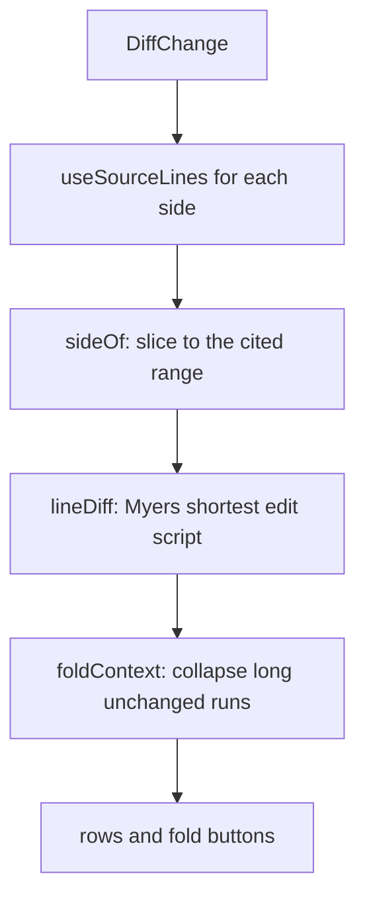

# Blocks: rendering the Page AST

The CLI parses each page into a `Page` whose body is a tree of `Block` and `Inline` nodes (see [the page model](./page-model.md)). The viewer turns that tree into DOM in `packages/viewer/src/blocks/`: one switch dispatches each node type to a React component, and every component that points at code marks its element with `data-ref` so the [source pane](./source-pane.md) can find it without the blocks knowing the pane exists.

## One switch per node type

[`BlockView`](explain:packages/viewer/src/blocks/blocks.tsx:30-160) is a single `switch` over `block.type`; its `default` branch is [`block satisfies never`](explain:packages/viewer/src/blocks/blocks.tsx:157-158), so adding a member to the [`Block` union](explain:packages/contract/src/page.ts:60-107) without a renderer fails to type-check. [`Inlines`](explain:packages/viewer/src/blocks/inlines.tsx:11-64) does the same over the [`Inline` union](explain:packages/contract/src/page.ts:12-26). [`Blocks`](explain:packages/viewer/src/blocks/blocks.tsx:17-28) maps a list of blocks and, when `lede` is set, gives the first paragraph the `lede` class; the page route sets it only for the page body ([page-route.tsx](explain:packages/viewer/src/routes/page-route.tsx:135)).

Components that need one variant take it as [`BlockOf<"tree">`](explain:packages/viewer/src/blocks/blocks.tsx:15) and so on, which keeps the narrowed type without redeclaring it.

| `Block` type | Renderer | What it draws |
|---|---|---|
| `heading` | [inline in `BlockView`](explain:packages/viewer/src/blocks/blocks.tsx:39-49) | `h2`–`h4` with the parsed `id` and a `#` anchor |
| `paragraph` | [inline](explain:packages/viewer/src/blocks/blocks.tsx:50-55) | `p`, `lede` class on the page's first paragraph |
| `list` | [inline](explain:packages/viewer/src/blocks/blocks.tsx:56-84) | `ol`/`ul`; if any item has `checked`, every item becomes a disabled checkbox row |
| `table` | [inline](explain:packages/viewer/src/blocks/blocks.tsx:85-111) | a focusable scroll region around `table`, column alignment from `align` |
| `alert` | [inline](explain:packages/viewer/src/blocks/blocks.tsx:112-121) | `aside.alert-<kind>` with icon and localized label |
| `quote`, `thematicBreak`, `details` | [inline](explain:packages/viewer/src/blocks/blocks.tsx:122-144) | `blockquote`, `hr`, native `details`/`summary` |
| `code` | [`CodeBlock`](explain:packages/viewer/src/blocks/code.tsx:79-99) | highlighted literal code with a copy button |
| `excerpt` | [`Excerpt`](explain:packages/viewer/src/blocks/code.tsx:135-188) | lines read from the repo, numbered, with the cited path as header |
| `mermaid` | [`Mermaid`](explain:packages/viewer/src/blocks/mermaid.tsx:24-69) | SVG from beautiful-mermaid, loaded lazily |
| `tree` | [`TreeView`](explain:packages/viewer/src/blocks/tree.tsx:7-61) | nested `details` with name and description per node |
| `tabs` | [`TabsView`](explain:packages/viewer/src/blocks/tabs.tsx:11-79) | ARIA tablist with keyboard navigation |
| `beforeAfter` | [`BeforeAfterView`](explain:packages/viewer/src/blocks/before-after.tsx:14-93) | two columns; list items missing from the after side are struck through |
| `annotatedSource` | [`AnnotatedSourceView`](explain:packages/viewer/src/blocks/annotated-source.tsx:7-41) | a numbered list of notes; the code itself appears in the source pane |
| `diff` | [`Diff`](explain:packages/viewer/src/blocks/diff.tsx:21-27) | a unified line diff computed in the browser |
| `widget` | [`WidgetFrame`](explain:packages/viewer/src/blocks/widget.tsx:37-131) | a frame that imports and mounts `widgets/<name>.js` |

## Citations are attributes {#citations}

A `citation` inline renders as a plain link ([inlines.tsx](explain:packages/viewer/src/blocks/inlines.tsx:44-54)): `href` points at the file's source route with `#L<first line>` ([`sourceHref`](explain:packages/viewer/src/ref.ts:40-43)), `data-ref` holds the formatted citation, and `data-kind` is `file` when the citation has no ranges, `cite` otherwise. Excerpts, diff gutters, annotation notes, and widget source lists emit the same attributes.

The pane picks these elements up by querying `[data-ref]` under the page and parsing each one back into a `Ref` ([`discoverAnchors`](explain:packages/viewer/src/pane/anchors.ts:11-31)). Hover, focus and click are delegated from the page root; a plain left click calls `preventDefault` and toggles or pins the anchor in the pane instead of following the link ([`onClick`](explain:packages/viewer/src/pane/input.ts:56-67)). A click with ⌘, Ctrl or Shift held, or with a button other than the primary one, returns early, so the `href` still opens the file's source page, for example in a new tab. Alt is not checked: an Alt-click is handled like a plain click.

| Attribute | Values | Effect in the pane |
|---|---|---|
| `data-ref` | `repo:path[:ranges]` | which lines to show |
| `data-kind` | `cite`, `file`, `excerpt`, `note` | how the anchor is drawn and grouped |
| `data-follow` | `"0"` or absent | `"0"` keeps the anchor out of the reading-line follow ([anchors.ts](explain:packages/viewer/src/pane/anchors.ts:27), [controller.ts](explain:packages/viewer/src/pane/controller.ts:187-189)) |

`data-follow="0"` appears on secondary links: the header of an excerpt, each diff line number, and widget citations. The excerpt `figure` itself carries `data-kind="excerpt"` without it ([code.tsx](explain:packages/viewer/src/blocks/code.tsx:148)), so while scrolling the pane follows the excerpt as one unit rather than its header link.

> [!IMPORTANT]
> Nothing in `blocks/` imports from `pane/`. The contract between them is DOM only: the `data-ref`, `data-kind`, and `data-follow` attributes, the `data-index` number on annotation notes, and the `note` and `annotated` class names the pane queries to collect a group's notes ([anchors.ts](explain:packages/viewer/src/pane/anchors.ts:33-39), [controller.ts](explain:packages/viewer/src/pane/controller.ts:229)). The `cite` class on links is used only by CSS. A new block that points at code must emit those attributes to take part in the pane.

## Literal code and excerpts

Both render as a `figure` with a header and a copy button, but they get their text from different places.

<Tabs>
<Tab label="Literal code">

The fence body is in the AST, so `CodeBlock` highlights it synchronously with the fence language and copies `value` as is.

```tsx file=explain:packages/viewer/src/blocks/code.tsx:79-99
```

</Tab>
<Tab label="Excerpt">

The AST holds only a `Ref`. [`useSourceLines`](explain:packages/viewer/src/blocks/code.tsx:14-32) loads the file through [`loadSourceLines`](explain:packages/viewer/src/data.ts:49-60), which fetches the source API once per `repo:path`, drops a trailing newline, splits into lines, and highlights them by file extension. Every excerpt, diff, and widget on the page that cites the same file shares that one promise.

```tsx file=explain:packages/viewer/src/blocks/code.tsx:138-146
```

No ranges means the whole file. Ranges starting past the end of the file are dropped and the rest are clamped, so an excerpt of a shrunk file degrades instead of throwing. Between two ranges the renderer inserts a `⋮` gap row ([code.tsx](explain:packages/viewer/src/blocks/code.tsx:173-183)). While loading it shows a skeleton; a missing file renders [`MissingFile`](explain:packages/viewer/src/blocks/code.tsx:122-133); the copy button copies only the cited lines ([`citedLines`](explain:packages/viewer/src/ref.ts:45-48)).

</Tab>
</Tabs>

## Diff

`<Diff before=… after=… />` parses to a `diff` block whose `change` is `modified`, `added`, or `deleted` ([`DiffChange`](explain:packages/contract/src/page.ts:55-58)). The parser stores citations only; the diff is computed in the browser on every render from the files as they are now.



[`Diff`](explain:packages/viewer/src/blocks/diff.tsx:21-43) loads both sides, standing in an empty file for the missing side of an added or deleted file. [`sideOf`](explain:packages/viewer/src/blocks/diff.tsx:45-55) slices each side to its first range and remembers `from`, so the 0-based indices that `lineDiff` returns map back to file line numbers as `from + index`. Each gutter number is itself a single-line citation ([`gutter`](explain:packages/viewer/src/blocks/diff.tsx:84-99)), which makes every line in the diff open in the source pane. The header counts removed and added rows ([diff.tsx](explain:packages/viewer/src/blocks/diff.tsx:144-145)).

### How `lineDiff` works

[`lineDiff`](explain:packages/viewer/src/blocks/line-diff.ts:10-60) is Myers' greedy shortest-edit-script algorithm. Picture a grid with `before` along x and `after` along y. Moving right removes `before[x]`, moving down adds `after[y]`, and moving diagonally is free when the two lines are equal. The algorithm finds a path from `(0, 0)` to `(n, m)` with the fewest non-diagonal steps, then reads the path back as rows.

<AnnotatedSource file="explain:packages/viewer/src/blocks/line-diff.ts:10-60">
<Note lines="14-19">`k = x - y` names a diagonal. `reach[offset + k]` stores the furthest `x` reached on diagonal `k`; `offset = n + m + 1` keeps `k ± 1` inside the `Int32Array`. `stepsDown` decides whether diagonal `k` is entered from `k + 1` by a down step (an addition) or from `k - 1` by a right step (a removal): forced at the edges `k = -d` and `k = d`, otherwise whichever neighbor got further. On a tie it steps right, so removals come first.</Note>
<Note lines="21-22">Round `d` explores every path with exactly `d` edits. Before each round the whole `reach` array is copied into `trace`; the backtrack needs those snapshots.</Note>
<Note lines="23-27">For each diagonal reachable in `d` edits (every other one from `-d` to `d`), take the one edit step from the better neighbor.</Note>
<Note lines="28-31">The snake: slide down the diagonal while the lines are equal. Comparison is plain `===` on raw lines, with no whitespace normalization.</Note>
<Note lines="32-33">Record the new furthest `x`. The first round to reach `(n, m)` stops the search, so `d` is the minimal number of edits.</Note>
<Note lines="36-49">Walk back from `(n, m)` through the snapshots, last round first. For round `d`, recompute with `stepsDown` which neighbor diagonal the path came from and where that neighbor's furthest point was; everything diagonal between there and the current point is unchanged context.</Note>
<Note lines="50-58">Round 0 has no edit step. For the others, if `x` did not move the step was vertical, so `after[previousY]` was added; otherwise `before[previousX]` was removed.</Note>
<Note lines="59">Rows were collected end to start; reverse them.</Note>
</AnnotatedSource>

Cost follows from the loops: rounds stop at the edit distance `D`, each round touches at most `2D + 1` diagonals, and `trace` holds `D + 1` copies of a `2(n + m + 1) + 1` element array. Since a `<Diff>` normally cites a few dozen lines, that is small. Why the viewer carries its own 60-line diff rather than a dependency is not stated in the code; a small minimal-diff routine that returns exactly the row shape `diff.tsx` needs is the likely reason (inference).

### Folding unchanged runs

[`foldContext`](explain:packages/viewer/src/blocks/line-diff.ts:62-92) groups rows into `shown` and `folded` pieces. A run of context rows longer than `foldOver = 6` keeps `keep = 3` rows on each side and folds the middle; a run of six or fewer stays whole. This applies to the leading and trailing runs too, so a diff whose change sits deep in the range still opens on its first three lines.

```ts file=explain:packages/viewer/src/blocks/line-diff.ts:62-80
```

`DiffFigure` draws a folded piece as a button labeled with its row count; clicking it adds the piece index to the `opened` set and the rows render in place ([diff.tsx](explain:packages/viewer/src/blocks/diff.tsx:177-193)).

<Widget name="blocks-line-diff" title="lineDiff and foldContext on their test cases" source="explain:packages/viewer/src/blocks/line-diff.ts explain:packages/viewer/src/blocks/line-diff.test.ts">

Pick a case from `line-diff.test.ts`. The widget runs a JavaScript port of `lineDiff` or `foldContext` on the test's input, draws the rows in the diff block's column layout (before number, after number, sign, text), and checks the result against the test's expectation. The numbers are `lineDiff`'s raw 0-based indices, as in the test, not the file line numbers the diff block shows.

</Widget>

## The other components

### Tree

[`TreeNode`](explain:packages/viewer/src/blocks/tree.tsx:19-61) splits each item label: if the first inline is not plain text (a code span or a citation), it becomes the node name and the rest the description, with a leading space or `·` trimmed by [`trimStart`](explain:packages/viewer/src/blocks/blocks.tsx:175-180). Branches are native `details` elements, open while `depth < open`, and `open` defaults to 1 ([tree.tsx](explain:packages/viewer/src/blocks/tree.tsx:12)). A citation in a tree item is an ordinary citation inline, so it reaches the pane like any other.

### Tabs

[`TabsView`](explain:packages/viewer/src/blocks/tabs.tsx:11-79) follows the ARIA tabs pattern: a roving `tabIndex`, Left/Right wrapping around, Home/End. All panels stay in the DOM and inactive ones get `hidden` ([tabs.tsx](explain:packages/viewer/src/blocks/tabs.tsx:64-76)). The pane relies on that: an anchor inside a `[hidden]` ancestor is not visible to it ([geometry.ts](explain:packages/viewer/src/pane/geometry.ts:12-14)), so citations in a closed tab are skipped by the reading-line follow.

### BeforeAfter

[`BeforeAfterView`](explain:packages/viewer/src/blocks/before-after.tsx:14-93) is built for lists. It counts the normalized text of every list item on the after side, then walks the before side and strikes any item whose count is exhausted, a multiset difference ([before-after.tsx](explain:packages/viewer/src/blocks/before-after.tsx:31-43)). An item that opens with a code span gets that span as a role chip. The strike-through animates, staggered by the `--i` custom property, once an `IntersectionObserver` sees the block on screen ([before-after.tsx](explain:packages/viewer/src/blocks/before-after.tsx:18-30)). Non-list children render through the normal `BlockView`.

### AnnotatedSource

The block itself draws no code. [`AnnotatedSourceView`](explain:packages/viewer/src/blocks/annotated-source.tsx:7-41) renders a header and one button per note, each with `data-kind="note"` and a `data-ref` narrowed to that note's lines. When a note is shown, the pane collects every `.note` in the same `.annotated` group and draws the cited range with all their markers ([controller.ts](explain:packages/viewer/src/pane/controller.ts:228-229), [`noteMarkers`](explain:packages/viewer/src/pane/anchors.ts:33-39)).

### Mermaid

[`Mermaid`](explain:packages/viewer/src/blocks/mermaid.tsx:24-47) imports `beautiful-mermaid` on first use and renders with a [theme](explain:packages/viewer/src/blocks/mermaid.tsx:9-22) whose colors are the viewer's CSS variables, so diagrams take the page's colors instead of fixed ones. It strips `@import url(…)` rules from the SVG and widens the font stack with CJK fonts. A diagram that fails to render shows the error and its source in a `details` ([mermaid.tsx](explain:packages/viewer/src/blocks/mermaid.tsx:58-66)).

### Widget

[`WidgetFrame`](explain:packages/viewer/src/blocks/widget.tsx:37-131) draws the title, description, and source citations, then imports `/@explain/widgets/<name>.js` together with the shared widget stylesheet and calls the module's `mount` with a context whose `cite` builds the same `a.cite` elements as above. A name not listed in the site's widgets, or a module without `mount`, shows an error in the frame. The module contract and how the CLI serves widgets are on the [widgets](./widgets.md) page.
