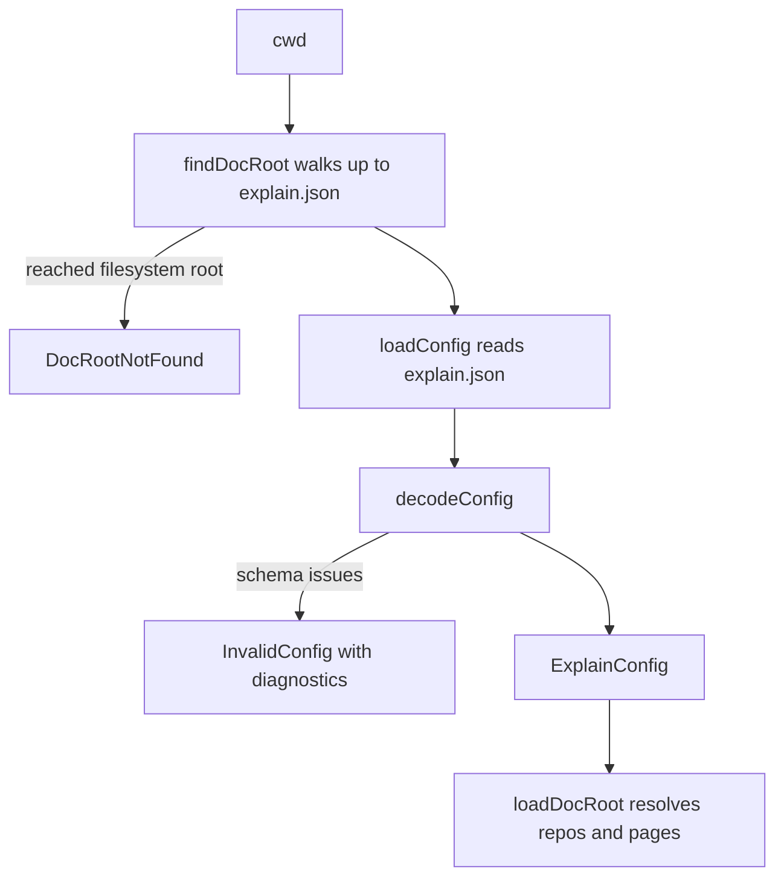

# explain.json and how the CLI finds it

A doc root is any directory with an `explain.json`. That one file names the site, its locales, the
repos that citations may point into, and the nav. Its schema lives in the contract package as an
Effect `Schema` ([config.ts](explain:packages/contract/src/config.ts)); the CLI finds the file,
decodes it with that schema, and turns any failure into `file:line:column message` diagnostics
([doc-root/config.ts](explain:packages/cli/src/doc-root/config.ts)).

## The fields

```ts file=explain:packages/contract/src/config.ts:49-59
```

| Field | Required | Rule |
|---|---|---|
| `title` | no | one string for every locale; when it is absent the CLI sends `Document` in the site response, and the viewer shows that ([api-bodies.ts](explain:packages/cli/src/site/api-bodies.ts:47)) |
| `locales` | yes | non-empty, unique, each a BCP 47-like tag such as `en` or `zh-CN` ([config.ts](explain:packages/contract/src/config.ts:9-13,42-47)) |
| `defaultLocale` | no | defaults to the first locale; must be one of `locales` |
| `repos` | yes | key → absolute path; keys follow the citation repo-key rule ([config.ts](explain:packages/contract/src/config.ts:22-35)) |
| `nav` | yes | groups of `{ title, pages }`; `title` is a single string; each page id matches `^[a-z0-9][a-z0-9-]*$`, is not `source`, and appears only once ([config.ts](explain:packages/contract/src/config.ts:5-7,15-20,37-40)) |

Two of these rules exist to keep other formats unambiguous:

- Repo keys are checked with the same `repoKeyProblem` that parses citations, so a key like `http`
  that a page could never cite is rejected here too. See [citation](./citation.md).
- The page id `source` is reserved because the viewer's router claims `/<locale>/source?…` for its
  source view ([router.ts](explain:packages/viewer/src/router.ts:23-28)).

## `nav` is the page list

There is no separate list of pages. `navPageIds` flattens the nav groups in order:

```ts file=explain:packages/contract/src/config.ts:99-100
```

The loader reads exactly those ids, in every locale
([load.ts](explain:packages/cli/src/doc-root/load.ts:24-30)). A Markdown file that is not in nav is
never parsed, and a nav id without a file becomes a "missing" page with a diagnostic
([check-page.ts](explain:packages/cli/src/doc-root/check-page.ts:42-49)). Page links are checked
against the same set ([check-page.ts](explain:packages/cli/src/doc-root/check-page.ts:71-79)). A page
listed twice would have two places in the reading order, which is probably why the schema forbids it
(inference).

## `defaultLocale`: optional in the file, always present in memory

The schema has two shapes. The file shape has an optional `defaultLocale`; the decoded type always
has one:

<AnnotatedSource file="explain:packages/contract/src/config.ts:61-95">
<Note lines="62-63">`decodeTo` targets a struct where `defaultLocale` is a required `Locale`, so `ExplainConfig.Type` never has it undefined.</Note>
<Note lines="65-68">Decoding fills a missing `defaultLocale` with `locales[0]`. `Locales` is refined to a non-empty tuple, so this index is always defined.</Note>
<Note lines="69">Encoding passes the value through, so a re-encoded config keeps the filled-in default.</Note>
<Note lines="75-80">Rules that span fields run on the decoded value: the default must be one of the locales.</Note>
<Note lines="81-92">Every repeated page id gets its own issue, with a path like `nav.1.pages.0` pointing at the repeat.</Note>
</AnnotatedSource>

Consumers can therefore read `config.defaultLocale` without a fallback. The site response passes it
straight to the viewer ([api-bodies.ts](explain:packages/cli/src/site/api-bodies.ts:45-52)), which
uses it for the home redirect and for unknown locales
([app.tsx](explain:packages/viewer/src/app.tsx:35-55)).

The tests pin both behaviors, plus one rejection per rule:

```ts file=explain:packages/contract/src/config.test.ts:22-55
```

## Finding and loading the file



`findDocRoot` starts at the working directory and checks each parent for `explain.json`, so every
command works from any subdirectory of a doc root:

```ts file=explain:packages/cli/src/doc-root/config.ts:25-35
```

`decodeConfig` parses the JSON text and decodes it in one step:

<AnnotatedSource file="explain:packages/cli/src/doc-root/config.ts:37-58">
<Note lines="39">`errors: "all"` collects every issue the schema finds instead of stopping at the first.</Note>
<Note lines="40">`onExcessProperty: "error"` turns an unknown key, such as a misspelled field, into an error rather than silently ignoring it.</Note>
<Note lines="45">Effect's Standard Schema formatter flattens the issue tree into a list of `{ path, message }`.</Note>
<Note lines="47-49">JSON has no positions here, so every diagnostic points at line 1, column 1 of `explain.json`, named relative to the doc root.</Note>
<Note lines="50-53">The issue path is joined with dots and prefixed to the message, giving `repos.http: …` or `nav.1.pages.0: …`.</Note>
</AnnotatedSource>

Both errors are `Schema.TaggedError`s, so callers pick how to react by tag:

| Caller | `DocRootNotFound` | `InvalidConfig` |
|---|---|---|
| Every command that opens a doc root ([open-doc-root.ts](explain:packages/cli/src/commands/open-doc-root.ts:34-40)) | prints `no explain.json in … or any parent directory`, exit 2 | prints each diagnostic with the file path made relative to the working directory, exit 2 ([open-doc-root.ts](explain:packages/cli/src/commands/open-doc-root.ts:9-23,29-31)) |
| `explain init` ([init.ts](explain:packages/cli/src/commands/init.ts:22-28)) | n/a | validates the config it is about to write, and writes nothing on failure |
| `explain dev` reload ([dev.ts](explain:packages/cli/src/site/dev.ts:34-47)) | n/a | keeps serving, in an `invalid` state that lists the diagnostics |

### Issues arrive in layers

Running `explain validate` from the doc root against broken configs shows that the schema reports problems in stages,
not all at once. With a duplicated locale, a relative repo path, a reserved page id, and an unknown
key `titel`, only field-level issues appear:

```text
explain.json:1:1 titel: Expected no excess property
explain.json:1:1 locales: locales must be unique
explain.json:1:1 repos.http: repo path "rel" must be absolute
explain.json:1:1 nav.0.pages.0: page id "source" is reserved
```

The reserved repo key `http`, the `defaultLocale` that is not in `locales`, and the page listed twice
in the same file were not reported. Once those field issues are fixed, the `repos` key check reports
`repos.http: repo key "http" is reserved`. After that, the whole-config check reports both
`defaultLocale "en" is not listed in locales` and `nav.1.pages.0: page "x" appears more than once in
nav`. A filter attached with `.check` to a record or struct runs only after its members decode
(inference from these runs and from where the checks are attached in
[config.ts](explain:packages/contract/src/config.ts:28-35,72-95)).

> [!NOTE]
> Fixing `explain.json` can surface new errors on the next run. This comes from how the schema is
> layered; it is not a sign that the earlier fix was wrong.

## What the schema does not check

The schema only checks that a repo path is absolute. Whether it is a directory is checked later by
`resolveRepos`, which reports `repos.<key>: … is not a directory` as a doc-root error instead of
failing the config ([resolve-source.ts](explain:packages/cli/src/doc-root/resolve-source.ts:18-37)).
Pages are then loaded as described in [load-doc-root](./load-doc-root.md).
