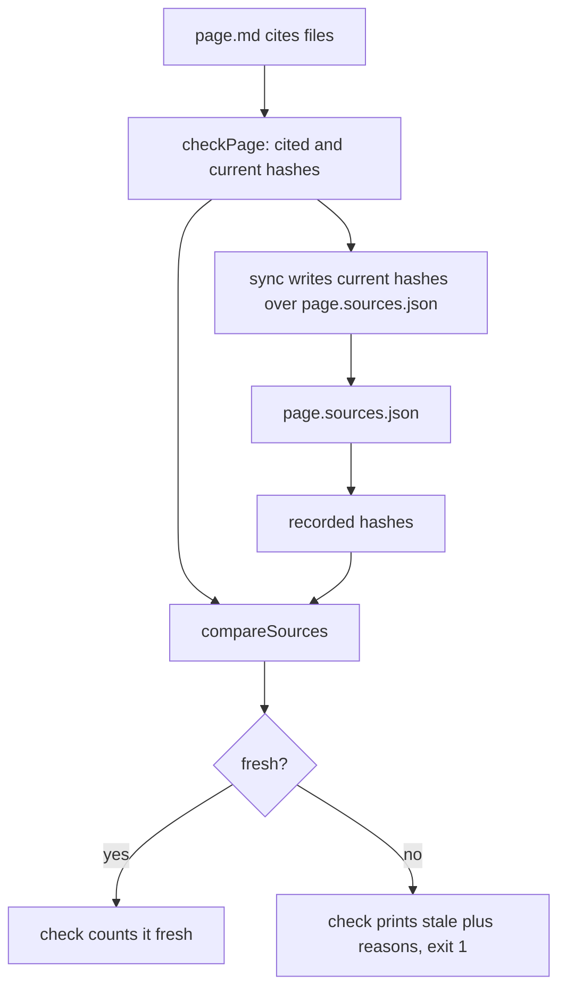

# Freshness

A page is a set of claims about code that keeps changing. Freshness is how `explain` notices: when a page is synced it records a hash of every file the page cites, and from then on any difference between what the page cites, what was recorded, and what is on disk marks the page **stale**. Freshness never looks at the page's prose; it only says which pages need a human (or an agent) to reread the code.

## The data

`explain freshness sync` writes one `<locale>/<id>.sources.json` next to each page. After syncing a page that cites one file, it looks like this (an illustrative example; the hash stands for whatever blob id `f.ts` has):

```json
{
  "files": [
    {
      "repo": "src",
      "path": "f.ts",
      "hash": "422c2b7ab3b3c668038da977e4e93a5fc623169c"
    }
  ]
}
```

The types and the serializer are shared with the viewer and live in the contract package ([sources](./sources.md)). The serializer sorts by repo then path and ends with a newline, so syncing an unchanged page twice writes byte-identical files ([explain.test.ts](explain:packages/cli/test/explain.test.ts:80-87)) and a `git diff` of a sources file shows only real changes.

Each loaded page carries three views of its sources, all built in `checkPage` ([Loading a doc root](./load-doc-root.md)):

| Name | What it is |
|---|---|
| `cited` | every distinct repo and path the page cites now, from links, excerpts, `AnnotatedSource` and `Diff` |
| `sources` | the cited files that resolve to a file, each with its current hash |
| `recorded` | the files in the sources file, or `undefined` when there is none |

## Hashing: git blob ids

<AnnotatedSource file="explain:packages/cli/src/doc-root/freshness.ts:17-32">
<Note lines="19">One cache per loaded doc root, keyed like the resolver's cache, so a file cited by many pages is hashed once.</Note>
<Note lines="23-26">The bytes are prefixed with `blob <length>` and a NUL, which is how git frames an object before hashing it.</Note>
<Note lines="27-28">SHA-1 through the Effect `Crypto` service, printed as 40 lowercase hex digits.</Note>
</AnnotatedSource>

The result is the same id `git hash-object --no-filters` prints for the file, and the CLI test asserts exactly that ([explain.test.ts](explain:packages/cli/test/explain.test.ts:27-28,71-78)). The file does not have to be committed, or even tracked: the bytes come from disk through [resolveSource](./resolve-source.md). Using git's framing rather than a bare SHA-1 makes a recorded hash comparable with the object ids git already shows for the same content (inference: the code does not say why it chose this format).

> [!IMPORTANT]
> The hash covers the whole file, not the cited lines. Any edit to a cited file, even far from the cited ranges, makes every page that cites it stale. A cited range cannot be tracked by itself anyway: inserting a line above it shifts it, so only rereading the page can tell whether its claims still hold (inference: the code records no rationale).

## What makes a page stale

`compareSources` compares the three views and returns `fresh` or `stale` with a list of reasons:

```ts file=explain:packages/cli/src/doc-root/freshness.ts:34-70
```

| Reason | Condition | `freshness check` prints |
|---|---|---|
| `sources-missing` | no sources file at all; no other reason is computed | no sources file; run explain freshness sync … |
| `sources-malformed` | the sources file does not decode; set by `checkPage`, not `compareSources` | … is malformed; run explain freshness sync … |
| `not-recorded` | cited now, absent from the sources file | … is cited but not hashed |
| `not-cited` | in the sources file, no longer cited | … is hashed but no longer cited |
| `missing` | recorded and cited, but no longer resolves to a file | … no longer exists |
| `changed` | recorded and cited, and the current hash differs | … changed |

The messages come from `describeReason` ([check.ts](explain:packages/cli/src/commands/freshness/check.ts:10-26)). Reasons are sorted by repo and path, so the output is stable.

Two consequences are easy to miss:

- Changing *which* files a page cites makes it stale even if no code changed. Adding a citation without syncing gives `not-recorded`; removing the last citation of a file gives `not-cited`. Changing only the line ranges within an already-cited file changes nothing, because the set of files and their bytes are the same.
- A deleted cited file is a freshness event, not a hard error. `checkPage` records "does not exist" as a `CitationFile` diagnostic, which does not make `freshness check` skip the page, so the page is reported as `missing` stale ([explain.test.ts](explain:packages/cli/test/explain.test.ts:108-115)). A file that shrank below a cited range is reported `changed`, and `sync` refuses it until the page is fixed ([explain.test.ts](explain:packages/cli/test/explain.test.ts:117-125)).

## The two commands



`explain freshness check` takes no arguments and walks every page. A page that is missing, did not parse, or has a diagnostic whose kind skips the check (a parse error or a `CitationRepo`) cannot be compared and is listed as `not checked`. The command exits 1 if anything is stale or not checked, 0 otherwise ([check.ts](explain:packages/cli/src/commands/freshness/check.ts:36-57)).

`explain freshness sync page.md...` writes `page.sources` for each named page, but only when the page parsed and has no diagnostic whose kind refuses sync ([sync.ts](explain:packages/cli/src/commands/freshness/sync.ts:17-27)). Those kinds are parse errors and every citation problem, `CitationFile` included. Syncing a page that still cites a deleted file would silently bless a broken citation; refusing forces the page to be fixed first. A bad page link does not refuse sync. `writeSources` itself is a single write of the formatted file:

```ts file=explain:packages/cli/src/doc-root/freshness.ts:72-76
```

> [!NOTE]
> A sources file that fails to decode adds a `SourcesRecord` diagnostic to the page, and its freshness becomes stale with the single reason `sources-malformed` ([check-page.ts](explain:packages/cli/src/doc-root/check-page.ts:89-112)). `check` prints `<sources file> is malformed; run explain freshness sync <page>`. `SourcesRecord` does not refuse sync, since sync overwrites the file, so running the suggested command repairs it ([explain.test.ts](explain:packages/cli/test/explain.test.ts:191-215)).

## Where freshness shows up

Besides `freshness check`, the dev server and the static build report each page's freshness to the viewer: a nav entry is `missing`, `invalid` (did not parse or has a diagnostic that skips the check), or the page's `fresh`/`stale` status ([api-bodies.ts](explain:packages/cli/src/site/api-bodies.ts:18-27)). The viewer marks stale entries in the nav rail ([rail.tsx](explain:packages/viewer/src/shell/rail.tsx:72-73)) and shows a fresh or stale badge on the page itself ([freshness.tsx](explain:packages/viewer/src/routes/freshness.tsx:10-20)); see [the viewer shell](./viewer-shell.md) and [the source pane](./source-pane.md).
