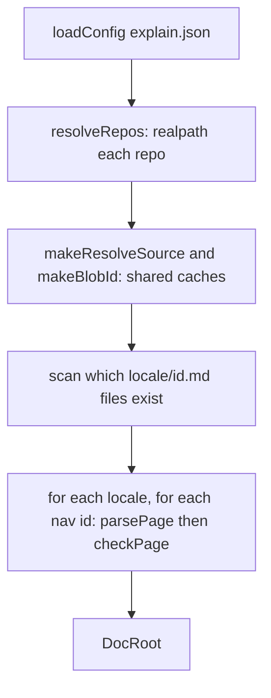

# Loading a doc root

Every command that works on an existing doc root calls `loadDocRoot` once and then only reads the value it returns. Loading never stops at the first broken page: it reads `explain.json`, resolves the repos, checks every page in every locale, and hands back one `DocRoot` in which each page records what is wrong with it. That is why `validate` can list all problems at once and `dev` can serve a half-written doc root.

## The DocRoot value

```ts file=explain:packages/cli/src/doc-root/types.ts:46-55
```

`errors` holds problems that belong to the doc root rather than to one page: a repo path that is not a directory. `resolveSource` is the function every later step uses to read a cited file; it is described in [Resolving a source](./resolve-source.md).

Each entry of `pages` is a `DocPage`, a union on `status`:

```ts file=explain:packages/cli/src/doc-root/types.ts:17-37
```

| `status` | When | What it carries |
|---|---|---|
| `missing` | `nav` lists the id, but `<locale>/<id>.md` does not exist | one error saying so |
| `invalid` | the Markdown failed to parse into a `Page` | the parse errors |
| `parsed` | the page parsed | the `Page`, its `errors` and `refProblems`, the current `sources`, the `recorded` sources, and its `freshness` |

Every variant has the same address: `locale`, `id`, `file` (`<locale>/<id>.md`) and `sourcesFile` (`<locale>/<id>.sources.json`). Commands match command-line arguments against `file`.

## Loading step by step

<AnnotatedSource file="explain:packages/cli/src/doc-root/load.ts:13-51">
<Note lines="18">Loading aborts only on doc-root-level failures: an `explain.json` that fails to decode surfaces as `InvalidConfig`, and file-system failures (reading the config or pages) surface as `PlatformError`. Page-level problems never abort.</Note>
<Note lines="20-22">Built once per load and shared by every page, so a file cited by ten pages is read and hashed once.</Note>
<Note lines="24-30">The page set is `nav`, not the directory listing. A Markdown file that is not in `nav` is never read.</Note>
<Note lines="32-35">A page that does not exist parses to `undefined`, which `checkPage` turns into a `missing` page.</Note>
<Note lines="39-43">Pages are produced locale by locale in `nav` order.</Note>
<Note lines="48">Repo errors become the doc-root `errors`.</Note>
</AnnotatedSource>



Parsing itself is pure and lives in the contract package ([parsing a page](./parse-page.md)); `loadDocRoot` only reads the file and passes the text and id to `parsePage`.

## What checkPage checks

`checkPage` turns one parse result into a `DocPage`. It never fails on a bad page; it records diagnostics, each with a file, a 1-based line and column, and a message ([Diagnostic](explain:packages/cli/src/doc-root/types.ts:10-15)).

### Citations

```ts file=explain:packages/cli/src/doc-root/check-page.ts:44-53
```

Every citation the parser found, in links, excerpts, `AnnotatedSource` and `Diff`, is in `page.refs`. Each one is resolved, and the result picks one of two lists:

| Resolved status | Message | List |
|---|---|---|
| `unknown-repo` | unknown repo "x"; explain.json repos has no such key | `errors` |
| `escapes` | x:path resolves outside the repo | `errors` |
| `missing` | x:path does not exist | `refProblems` |
| `not-a-file` | x:path is not a file | `refProblems` |
| `file`, but a range ends past the last line | x:path:N-M is beyond the file's K lines | `refProblems` |

> [!IMPORTANT]
> `errors` are mistakes in the page itself: no edit to the cited repo can fix them. `refProblems` are citations the code has moved out from under: the file was deleted, or shrank. `validate`, `sync` and `build` refuse on both lists, but `freshness check` skips only pages with `errors`, so a page whose cited file disappeared is reported as **stale** instead of unchecked. See [commands](./commands.md) for where each list is read.

The same loop fills `cited`, a map keyed by repo and path, so a file cited at five ranges counts once.

### Page links

```ts file=explain:packages/cli/src/doc-root/check-page.ts:54-58
```

A link `./<id>.md` must name a page that is in `nav` *and* exists in this page's locale; a link from `en/` is not satisfied by `zh/<id>.md`. The anchor part of a link is not checked here.

### Sources and freshness

```ts file=explain:packages/cli/src/doc-root/check-page.ts:60-85
```

After the checks, `checkPage` computes three things the freshness code needs:

- `sources`: each cited file that resolved to a file, sorted, with its blob id. This is exactly what `explain freshness sync` writes.
- `recorded`: the files from `<locale>/<id>.sources.json`, or `undefined` when there is no such file. A sources file that does not decode adds an error to the page.
- `freshness`: the comparison of the two, from `compareSources`.

How the comparison works is in [Freshness](./freshness.md); the file format is in [sources](./sources.md).

Finally the `errors` are sorted by file, line and column ([check-page.ts](explain:packages/cli/src/doc-root/check-page.ts:86-89)), so output order follows the page, not the order of the checks.
