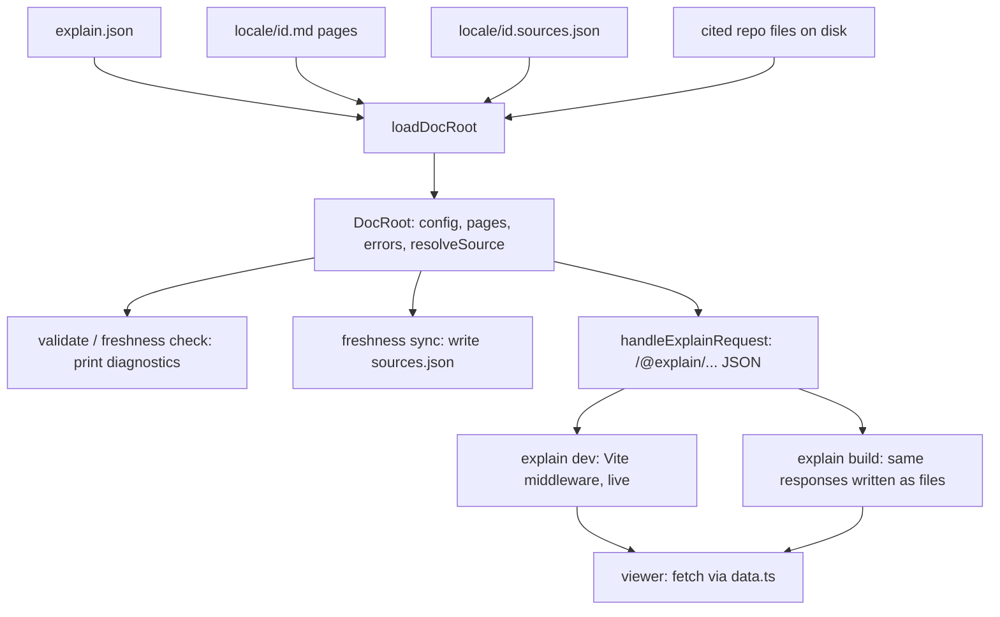

# Overview

explain-this turns a directory of Markdown pages into a documentation site whose every claim can point at real lines of code. An author (usually a coding agent driven by the [`explain-this` skill](explain:skills/explain-this/SKILL.md)) writes pages that cite code as `repo:path:ranges`; the `explain` CLI checks those citations against the files on disk, remembers what each cited file looked like, and serves or builds a site; the viewer renders the pages in the browser and opens the cited code beside the prose.

That directory is called the **doc root**. It holds an `explain.json`, one folder per locale with `<id>.md` pages and the `<id>.sources.json` files written by `explain freshness sync` ([format.md](explain:skills/explain-this/format.md:3-9)).

## Three packages

The repo is a Bun workspace: every folder under `packages/` is a package ([package.json](explain:package.json:6-9)). Each one has a single job.

<Tree open="2">

- `explain-this/`
  - `packages/`
    - `contract/` — the shared format, no I/O ([package.json](explain:packages/contract/package.json:6-12))
      - [`citation.ts`](explain:packages/contract/src/citation.ts) — `repo:path:ranges` parsing and formatting
      - [`config.ts`](explain:packages/contract/src/config.ts) — the `explain.json` schema
      - [`page.ts`](explain:packages/contract/src/page.ts) — the page AST (`Block`, `Inline`, `Page`)
      - `parse-page/` — Markdown + components → `Page` ([`parse-page.ts`](explain:packages/contract/src/parse-page/parse-page.ts))
      - [`sources.ts`](explain:packages/contract/src/sources.ts) — the `.sources.json` schema and `Freshness`
    - `cli/` — the `explain` binary ([package.json](explain:packages/cli/package.json:6-15))
      - [`main.ts`](explain:packages/cli/src/main.ts) — wires the five subcommands
      - `commands/` — one module per subcommand
      - `doc-root/` — load a doc root into a `DocRoot` ([`load.ts`](explain:packages/cli/src/doc-root/load.ts), [`types.ts`](explain:packages/cli/src/doc-root/types.ts))
      - `site/` — the JSON API, dev server and static build ([`api.ts`](explain:packages/cli/src/site/api.ts))
    - `viewer/` — the React app in the browser ([package.json](explain:packages/viewer/package.json:6-20))
      - [`api.ts`](explain:packages/viewer/src/api.ts) — URL shapes and response types the CLI must serve
      - [`data.ts`](explain:packages/viewer/src/data.ts) — `fetch` + cache for those URLs
      - `blocks/`, `pane/`, `routes/`, `shell/` — rendering, source pane, routes, chrome
  - `skills/explain-this/` — the agent skill and the format spec ([`SKILL.md`](explain:skills/explain-this/SKILL.md), [`format.md`](explain:skills/explain-this/format.md))

</Tree>

- **contract** defines the vocabulary every other part agrees on: what a citation is ([`parseRef`](explain:packages/contract/src/citation.ts:62-72)), what `explain.json` may contain, what a parsed page looks like ([`Page`](explain:packages/contract/src/page.ts:107-117)), and what a recorded source file looks like ([`SourceFile`](explain:packages/contract/src/sources.ts:7-11)). [`parsePage`](explain:packages/contract/src/parse-page/parse-page.ts:13-60) is a pure function from Markdown text to a `Page` plus diagnostics; it never touches the file system.
- **cli** is the only package that reads disk. It depends on both other packages ([package.json](explain:packages/cli/package.json:9-15)): on contract for parsing and schemas, on viewer for its API types and its source tree, which Vite serves or bundles.
- **viewer** is a React app with only browser dependencies ([package.json](explain:packages/viewer/package.json:10-20)). It lists contract as a dev dependency because it shares contract's *types* (the `Page` AST, `Freshness`) and nothing else.

> [!IMPORTANT]
> The viewer may import `effect`, `@effect/*`, `bun:*`, `node:*` or `@explain/contract/*` only with `import type`. The CLI enforces this with a Vite plugin that fails the dev server or build when a viewer module resolves one of those at runtime ([viewer.ts](explain:packages/cli/src/site/viewer.ts:6-7,19-34)). That keeps the browser bundle free of Effect and of the parser: the CLI parses, the viewer only renders the result.

## From files to pixels

Every command starts the same way: find the nearest `explain.json` upward from the current directory and load the whole doc root ([open-doc-root.ts](explain:packages/cli/src/commands/open-doc-root.ts:19-24), [findDocRoot](explain:packages/cli/src/doc-root/config.ts:25-35)). What happens after that depends on the command.



### Loading: one `DocRoot` for every command

[`loadDocRoot`](explain:packages/cli/src/doc-root/load.ts:13-51) decodes `explain.json`, resolves each repo path, then reads every page id listed in `nav` for every locale. Each page goes through [`checkPage`](explain:packages/cli/src/doc-root/check-page.ts:20-103): parse with contract's `parsePage`, resolve each citation against the repo, check page links, hash every cited file, read the recorded `.sources.json`, and compare the two into a `Freshness`. The result is a plain value:

```ts file=explain:packages/cli/src/doc-root/types.ts:24-55
```

A page is `missing`, `invalid` (could not be parsed at all) or `parsed`. A parsed page carries both the hashes of what it cites now (`sources`) and the hashes recorded at the last sync (`recorded`), so freshness is decided at load time rather than in each command. The details live in [load-doc-root](./load-doc-root.md), [resolve-source](./resolve-source.md) and [freshness](./freshness.md).

### Serving: one request handler, two transports

The site is a small read-only JSON API under `/@explain/`. The viewer owns its shape: [`api.ts`](explain:packages/viewer/src/api.ts:4-21) declares the URL patterns and the response types, and the CLI imports those types to build its bodies ([api.ts](explain:packages/cli/src/site/api.ts:1-8)).

| URL | Body | Built from |
|---|---|---|
| `/@explain/api/site.json` | title, locales, nav with each page's status | [`siteResponse`](explain:packages/cli/src/site/api-bodies.ts:28-52) |
| `/@explain/api/page/<locale>/<id>.json` | the parsed `Page`, diagnostics, freshness, per-file source states | [`pageResponse`](explain:packages/cli/src/site/api-bodies.ts:84-102) |
| `/@explain/api/source/<repo>/<path>.json` | file text, line count, and the pages that cite it | [`sourceResponse`](explain:packages/cli/src/site/api.ts:56-93) |
| `/@explain/api/search/<locale>.json` | search entries for a locale | [api.ts](explain:packages/cli/src/site/api.ts:128-138) |

All of it is answered by one function, [`handleExplainRequest`](explain:packages/cli/src/site/api.ts:95-140), which maps a `GET` path and the current `DocRoot` to a status, headers and body. It knows nothing about HTTP servers or files. The two commands that publish a site only differ in how they deliver its answers:

<Tabs>
<Tab label="explain dev">

[`serveDocRoot`](explain:packages/cli/src/site/dev.ts:18-142) starts Vite with the viewer package as its root and installs a middleware that sends every `/@explain/` request to `handleExplainRequest` ([dev.ts](explain:packages/cli/src/site/dev.ts:80-96)). It watches the doc root and every repo in `explain.json`; on a change it reloads the `DocRoot` and tells the browser to reload ([dev.ts](explain:packages/cli/src/site/dev.ts:29-64)). An invalid `explain.json` does not stop the server; it becomes a `DevState` of `invalid` that the viewer can show.

</Tab>
<Tab label="explain build">

[`staticSite`](explain:packages/cli/src/site/build.ts:23-53) lists every URL the viewer could ask for: the site, every page, every search index, and every cited or recorded source file. [`buildSite`](explain:packages/cli/src/site/build.ts:55-121) calls the same `handleExplainRequest` for each one, writes the body to the file at that URL's path, bundles the viewer with Vite, and copies `index.html` to every page route so a static host can serve deep links.

</Tab>
</Tabs>

Because the static files sit at exactly the URLs the dev server answers, the viewer cannot tell the two apart. It just fetches from the path helpers and caches each promise ([data.ts](explain:packages/viewer/src/data.ts:15-37)). See [site](./site.md) for the server and build, and [viewer-shell](./viewer-shell.md) for what the viewer does with the responses.

### Rendering

In the browser the viewer routes `/<locale>/<id>` to a page and `/<locale>/source?<repo>/<path>` to a source file ([router.ts](explain:packages/viewer/src/router.ts:14-29)). A page's `Block` tree is rendered by [blocks](./blocks.md); clicking a citation opens the cited lines in the [source pane](./source-pane.md), which loads the file through the `source` API above.

## Where to go next

- [workflow](./workflow.md): how an author goes from an empty folder to a published, fresh site.
- The format, bottom up: [citation](./citation.md), [config](./config.md), [page-model](./page-model.md), [parse-page](./parse-page.md), [sources](./sources.md).
- The CLI: [commands](./commands.md), [load-doc-root](./load-doc-root.md), [resolve-source](./resolve-source.md), [freshness](./freshness.md), [site](./site.md).
