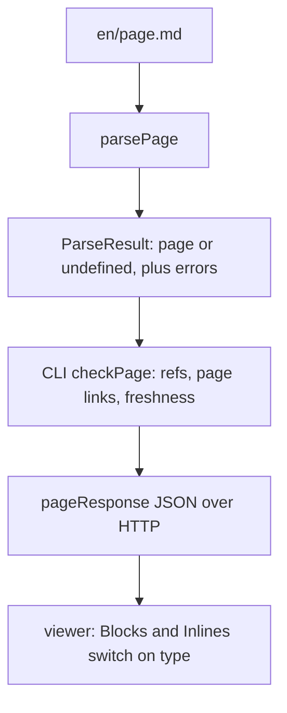

# The page model

`page.ts` in the contract package defines what a parsed page *is*: a tree of `Block`s and `Inline`s
plus a few lists the parser collects on the way. It holds no logic beyond one text helper. It is the
contract between the two halves of the project: [parse-page](./parse-page.md) turns Markdown into a
`Page`, the CLI checks and serves it, and the viewer's [blocks](./blocks.md) render it.



## `Page`

```ts file=explain:packages/contract/src/page.ts:107-117
```

`title` and `blocks` are the content. The other three fields are indexes the parser builds while it
walks the Markdown, so nobody downstream has to walk the tree again:

| Field | Filled by | Read by |
|---|---|---|
| `toc` | each `##`–`####` heading ([heading.ts](explain:packages/contract/src/parse-page/heading.ts:49)) | the viewer's table of contents ([page-route.tsx](explain:packages/viewer/src/routes/page-route.tsx:50)) |
| `refs` | every citation, excerpt, annotated source, and diff side, through one `citation` helper ([context.ts](explain:packages/contract/src/parse-page/context.ts:20-25)) | the CLI, to resolve each file and hash it for freshness ([check-page.ts](explain:packages/cli/src/doc-root/check-page.ts:57-70,81-87)) |
| `pageLinks` | `./<id>.md` and `#anchor` links ([inline.ts](explain:packages/contract/src/parse-page/inline.ts:17-33)) | the CLI, to check that the target page exists ([check-page.ts](explain:packages/cli/src/doc-root/check-page.ts:71-79)) |

`refs` and `pageLinks` carry a `Position` so each problem can be reported at the line and
column of the Markdown that caused it.

`parsePage` returns `{ page, errors }` rather than throwing, and `page` is `undefined` only when the
page has frontmatter or the Markdown parser throws on syntax it cannot recover from
([parse-page.ts](explain:packages/contract/src/parse-page/parse-page.ts:7-21)). HTML comments,
autolinks and `<!…>` or `<?…>` constructs also make the parser throw, but those are reported, blanked out and
parsed again, so they do not lose the page
([markdown.ts](explain:packages/contract/src/parse-page/markdown.ts:88-125)). Any other problem
becomes a `Diagnostic` while the rest of the page is still built
([parse-page.ts](explain:packages/contract/src/parse-page/parse-page.ts:43-44)). The viewer renders
such a page with its citation problems in the sources panel and every other diagnostic listed above
its body ([page-route.tsx](explain:packages/viewer/src/routes/page-route.tsx:124-144)).

## Positions and diagnostics

```ts file=explain:packages/contract/src/page.ts:3-10
```

A contract `Diagnostic` knows only its place in the page source, not which file it came from. The
CLI adds the file name and a `_tag` naming the kind of problem when it collects them
([check-page.ts](explain:packages/cli/src/doc-root/check-page.ts:37-41,51)). The viewer's API types
spell that out: `Diagnostic` is the contract type plus `file`, and `PageDiagnostic` adds one of six
tags ([api.ts](explain:packages/viewer/src/api.ts:23-35)).

## Inlines

```ts file=explain:packages/contract/src/page.ts:12-26
```

The union mirrors the GFM inline nodes the format allows, plus two kinds explain adds. The Markdown
link syntax splits into three kinds by target: `link` for a web URL, `citation` for a
`repo:path:ranges` target, and `pageLink` for `./<id>.md` or `#anchor`
([inline.ts](explain:packages/contract/src/parse-page/inline.ts:17-44)).

A `citation` stores a parsed [`Ref`](explain:packages/contract/src/citation.ts:8-12), not the
original string, so the viewer reads `ref.repo`, `ref.path` and `ref.ranges` directly
([inlines.tsx](explain:packages/viewer/src/blocks/inlines.tsx:44-54)). The grammar itself is on
[citation](./citation.md).

## Blocks

```ts file=explain:packages/contract/src/page.ts:60-98
```

Most blocks are the GFM blocks you would expect. The rest map one-to-one onto the format's own
syntax:

| Written in Markdown | Block |
|---|---|
| `## Heading {#id}` | `heading`, with the resolved `id`; depth is `2 \| 3 \| 4` because `#` is reserved for the title ([page.ts](explain:packages/contract/src/page.ts:30)) |
| `> [!NOTE]` and the other four alert kinds | `alert` with an [`AlertKind`](explain:packages/contract/src/page.ts:28) |
| a fence with `file=<citation>` | `excerpt`: a `Ref`, never the code; the viewer reads the lines from the repo |
| a `mermaid` fence | `mermaid` |
| `<details><summary>` | `details` |
| `<Tree>` | `tree` of [`TreeItem`](explain:packages/contract/src/page.ts:39-42)s |
| `<Tabs>`, `<BeforeAfter>` | `tabs`, `beforeAfter`, both made of [`LabeledBlocks`](explain:packages/contract/src/page.ts:44-47) |
| `<AnnotatedSource>` | `annotatedSource`: one `Ref` and [`SourceNote`](explain:packages/contract/src/page.ts:49-53)s with absolute line numbers |
| `<Diff>` | `diff` holding a `DiffChange` |

> [!IMPORTANT]
> Code that a page shows from a repo is never copied into the `Page`. `excerpt`, `annotatedSource`
> and `diff` carry `Ref`s only. The page stays small, and the viewer always shows the file as it is on
> disk now, which is what freshness compares against.

### `DiffChange`

```ts file=explain:packages/contract/src/page.ts:55-58
```

The format lets a `<Diff>` omit `before` for an added file or `after` for a deleted one. Encoding that
as three tagged variants, instead of two optional fields, makes a diff with neither side
unrepresentable, and every consumer narrows on `kind` before touching a side
([diff.tsx](explain:packages/viewer/src/blocks/diff.tsx:21-42)).

## Text from inlines: `TocEntry` and `plainText`

```ts file=explain:packages/contract/src/page.ts:101-105,119-132
```

A `TocEntry` stores its heading as plain text, already flattened with `plainText`, so the table of
contents does not need to render inlines. The CLI uses the same helper for nav titles and the search
index ([api-bodies.ts](explain:packages/cli/src/site/api-bodies.ts:15-16),
[search.ts](explain:packages/cli/src/site/search.ts:6-13)).

## Who depends on the shape

The viewer imports only *types* from `page.ts`, never values, so it keeps a small copy of the same
flattening logic as `inlineText`
([inlines.tsx](explain:packages/viewer/src/blocks/inlines.tsx:66-75)). Both `BlockView` and
`InlineView` end their `switch` with `satisfies never`
([blocks.tsx](explain:packages/viewer/src/blocks/blocks.tsx:154-155),
[inlines.tsx](explain:packages/viewer/src/blocks/inlines.tsx:61-62)). Adding a `Block` or `Inline`
variant is therefore a type error in the viewer until it renders it. The CLI's search indexer lists
every `Block` type in a `switch` with no `default`
([search.ts](explain:packages/cli/src/site/search.ts:9-41)); a new variant would leave the function
without a return on that path, which TypeScript also reports (inference).

> [!TIP]
> To add a component, change `page.ts` first, then follow the type errors: the parser must produce
> the variant, the viewer must render it, and the search index must decide what text it contributes.
> If the component cites code, push its refs through the parser's `citation` helper so the CLI checks
> and hashes them.
