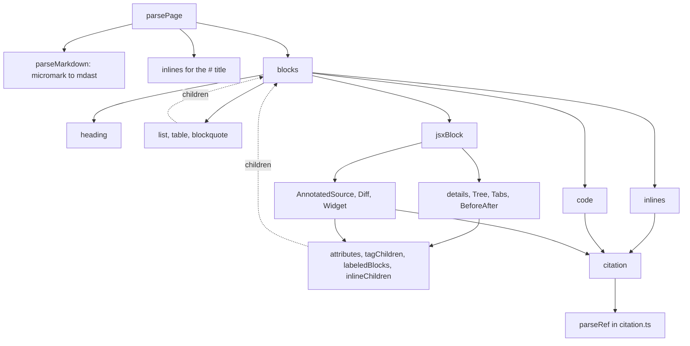

# Parsing a page

`parsePage(source, pageId)` turns the text of one `<locale>/<id>.md` file into the `Page` tree defined in [page.ts](explain:packages/contract/src/page.ts:115-126), plus a list of diagnostics that each carry a line and a column. It is a pure function: it reads no files and knows nothing about repos. The CLI's loader calls it once per page ([load.ts](explain:packages/cli/src/doc-root/load.ts:35-38)) and then checks the collected citations, page links, and widget names against the disk; that second step is covered in [Loading a doc root](./load-doc-root.md). The shape of the tree itself is on [The page model](./page-model.md).

## The files {#files}

Each file owns one layer. Container components recurse into `blocks` for their children.

<Tree open="1">

- `packages/contract/src/parse-page/`
  - [parse-page.ts](explain:packages/contract/src/parse-page/parse-page.ts): entry; frontmatter check, title, assembling the `Page`
  - [markdown.ts](explain:packages/contract/src/parse-page/markdown.ts): the Markdown parser configuration and node positions
  - [context.ts](explain:packages/contract/src/parse-page/context.ts): the shared collector, `report`, and `citation`
  - [block.ts](explain:packages/contract/src/parse-page/block.ts): block dispatch, lists, tables, quotes and alerts
  - [inline.ts](explain:packages/contract/src/parse-page/inline.ts): inline dispatch and the link classifier
  - [heading.ts](explain:packages/contract/src/parse-page/heading.ts): heading depth rules and ids
  - [code.ts](explain:packages/contract/src/parse-page/code.ts): literal code, excerpts, mermaid
  - [jsx-block.ts](explain:packages/contract/src/parse-page/jsx-block.ts): dispatch on tag name
  - [attributes.ts](explain:packages/contract/src/parse-page/attributes.ts): attribute validation against a spec
  - [jsx-children.ts](explain:packages/contract/src/parse-page/jsx-children.ts): child shape helpers shared by the components
  - [layout-components.ts](explain:packages/contract/src/parse-page/layout-components.ts): `details`, `Tree`, `Tabs`, `BeforeAfter`
  - [source-components.ts](explain:packages/contract/src/parse-page/source-components.ts): `AnnotatedSource`, `Diff`, `Widget`
  - [parse-page.test.ts](explain:packages/contract/src/parse-page/parse-page.test.ts): the behavior spec this page leans on

</Tree>

## Call tree {#call-tree}



Two passes happen. First the whole file goes through a real Markdown parser and comes back as an [mdast](https://github.com/syntax-tree/mdast) tree. Then a hand-written walk converts that tree, node by node, into the much smaller `Page` vocabulary and reports every node it does not accept.

## The entry {#entry}

<AnnotatedSource file="explain:packages/contract/src/parse-page/parse-page.ts:13-61">

<Note lines="14-19">Frontmatter is rejected before parsing. The parser has no frontmatter extension, so a leading `---` block would otherwise turn into a thematic break and a setext heading instead of an error (inference from CommonMark rules).</Note>

<Note lines="21-36">The only fatal path. micromark throws on syntax it cannot tokenize, such as a broken JSX tag or `<!--`; the thrown message carries `line`, `column` and `reason`, which become the single diagnostic. No `Page` comes back.</Note>

<Note lines="38-47">One mutable context per call. Every converter appends to these arrays rather than returning side data.</Note>

<Note lines="48-55">The first node must be a depth-1 heading. A missing title is reported but parsing continues, so the author still sees the body's problems in the same run.</Note>

<Note lines="56-60">The title becomes inline content; the rest becomes blocks. `toc`, `refs`, `pageLinks` and `widgets` are read from the context after `blocks` has walked everything, so they are in document order.</Note>

</AnnotatedSource>

There are therefore two failure modes, and callers treat them differently:

| What went wrong | `page` | `errors` | Example test |
|---|---|---|---|
| Frontmatter, or micromark threw | `undefined` | exactly one | [frontmatter](explain:packages/contract/src/parse-page/parse-page.test.ts:137-139), [HTML comment](explain:packages/contract/src/parse-page/parse-page.test.ts:111-113) |
| Anything the walk rejects | a `Page` without the rejected nodes | all of them | [Diff errors](explain:packages/contract/src/parse-page/parse-page.test.ts:238-274) |

The loader adds the file name to each diagnostic and stops early only when `page` is `undefined` ([check-page.ts](explain:packages/cli/src/doc-root/check-page.ts:39-43)); otherwise it goes on to resolve the page's refs, page links and widgets ([check-page.ts](explain:packages/cli/src/doc-root/check-page.ts:47-64)).

## The Markdown layer {#markdown}

```ts file=explain:packages/contract/src/parse-page/markdown.ts:15-23
```

The parser is `mdast-util-from-markdown` driven by micromark, with two syntax extensions: GFM (tables, task lists, strikethrough, footnotes, literal autolinks) and MDX JSX, which is what makes `<Tree>` and friends real syntax nodes instead of raw HTML. The `disable` entry then switches four CommonMark constructs off:

- `htmlFlow` and `htmlText`: raw HTML is not recognised at all, so `<div>` is read as a JSX element and rejected by name ([test](explain:packages/contract/src/parse-page/parse-page.test.ts:115-117)), and `<!-- … -->` makes the JSX tokenizer throw ([test](explain:packages/contract/src/parse-page/parse-page.test.ts:111-113)). That is how the format allows `<details>` and `<summary>` as its only HTML: they go through the same JSX dispatch as the components.
- `autolink`: `<https://…>` is not a link; it also reaches the JSX tokenizer and throws. Write `[text](url)` instead.
- `codeIndented`: a four-space-indented line is ordinary paragraph text. Only fenced code exists. Why: indented children inside tags would otherwise turn into code blocks (inference).

Every mdast node carries a start position, and [`positionOf`](explain:packages/contract/src/parse-page/markdown.ts:25-28) is the one place that reads it, falling back to 1:1. [`describeNode`](explain:packages/contract/src/parse-page/markdown.ts:30-33) names a node for messages: `<Name>` for a tag, the mdast type otherwise, which is why unsupported nodes are reported as e.g. `image is not supported`.

## Context and diagnostics {#diagnostics}

```ts file=explain:packages/contract/src/parse-page/context.ts:16-26
```

`report` pushes a `{ line, column, message }` and returns `undefined`. Converters use it as `return report(...)`, and both list walkers drop `undefined` results ([blocks](explain:packages/contract/src/parse-page/block.ts:91-92), [inlines](explain:packages/contract/src/parse-page/inline.ts:47-51)). A bad node therefore disappears from the tree while its siblings survive, and every problem in the file is reported in one run.

Positions are as specific as the code can make them:

- Most errors point at the start of the offending node: a heading, a fence, a tag.
- Attribute errors point at the attribute itself ([attributes.ts](explain:packages/contract/src/parse-page/attributes.ts:20)). The test with `<Tree open={2}>` expects column 7, where `open` starts ([test](explain:packages/contract/src/parse-page/parse-page.test.ts:105-109)).
- Mermaid `click`, `@{}` and state-diagram note problems point at the line inside the fence: the fence's line plus the line's index plus one ([code.ts](explain:packages/contract/src/parse-page/code.ts:14-20)). An unsupported `gantt` or `architecture-beta` diagram is reported at the fence itself ([code.ts](explain:packages/contract/src/parse-page/code.ts:10-13)).
- Bad links point at the link's `[` ([test](explain:packages/contract/src/parse-page/parse-page.test.ts:154-160) expects columns 1, 14 and 27 for three links on one line).

`citation` wraps [`parseRef`](explain:packages/contract/src/citation.ts:62-72) (see [Citations](./citation.md)): on failure it reports `parseRef`'s message at the given position, on success it records `{ ref, at }` in `ctx.refs`.

> [!IMPORTANT]
> Every citation in a page, whether a link, an excerpt fence, `AnnotatedSource file`, `Diff before`/`after`, or `Widget source`, goes through `citation()`. That makes `page.refs` the complete list of cited files, which is what `explain freshness sync` records. A new component that cites code must call `citation()` too, or its files silently drop out of freshness tracking.

The first test pins this down: an inline citation, an excerpt and an `AnnotatedSource` produce refs at lines 3, 12 and 17, in document order ([test](explain:packages/contract/src/parse-page/parse-page.test.ts:92-96)).

## Blocks {#blocks}

[`block`](explain:packages/contract/src/parse-page/block.ts:68-89) is a switch over the mdast node type. Headings, paragraphs, lists (keeping the task-list `checked` state), tables (first row becomes `head`), blockquotes, code, thematic breaks and flow JSX elements each have a case; anything else falls to `default` and is reported. [`inline`](explain:packages/contract/src/parse-page/inline.ts:53-73) has the same shape for phrasing content. Those defaults are deliberate: link reference definitions and footnote definitions reach the one in `block`, images reach the one in `inline`, and each would otherwise be dropped silently ([test](explain:packages/contract/src/parse-page/parse-page.test.ts:276-281)).

<details>
<summary>Markdown that parses but is rejected</summary>

Each of these is valid GFM, reaches `default` in `block` or `inline`, and is reported as `<type> is not supported`:

- `image` (``)
- `definition` (`[a]: https://x`) and the reference links that would use it
- `footnoteReference` and `footnoteDefinition`
- `html` cannot occur, because the constructs that produce it are disabled

</details>

**Alerts** are blockquotes in disguise. [`blockquote`](explain:packages/contract/src/parse-page/block.ts:38-66) looks at the first text of the first paragraph for `[!KIND]`. No marker means a plain `quote`. A marker with an unknown kind, or followed by more text on the same line, is an error. Otherwise the marker is cut out of the text, an emptied first paragraph is dropped, and the rest is converted as ordinary blocks inside an `alert`.

## Inlines and links {#links}

[`inline`](explain:packages/contract/src/parse-page/inline.ts:53-73) maps text, strong, emphasis, delete, inline code and hard breaks one to one. A JSX tag inside running text is rejected with "must stand on its own lines" ([inline.ts](explain:packages/contract/src/parse-page/inline.ts:68-69)): every component is a block.

Links are where the format's three link kinds are told apart. [`link`](explain:packages/contract/src/parse-page/inline.ts:11-45) checks the target in this order:

| Target | Becomes | Recorded in |
|---|---|---|
| `#anchor` | `pageLink` to the current page | `pageLinks` |
| `./<id>.md` or `./<id>.md#anchor` | `pageLink`; the id must match `pageIdPattern` | `pageLinks` |
| no `scheme:` prefix (e.g. `../x.md`) | error | |
| `http:`, `https:`, `mailto:` | external `link` | |
| any other `scheme:` | `citation`, the scheme being the repo key | `refs` |

The last row is why the parser needs no list of repo keys: anything that looks like `word:` and is not one of three web schemes is a citation, and whether that repo exists is the loader's problem. A test reads `[run](term:run)` as a citation to a repo named `term` ([test](explain:packages/contract/src/parse-page/parse-page.test.ts:148-152)); `ftp://x` likewise becomes a citation, and `parseRef` rejects its path ([test](explain:packages/contract/src/parse-page/parse-page.test.ts:154-160)).

## Headings and ids {#headings}

[`heading`](explain:packages/contract/src/parse-page/heading.ts:11-51) rejects any `#` heading after the title and anything deeper than `####`, so the tree's `HeadingDepth` is just `2 | 3 | 4`. Then it settles the id:

1. If the last text child ends in `{#id}`, the suffix is cut off the visible text ([heading.ts](explain:packages/contract/src/parse-page/heading.ts:18-29)). An explicit id must match `^[a-z0-9][a-z0-9-]*$` and must not be taken yet; either failure drops the heading with an error ([test](explain:packages/contract/src/parse-page/parse-page.test.ts:141-146)).
2. Otherwise the id is `github-slugger`'s `slug` of the heading's plain text, with `-1`, `-2`, … appended until it is unused ([heading.ts](explain:packages/contract/src/parse-page/heading.ts:42-47)). In the first test, `## Rules {#rules}` takes `rules`, so a later plain `## Rules` gets `rules-1` ([test](explain:packages/contract/src/parse-page/parse-page.test.ts:37-40)). CJK text keeps its characters, so `## 压缩 闸门` gets `压缩-闸门` ([test](explain:packages/contract/src/parse-page/parse-page.test.ts:99-103)). Text that slugs to nothing (only punctuation) asks for an explicit `{#id}`.

Each accepted heading is also pushed onto `ctx.toc`, which becomes the page's table of contents. Explicit and generated ids share one `usedIds` set, so an explicit id that an earlier heading's slug already took is an error, not a silent rename.

## Code fences {#code}

[`code`](explain:packages/contract/src/parse-page/code.ts:24-45) splits the fence's info string into words. One word may be `file=<citation>`. The language, if there is one, can only be the first word, so `file=` goes after it (`` ```ts file=… `` works, while `` ```file=… ts `` is rejected). Any other word is an error (`` ```ts title=x `` is rejected). The result depends on two questions:

| `file=` | language | Result |
|---|---|---|
| no | `mermaid` | `mermaid` block, after a lint pass |
| no | anything or none | literal `code` block with the body |
| yes | `mermaid` | error: a diagram cannot be an excerpt |
| yes | anything or none | `excerpt` with a `Ref`, body must be empty ([test](explain:packages/contract/src/parse-page/parse-page.test.ts:123-127)) |

An excerpt carries no code at all, only the citation; the viewer fetches the lines later. That is how an excerpt can never drift from the repo.

The mermaid lint ([code.ts](explain:packages/contract/src/parse-page/code.ts:6-22)) rejects the features the viewer's renderer does not handle: `gantt` and `architecture-beta` diagrams, `click`, `@{}` shapes, and notes in state diagrams. These are reported but the block is still kept.

## Tags {#tags}

Every flow-level tag goes to [`jsxBlock`](explain:packages/contract/src/parse-page/jsx-block.ts:16-42), which dispatches on the name. Tags that only make sense inside a parent (`Tab`, `Before`, `After`, `Note`, `summary`) get a specific "only allowed inside" message; everything else unknown is `unknown tag <Name>` ([test](explain:packages/contract/src/parse-page/parse-page.test.ts:119-121)). The "only allowed inside" message needs the stray tag on its own lines: a one-line `<Note lines="1">x</Note>` at the top level is a text element inside a paragraph, so it reaches `inline` instead and gets "must stand on its own lines, not inside text".

The components share three helpers.

[`attributes`](explain:packages/contract/src/parse-page/attributes.ts:6-41) checks the element's attributes against a spec of `required` / `optional` names. Values must be string literals: `{...}` spreads and `name={expr}` are both errors. Unknown names are errors unless `rest` is set, which only `Widget` does so that extra attributes become props. It returns the values only if it added no new diagnostic; it compares the error count before and after rather than tracking a flag.

[`requireBlankLines`](explain:packages/contract/src/parse-page/jsx-children.ts:12-34) checks the raw source between the opening tag and the first child, and between the last child and the closing tag, for an empty line. A line of only spaces or `>` counts, presumably so that tags inside a blockquote pass (inference). It is a text check on source offsets, not an mdast check. The test writes `<Tab label="a">` with `text` directly under it and expects one error on the `<Tab>` line ([test](explain:packages/contract/src/parse-page/parse-page.test.ts:168-172)).

[`tagChildren`](explain:packages/contract/src/parse-page/jsx-children.ts:61-84) collects the named children of a container. A child written on one line, like `<Note lines="2-4">first</Note>`, is a text element inside a paragraph to the Markdown parser, so a paragraph that holds only such elements and whitespace is accepted too ([onlyTextElements](explain:packages/contract/src/parse-page/jsx-children.ts:36-46)). Anything else inside the container is reported by type.

A pattern runs through all component functions: they report everything they can before giving up. `annotatedSource` checks its attributes and its `Note` children before it returns on a missing `file`, and `tree` checks blank lines and the list shape before it returns on bad attributes.

### Layout components {#layout}

These hold Markdown, so they call back into `blocks` (or `inlines`) for their content.

- [`tree`](explain:packages/contract/src/parse-page/layout-components.ts:41-58): exactly one list. Each item is one paragraph label plus an optional nested list, with no task-list checkbox ([treeItems](explain:packages/contract/src/parse-page/layout-components.ts:17-39)). `open` must be digits and becomes a number or `null`.
- [`tabs`](explain:packages/contract/src/parse-page/layout-components.ts:60-67): `Tab` children via `tagChildren`, each converted by [`labeledBlocks`](explain:packages/contract/src/parse-page/jsx-children.ts:86-99) (required `label`, block children, blank lines). Zero surviving tabs is an error.
- [`beforeAfter`](explain:packages/contract/src/parse-page/layout-components.ts:69-85): exactly two flow children, `Before` then `After`, each through `labeledBlocks`.
- [`details`](explain:packages/contract/src/parse-page/layout-components.ts:87-105): the first child must be one `summary`, either on its own lines or inline in a paragraph; the summary becomes inlines and the remaining children become blocks.

### Source components {#source-components}

These cite code, so each funnels its citation attributes through `citation()`.

<Tabs>

<Tab label="AnnotatedSource">

```md
<AnnotatedSource file="fold:index.ts:1-20">

<Note lines="2-4">first</Note>

</AnnotatedSource>
```

[`annotatedSource`](explain:packages/contract/src/parse-page/source-components.ts:12-45) requires `file` to cite exactly one range. Each `Note` needs `lines="N"` or `lines="N-M"` and one paragraph of inline text, and must fall inside that range; `lines="9-12"` against `5-10` is reported at the note ([test](explain:packages/contract/src/parse-page/parse-page.test.ts:162-166)). A rejected note is dropped; the block survives.

</Tab>

<Tab label="Diff">

```md
<Diff before="base:src/a.ts:1-5" after="head:src/a.ts:2-7" />
<Diff after="head:src/b.ts" />
<Diff before="base:src/c.ts:3" />
```

[`diff`](explain:packages/contract/src/parse-page/source-components.ts:47-73) takes no children and two optional attributes, each a citation of at most one range. Which sides are present decides the `DiffChange` kind: both is `modified`, only `after` is `added`, only `before` is `deleted`, neither is an error. Both sides land in `refs`, so a diff counts as citing two files ([test](explain:packages/contract/src/parse-page/parse-page.test.ts:195-236)).

</Tab>

<Tab label="Widget">

```md
<Widget name="fold-play" title="Play" source="fold:fold.ts fold:t.ts:1-5" preset="a">

What it shows.

</Widget>
```

[`widget`](explain:packages/contract/src/parse-page/source-components.ts:75-95) requires `name`, `title` and `source`, and passes every other attribute through as a string prop (`{ preset: "a" }` in the [test](explain:packages/contract/src/parse-page/parse-page.test.ts:174-193)). `source` is a whitespace-separated list of citations; one bad citation drops the widget. The name goes into `ctx.widgets` so the loader can check that `widgets/<name>.js` exists. See [Widgets](./widgets.md).

</Tab>

</Tabs>

## Reading the tests {#tests}

[parse-page.test.ts](explain:packages/contract/src/parse-page/parse-page.test.ts) is the best map of the accepted language. The first case builds a full tree from a page that uses each common construct and asserts the exact `Page` value ([test](explain:packages/contract/src/parse-page/parse-page.test.ts:8-97)); most other cases feed one small bad page to the `errorsAt` helper and assert only the `{ line, column }` list ([helper](explain:packages/contract/src/parse-page/parse-page.test.ts:4-5)). When you add a construct, add it in the same two shapes: the accepted tree, and the position of each rejection.
