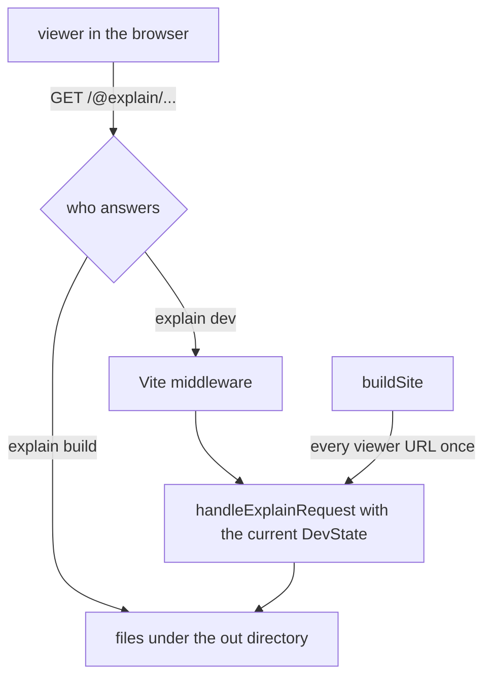

# Dev server and static build

`explain dev` and `explain build` serve the same viewer from the same data. Everything the viewer needs from the doc root sits under one URL prefix, `/@explain/`, answered by one function, [`handleExplainRequest`](explain:packages/cli/src/site/api.ts:95-140). The dev server calls it for each live request; the build calls it once for every URL the viewer could ask for and writes each answer to a file. This page covers that handler, the two ways it is used, and the search index it serves. The consumer side, how the viewer fetches and caches these responses, is on [viewer-shell](./viewer-shell.md).

## One handler, two hosts



The handler takes a [`DevState`](explain:packages/cli/src/site/api.ts:17-23), either a loaded `DocRoot` or the diagnostics of an `explain.json` that failed to load, and returns a plain `{ status, headers, body }`. It never touches an HTTP object, which is what lets the build reuse it unchanged. The build test checks this directly: for every file it wrote, it asks the handler for the same URL and compares the bytes ([build.test.ts](explain:packages/cli/test/build.test.ts:82-90)).

Every path ends in `.json`, and nothing depends on query strings or request headers. A request for a source without the `.json` suffix is a 404 ([dev.test.ts](explain:packages/cli/test/dev.test.ts:94)). That is what makes a directory of files on a static host a faithful copy of the dev server (inference: the reason is not stated in code, but the build relies on it).

## Routes

The path shapes are typed in the viewer package as [`ApiPath`](explain:packages/viewer/src/api.ts:4-21), so the CLI and the viewer build URLs with the same helpers.

| Route | Answer | Source |
|---|---|---|
| `/@explain/api/site.json` | `SiteResponse`: title, locales, default locale, root diagnostics, and per-locale nav with each page's status. When `explain.json` is invalid, `{ status: "invalid", errors }` with status 200. | [siteResponse](explain:packages/cli/src/site/api-bodies.ts:28-52) |
| `/@explain/api/page/<locale>/<id>.json` | `PageResponse`: the parsed page, its diagnostics, freshness, and one entry per source file with its state | [pageResponse](explain:packages/cli/src/site/api-bodies.ts:84-102) |
| `/@explain/api/source/<repo>/<path…>.json` | `SourceResponse`: the file text, line count, and the pages that cite it; or `status: "missing"` | [sourceResponse](explain:packages/cli/src/site/api.ts:56-93) |
| `/@explain/api/search/<locale>.json` | `SearchIndex`: one entry per page section | [searchEntries](explain:packages/cli/src/site/search.ts:43-66) |

All responses carry `Cache-Control: no-store` ([api.ts](explain:packages/cli/src/site/api.ts:38-42)), so the browser never serves a stale page after an edit.

### How a path is dispatched

```ts file=explain:packages/cli/src/site/api.ts:100-104
```

Anything other than `GET` is a 405. The path is split on `/` before decoding, so an encoded `%2F` inside a segment stays inside that segment instead of creating a new one; a segment that fails to decode is a 404. For `api` routes the `.json` suffix is stripped from the last segment and the rest are the arguments ([api.ts](explain:packages/cli/src/site/api.ts:106-110)).

When the state is `invalid`, `site.json` still answers 200 with the errors, so the viewer can show them, and every other route answers [503](explain:packages/cli/src/site/api.ts:54) pointing at `site.json`.

### The source route is the security boundary

The source route is how the browser reads files from disk, so it only serves what a citation could name:

```ts file=explain:packages/cli/src/site/api.ts:61-66
```

The repo must be a key of `explain.json` `repos` (404 otherwise). `repo:path` must parse as a citation (403 otherwise), which [rejects `.` and `..` segments](explain:packages/contract/src/citation.ts:34-38). Then [`resolveSource`](./resolve-source.md) does the real check against the disk, and a path that [resolves outside the repo or is not a file](explain:packages/cli/src/site/api.ts:86-89) is a 403. The dev test tries both an encoded `..%2Fsecret.txt` and a symlink pointing out of the repo, and checks that the secret never appears in the body ([dev.test.ts](explain:packages/cli/test/dev.test.ts:96-100)).

`citedBy` is computed on every request by scanning all parsed pages for a ref to the same repo and path ([api.ts](explain:packages/cli/src/site/api.ts:67-73)); the source viewer uses it to list the pages that cite a file.

## The dev server

[`serveDocRoot`](explain:packages/cli/src/site/dev.ts:18-142) runs a Vite dev server whose root is the viewer package ([viewer.ts](explain:packages/cli/src/site/viewer.ts:9-16)), so the viewer's own source is served and hot-compiled straight from `node_modules` or the workspace. The explain part is a Vite plugin with two jobs.

**Serving.** A middleware sends every `/@explain/` request to the handler, reading the current state under a lock ([dev.ts](explain:packages/cli/src/site/dev.ts:80-96)). Any other `GET` that accepts HTML and whose first segment is empty or a locale is rewritten to `/index.html` ([dev.ts](explain:packages/cli/src/site/dev.ts:97-105)), so a deep link like `/en/site` loads the single-page app.

**Reloading.** Vite's file watcher is pointed at the doc root and every repo in `explain.json`. Any add, change or unlink under those directories goes into a queue; the queue is debounced by 100 ms and each settled burst triggers one reload:

```ts file=explain:packages/cli/src/site/dev.ts:135-140
```

A [reload](explain:packages/cli/src/site/dev.ts:29-64) is a full `loadDocRoot`, not an incremental update: pages are reparsed, citations re-resolved, and freshness recomputed. The result replaces `state` while holding the same lock the middleware uses, so a request sees either the old doc root or the new one, never a half-built one. Then:

- If the load succeeded, the watched set is updated to match the new `repos`: removed repos are unwatched, new ones added. Editing `explain.json` to add a repo is enough to start watching it.
- If it failed (invalid `explain.json`, or a filesystem error), the errors are printed to stderr and the state becomes `invalid`. The server keeps running and recovers on the next good save.
- Either way, the server sends `{ type: "full-reload" }` over Vite's HMR WebSocket, and the browser reloads the page.

> [!NOTE]
> Watching the repos, not just the doc root, is what makes the freshness badge live: editing a cited source file reloads the browser with that page marked stale.

## The search index

The search index is built on the server and fetched per locale; the viewer searches it client-side ([viewer-shell](./viewer-shell.md)). [`searchEntries`](explain:packages/cli/src/site/search.ts:43-66) splits a page into sections at every heading. Blocks before the first heading form a section titled with the page title and no anchor.

Each section's text is the plain text of its blocks, chosen by [`blockText`](explain:packages/cli/src/site/search.ts:9-41):

- Prose is indexed: paragraphs, list items, table cells, alerts, quotes, `<details>` with its summary, tree labels, tab labels and contents, before/after labels and contents, and `AnnotatedSource` notes.
- Code is not: fenced code, excerpts, mermaid, diffs and thematic breaks contribute nothing.

So searching finds what the page says about the code, not the code it quotes. Only `parsed` pages of the requested locale are included; an unknown locale is a 404 ([api.ts](explain:packages/cli/src/site/api.ts:128-138)).

## The static build

[`buildSite`](explain:packages/cli/src/site/build.ts:55-121) turns the doc root into a directory a static host can serve.

1. [`staticSite`](explain:packages/cli/src/site/build.ts:23-53) lists every URL the viewer can request: `site.json`, every page, one search index per locale, and a source response for every file any parsed page cites *or* recorded in its `.sources.json`. The recorded files matter because the sources panel shows files that dropped out of a page as well; the build test records `src/old.ts`, which no longer exists, and expects its source response (a `missing` one) to be written ([build.test.ts](explain:packages/cli/test/build.test.ts:51-52,77)).
2. Each URL goes through `handleExplainRequest`, 16 at a time. Any status other than 200 fails the whole build with the URL and body.
3. The out directory is replaced, but only if it is empty or already holds an `@explain` directory. A foreign directory is refused untouched ([build.ts](explain:packages/cli/src/site/build.ts:77-85)).
4. Vite builds the viewer into the out directory.
5. The responses are written at their URL paths, and the built `index.html` is copied to every route the SPA can be entered at, plus `404.html` ([build.ts](explain:packages/cli/src/site/build.ts:101-119)).

For the build test's doc root, one `zh-CN` page that cites two files, the output is:

<Tree open="3">

- `out/`
  - `index.html`, `404.html`
  - `assets/` (the Vite bundle)
  - `zh-CN/`
    - `index.html` (locale home)
    - `source/index.html` (source viewer)
    - `index/index.html` (page `index`)
  - `@explain/`
    - `api/`
      - `site.json`
      - `page/zh-CN/index.json`
      - `search/zh-CN.json`
      - `source/fold/src/数据.ts.json`, `source/fold/src/index.html.json`, `source/fold/src/old.ts.json`

</Tree>

The [expected file lists](explain:packages/cli/test/build.test.ts:71-105) in the test are this tree. Every HTML route file is byte-identical to `index.html`; the viewer picks the page from the URL. `404.html` covers hosts that serve it for unknown paths (inference: the code only writes the file; which hosts use it is not in this repo).

> [!IMPORTANT]
> The build never computes anything the dev server would not: each written file is exactly the dev server's response for that URL. A difference between `explain dev` and a built site can only come from the host (for example, how it maps `/en/site` to `en/site/index.html`), not from the data.

## The commands

<Tabs>
<Tab label="explain dev">

```ts file=explain:packages/cli/src/commands/dev.ts:9-23
```

`--port` defaults to 4321 and is strict: if the port is taken, Vite fails, the error is printed and the exit code is 2. The doc root must load at startup, since [`openDocRoot`](explain:packages/cli/src/commands/open-doc-root.ts:35-43) exits on a missing or invalid `explain.json`; only later breakage is handled as the `invalid` state. Pages with diagnostics are still served, with their errors in the page response. The command then waits forever; the scope closes the Vite server on exit.

</Tab>
<Tab label="explain build">

```ts file=explain:packages/cli/src/commands/build.ts:15-33
```

Unlike `dev`, `build` refuses a doc root with any diagnostic, whether root-level (repos) or on a page, including citation problems. `--out` is resolved against the current directory and defaults to `dist/` inside the doc root. On success it prints the directory and the counts of pages and sources.

</Tab>
</Tabs>

## Keeping the viewer a browser bundle

Both Vite configurations add [`viewerImportGuard`](explain:packages/cli/src/site/viewer.ts:18-34). For any module inside the viewer package (outside its `node_modules`), a runtime import of `effect`, `@effect/*`, `bun`, `node:*` or `@explain/contract/*` is a build error; `import type` is fine because types are erased before resolution. That is why the viewer can type its API against the contract package (`Page`, `Freshness`) while the shared response shapes live in [`@explain/viewer/api`](explain:packages/viewer/src/api.ts:1-2) and the CLI imports them from there.
