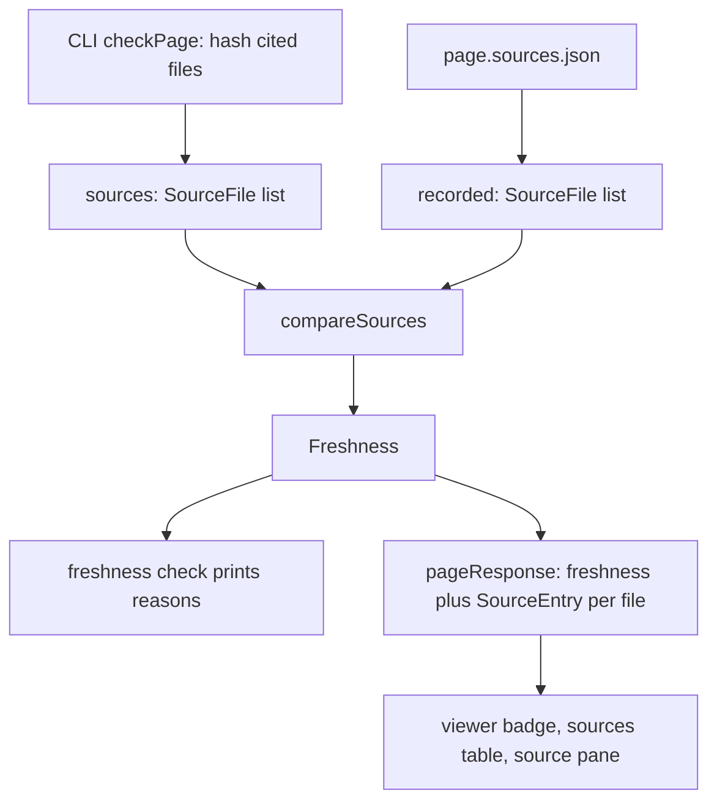

# Source records and freshness types

A page goes stale when the code it cites changes. Recording which files a page cites, and comparing
that record with the disk, is the CLI's job; showing the result is the viewer's. `sources.ts` in the
contract package holds the vocabulary both sides share: what a recorded file looks like, the format
of `<page>.sources.json`, and the shape of a freshness verdict. How the verdict is computed is on
[freshness](./freshness.md).

```ts file=explain:packages/contract/src/sources.ts
```

## `SourceFile`: one hashed file

A `SourceFile` is a repo key, a path, and a `hash` that must be a 40-character lowercase hex string
([sources.ts](explain:packages/contract/src/sources.ts:3-11)). There is no line range: freshness
works per file, so a change anywhere in a cited file makes the page stale, even outside the cited
lines.

The hash is a git blob id. The CLI computes SHA-1 over the header `blob <length>\0` followed by the
file's bytes, which is how git names a blob:

```ts file=explain:packages/cli/src/doc-root/freshness.ts:15-32
```

The record for `packages/contract/src/config.ts` on the [config](./config.md) page holds
`8aaaa18005248bb7436d19b8e028bfd57517329e`, and `git hash-object packages/contract/src/config.ts`
printed the same id when this page was written. The hash is computed from the bytes on disk, so
uncommitted edits count too.

## `SourcesFile`: the `.sources.json` format

`explain freshness sync` writes one `<locale>/<page>.sources.json` per page. Its schema is
`{ files: SourceFile[] }`, and `SourcesFileFromJson` decodes it straight from the JSON text
([sources.ts](explain:packages/contract/src/sources.ts:15-21)). Writing goes through
`formatSourcesFile`, so the output is deterministic:

<AnnotatedSource file="explain:packages/contract/src/sources.ts:34-45">
<Note lines="34-38">Records are ordered by repo key, then by path, by plain string comparison.</Note>
<Note lines="41-43">Each record is rebuilt with only `repo`, `path`, `hash`, in that order, so no extra field leaks into the file.</Note>
<Note lines="44">Two-space indentation and a trailing newline.</Note>
</AnnotatedSource>

The same inputs always produce the same bytes, which keeps `.sources.json` diffs in version control
down to the files that actually changed (inference). An excerpt of the file this repo's
`en/config.sources.json` received:

```json
{
  "files": [
    {
      "repo": "explain",
      "path": "packages/cli/src/commands/init.ts",
      "hash": "30346b589b2491ea79fff1c1ab6f43b0c9ebc60a"
    },
    {
      "repo": "explain",
      "path": "packages/contract/src/config.ts",
      "hash": "8aaaa18005248bb7436d19b8e028bfd57517329e"
    }
  ]
}
```

When the CLI loads a page, it reads this file back through `SourcesFileFromJson`. A missing file means
"never synced"; a file that does not decode is a validation error telling you to sync again
([check-page.ts](explain:packages/cli/src/doc-root/check-page.ts:68-83)).

## `Freshness` and `StaleReason`

```ts file=explain:packages/contract/src/sources.ts:23-32
```

A page is either `fresh`, or `stale` with its reasons; `compareSources` returns `stale` only when the
reason list is non-empty ([freshness.ts](explain:packages/cli/src/doc-root/freshness.ts:69-71)).
Every reason except `sources-missing` names the file it is about:

| `kind` | Meaning | `explain freshness check` prints |
|---|---|---|
| `sources-missing` | the page has no `.sources.json` | `no sources file; run explain freshness sync …` |
| `not-recorded` | the page cites a file the record does not list | `… is cited but not hashed` |
| `not-cited` | the record lists a file the page no longer cites | `… is hashed but no longer cited` |
| `missing` | a recorded file no longer resolves to a file | `… no longer exists` |
| `changed` | the file's current hash differs from the recorded one | `… changed` |

The messages come from `describeReason`
([check.ts](explain:packages/cli/src/commands/freshness/check.ts:9-23)). Comparing the set of cited
files, not just their hashes, is what makes a page stale when it starts or stops citing a file.

## How the two sides share these types



On the CLI side a parsed page carries all three values: the current `sources`, the `recorded` list
(`undefined` when there is no file), and the computed `freshness`
([types.ts](explain:packages/cli/src/doc-root/types.ts:24-32)). `compareSources` produces the
`Freshness`, sorting reasons with `compareSourceKeys` so output order is stable
([freshness.ts](explain:packages/cli/src/doc-root/freshness.ts:34-72)).

The viewer never computes freshness. It receives `Freshness` and `SourceFile` inside the page
response, as types imported from the contract
([api.ts](explain:packages/viewer/src/api.ts:1-2,53-79)). Because the reasons are per page, while
the sources table and source pane are per file, the server folds them into one `SourceEntry` per
file: a `state` that is either `fresh` or the kind of the reason that names the file, plus the
recorded and current `SourceFile`
([api-bodies.ts](explain:packages/cli/src/site/api-bodies.ts:54-82)). `sources-missing` names no file,
so it marks every entry `not-recorded`.

The viewer then reads `freshness.status` and the `sources-missing` reason for the badge
([freshness.tsx](explain:packages/viewer/src/routes/freshness.tsx:11-16)), and the recorded hash,
falling back to the current one, for the sources table
([sources.tsx](explain:packages/viewer/src/routes/sources.tsx:34,52-61)).

> [!IMPORTANT]
> `SourceState` in the viewer API is written out separately as `fresh` plus the four per-file
> `StaleReason` kinds ([api.ts](explain:packages/viewer/src/api.ts:53)). A new `StaleReason` kind
> must be added there too, and given a label in every locale's `sourceStates`, which is typed as a
> record over `SourceState` ([strings.ts](explain:packages/viewer/src/i18n/strings.ts:36)). The server
> stores `reason.kind` in a `Map<string, SourceState>`
> ([api-bodies.ts](explain:packages/cli/src/site/api-bodies.ts:68-73)), so forgetting the first step
> should fail type-checking (inference).
