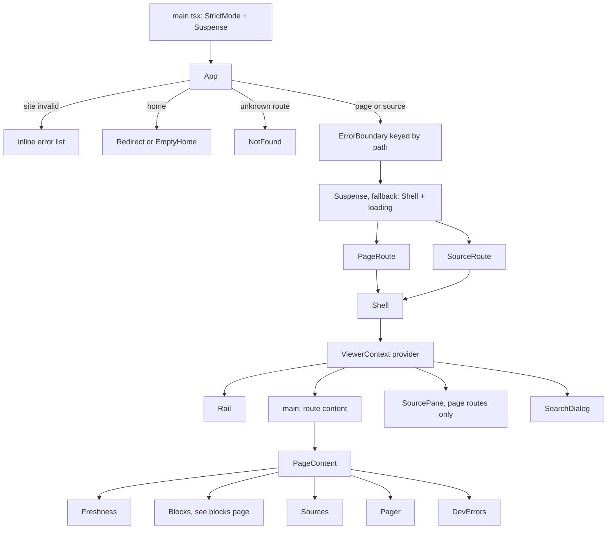

# The viewer shell

The viewer is the browser app that renders a doc root: the left rail, search, routing, page chrome (freshness badge, sources table, pager), and the standalone source page. It is a React 19 single-page app ([`react` and `react-dom` 19.3.0](explain:package.json:28-29), pulled in by [the viewer's `package.json`](explain:packages/viewer/package.json:10-15)) with `highlight.js` for code and `beautiful-mermaid` for diagrams. It has no router or state library: routing is about 70 lines on top of the History API, and data loading is a promise cache keyed by API path. Route data (site, page, source JSON) is read with React's `use` ([app.tsx](explain:packages/viewer/src/app.tsx:11), [page-route.tsx](explain:packages/viewer/src/routes/page-route.tsx:41), [source-route.tsx](explain:packages/viewer/src/routes/source-route.tsx:20)); source lines and the search index are awaited in effects ([code.tsx](explain:packages/viewer/src/blocks/code.tsx:20-29), [search-dialog.tsx](explain:packages/viewer/src/shell/search-dialog.tsx:76-77)).

This page covers everything in `packages/viewer` *except* the Markdown block renderers ([blocks](./blocks.md)) and the source pane on the right ([source-pane](./source-pane.md)). The viewer never reads the doc root itself; it only talks to the `/@explain/...` HTTP API that the CLI serves in `explain dev` or writes out as static files in `explain build` (see [site](./site.md)).

## Module map {#modules}

<Tree open="2">

- `packages/viewer/`
  - [`index.html`](explain:packages/viewer/index.html) the one HTML document: fonts, three stylesheets, `main.tsx`
  - `src/`
    - [`main.tsx`](explain:packages/viewer/src/main.tsx) mounts `<App>` under `StrictMode` and a root `Suspense`
    - [`app.tsx`](explain:packages/viewer/src/app.tsx) top-level dispatch: invalid site, home, not found, page, source
    - [`router.ts`](explain:packages/viewer/src/router.ts) URL ↔ `Route`, `navigate`, link interception
    - [`api.ts`](explain:packages/viewer/src/api.ts) API paths and response types, shared with the CLI
    - [`data.ts`](explain:packages/viewer/src/data.ts) cached `fetch` per API path, highlighted source lines
    - [`context.ts`](explain:packages/viewer/src/context.ts) `ViewerContext`: site, locale, strings, sources, status
    - [`ref.ts`](explain:packages/viewer/src/ref.ts) format/parse citation refs, source-route hrefs
    - [`highlight.ts`](explain:packages/viewer/src/highlight.ts) the language table, on-demand language loading, per-line HTML
    - `routes/` page and source routes plus page chrome
      - [`page-route.tsx`](explain:packages/viewer/src/routes/page-route.tsx)
      - [`source-route.tsx`](explain:packages/viewer/src/routes/source-route.tsx)
      - [`freshness.tsx`](explain:packages/viewer/src/routes/freshness.tsx), [`sources.tsx`](explain:packages/viewer/src/routes/sources.tsx), [`pager.tsx`](explain:packages/viewer/src/routes/pager.tsx), [`dev-errors.tsx`](explain:packages/viewer/src/routes/dev-errors.tsx)
    - `shell/` the frame around every route
      - [`shell.tsx`](explain:packages/viewer/src/shell/shell.tsx), [`rail.tsx`](explain:packages/viewer/src/shell/rail.tsx), [`search-dialog.tsx`](explain:packages/viewer/src/shell/search-dialog.tsx)
    - `i18n/` UI strings
      - [`strings.ts`](explain:packages/viewer/src/i18n/strings.ts), [`en.ts`](explain:packages/viewer/src/i18n/en.ts), [`zh-CN.ts`](explain:packages/viewer/src/i18n/zh-CN.ts)
    - `blocks/` page content renderers, see [blocks](./blocks.md)
    - `pane/` the source pane, see [source-pane](./source-pane.md)
    - `styles/` [`tokens.css`](explain:packages/viewer/src/styles/tokens.css), [`base.css`](explain:packages/viewer/src/styles/base.css), [`viewer.css`](explain:packages/viewer/src/styles/viewer.css) and `viewer/*.css`

</Tree>

## Boot {#boot}

[`index.html`](explain:packages/viewer/index.html:15-18) links `tokens.css`, `base.css` and `viewer.css` as plain stylesheets and loads `/src/main.tsx` as a module; there is no bundler entry besides this file, because the CLI runs Vite with the viewer package as its root ([dev.ts](explain:packages/cli/src/site/dev.ts:112-119)). In a static build every route gets a copy of the same `index.html` ([build.ts](explain:packages/cli/src/site/build.ts:101-119)), so a deep link loads the SPA and the client decides what to show.

```tsx file=explain:packages/viewer/src/main.tsx:8-14
```

The root `Suspense` has a `null` fallback: until `site.json` arrives the screen stays blank. `App` then suspends on [`use(loadSite())`](explain:packages/viewer/src/app.tsx:11).

## Component tree {#tree}



Each route component wraps *itself* in `Shell` rather than `App` wrapping all routes once. That lets a route pass the props only it knows: `PageRoute` hands the shell the page title, the table of contents, the source entries, and `pane={parsed !== null}` ([page-route.tsx](explain:packages/viewer/src/routes/page-route.tsx:41-56)); `SourceRoute`, `NotFound` and the error boundary render a shell with no pane. The cost is that the shell remounts on every route change, which also re-runs its scroll-to-hash effect (see [Shell](#shell)).

## Routing {#routing}

[`parseRoute`](explain:packages/viewer/src/router.ts:14-29) turns `location.pathname` and `location.search` into one of four routes:

| URL | Route |
|---|---|
| `/` | `home`, locale `null` |
| `/zh` | `home`, locale `zh` |
| `/zh/viewer-shell` (trailing `/` allowed) | `page` |
| `/zh/source?explain/packages/viewer/src/app.tsx#L11` | `source`, repo `explain`, path after the first `/` |
| anything deeper, or `source` without a repo and path | `unknown` |

The source route keeps the repo and file path in the **query string**, not the path. The path segment is fixed (`source`), so the static build only needs one `index.html` per locale for all source files ([build.ts](explain:packages/cli/src/site/build.ts:41-44)), and a file path of any depth never collides with the "more than two segments is unknown" rule. The router tests pin this, including a path with spaces, `#` and `?`, a trailing slash, and the rejected old path form ([router.test.ts](explain:packages/viewer/src/router.test.ts:10-43)).

> [!IMPORTANT]
> `source` is the one page id that can never be a page: the router treats `/<locale>/source` as the source route, and the config schema rejects it as a page id ([config.ts](explain:packages/contract/src/config.ts:7,18)).

Navigation is plain History API plus a custom event:

```ts file=explain:packages/viewer/src/router.ts:37-55
```

`useLocation` re-renders `App` on `popstate` and on `navigate`. [`interceptLinks`](explain:packages/viewer/src/router.ts:57-72), installed once by `App`, turns every same-origin left-click on an `<a href>` into `navigate`, so pages, blocks and the rail can render ordinary anchors with no router-aware link component. It skips modifier clicks, links with a `target`, `/@...` paths (API files), and a pure hash jump on the current page, which the browser handles natively.

[`App`](explain:packages/viewer/src/app.tsx:34-81) then dispatches:

- **home** picks the requested locale if the site has it, else `defaultLocale`, and redirects to [`homeHref`](explain:packages/viewer/src/shell/shell.tsx:13-18): the `index` page if nav has one, else the first nav page. With an empty nav it renders `EmptyHome`.
- **unknown** or a locale the site does not list renders `NotFound` in the default locale.
- **page** and **source** render inside an `ErrorBoundary` keyed by the URL without its hash, so moving to another page resets a previous load error, but jumping between anchors does not remount the route.

## Data {#data}

The API surface is typed in [`api.ts`](explain:packages/viewer/src/api.ts:4-21): `site.json`, one `page/<locale>/<id>.json` per page, `source/<repo>/<path>.json` per cited file, and `search/<locale>.json`. The package exports this file as `@explain/viewer/api` ([package.json](explain:packages/viewer/package.json:6-9)), and the CLI imports the same path builders and response types when it serves and builds the site ([build.ts](explain:packages/cli/src/site/build.ts:1-7)), so the two sides cannot drift silently.

```ts file=explain:packages/viewer/src/data.ts:15-27
```

`getJson` memoizes the *promise* per path. That is what makes `use(loadPage(locale, id))` work: every render during suspension gets back the identical promise. A failed request is evicted so a retry can refetch. Nothing else ever invalidates the cache; in dev the CLI sends Vite a `full-reload` after any change to the doc root ([dev.ts](explain:packages/cli/src/site/dev.ts:62)), which throws away the module state anyway.

### Highlighting, loaded on demand {#highlight}

The viewer imports `highlight.js/lib/core`, which registers no languages. Instead, one table, [`languages`](explain:packages/viewer/src/highlight.ts:12-164), lists 30 languages. Each entry has a `load` that dynamically imports `highlight.js/lib/languages/<name>`, the file names, extensions and fence aliases that select it, and the languages it embeds:

```ts file=explain:packages/viewer/src/highlight.ts:104-109
```

[`languageOf`](explain:packages/viewer/src/highlight.ts:180-189) tries the exact file name (`Dockerfile`, `CMakeLists.txt`), then the lowercased extension, then the whole string lowercased as an alias or language id. One function therefore serves both source paths and fence names; `notes.txt` and `mermaid` map to nothing ([highlight.test.ts](explain:packages/viewer/src/highlight.test.ts:4-25)).

Loading happens the first time a language is needed:

<AnnotatedSource file="explain:packages/viewer/src/highlight.ts:191-220">
<Note lines="191-205">One promise per language id, so each module is imported once. Success registers it with hljs; a failed import resolves to `false` instead of throwing.</Note>
<Note lines="207-213">Walks `embeds` from the requested language: markdown pulls in xml, which pulls in css and javascript.</Note>
<Note lines="215-220">Registers all of them in parallel and answers with the requested language's own result. An id outside the table collects nothing, so the answer is `false`.</Note>
</AnnotatedSource>

So [`highlightLines`](explain:packages/viewer/src/highlight.ts:249-255) is async. With the language available it highlights the joined text and splits it; otherwise [`plainLines`](explain:packages/viewer/src/highlight.ts:242-247) only HTML-escapes each line. highlight.js returns one HTML string whose `<span>`s can cross newlines, so [`splitHighlighted`](explain:packages/viewer/src/highlight.ts:222-240) closes every open span at the end of a line and reopens it on the next; each line then stands alone and the line-numbered views can render any range. The tests pin both: a Python triple-quoted string spanning two lines, and inline tags in markdown highlighted through the embedded xml ([highlight.test.ts](explain:packages/viewer/src/highlight.test.ts:27-43)).

The two callers wait differently:

- [`loadSourceLines`](explain:packages/viewer/src/data.ts:49-60) splits a source file into lines and awaits `highlightLines`, caching the result per file. Excerpts and the source route's code lines do not suspend on it: [`useSourceLines`](explain:packages/viewer/src/blocks/code.tsx:14-32) waits in an effect and shows a skeleton until the lines arrive ([source-route.tsx](explain:packages/viewer/src/routes/source-route.tsx:72,89)). The language load is one more step inside the same promise.
- A literal fence, [`CodeBlock`](explain:packages/viewer/src/blocks/code.tsx:85-99), never suspends. It renders escaped plain text first and swaps in the highlighted HTML when it arrives, keyed by language and content so a stale result is dropped.

Because each language is its own `import()`, a production build emits it as a separate chunk and a reader downloads only the languages their pages use (inference: the splitting is Vite's default for dynamic imports; this repo has no config for it).

[`ref.ts`](explain:packages/viewer/src/ref.ts) is the viewer-side counterpart of the citation syntax: `formatRef`/`parseRef` for `repo:path:ranges`, `fileKey` for caching, and `sourceHref`, which links a citation to the source route with `#L<first line>`.

## Shell {#shell}

`Shell` is the frame every route renders into, and the only place `ViewerContext` is provided.

<AnnotatedSource file="explain:packages/viewer/src/shell/shell.tsx:39-81">
<Note lines="39">Strings are derived from the locale on every render; see [UI strings](#i18n).</Note>
<Note lines="47-50">`status` feeds the visually hidden live region at the bottom. It clears first and sets the message on the next frame, so the same message announced twice is still read out.</Note>
<Note lines="51-54">The context value: everything a block or pane component needs without prop drilling. `sources` is the page's source table, which [blocks](./blocks.md) and [source-pane](./source-pane.md) use to look up file state.</Note>
<Note lines="56-59">Sets `<html lang>` to the doc locale and the tab title to `page · site`.</Note>
<Note lines="61-70">Runs once per mount: scroll to the hash target or to the top, then add `body.ready`, which starts the entrance animation in `entrance.css`.</Note>
<Note lines="72-81">The source pane controller exists only when `pane` is true and attaches to the `main` element.</Note>
</AnnotatedSource>

The rendered tree is a skip link, a `.shell` grid with a top bar (shown only on narrow screens), the [`Rail`](explain:packages/viewer/src/shell/rail.tsx:8-103), `main#main`, and the pane; then the drawer scrim, the search dialog, and the live region ([shell.tsx](explain:packages/viewer/src/shell/shell.tsx:100-159)). The rail doubles as the mobile drawer: opening it toggles `body.drawer-open`, makes `main` `inert`, focuses the current page link, and `Escape` closes it ([shell.tsx](explain:packages/viewer/src/shell/shell.tsx:83-98)).

The rail lists nav groups for the current locale, flags pages whose status is `stale` or `invalid`, dims pages whose file is `missing`, expands the current page's `##` headings as a table of contents with a scroll spy (a heading counts as active once its top passes 30% of the viewport), and ends with a locale switch that keeps the current page id ([rail.tsx](explain:packages/viewer/src/shell/rail.tsx:58-122)).

### Search {#search}

[`SearchDialog`](explain:packages/viewer/src/shell/search-dialog.tsx:39-154) is a native `<dialog>` opened by `⌘K`/`Ctrl-K`, or `/` when focus is not in a form field. The index for the locale is fetched on first open. Matching is a case-insensitive substring search over `heading + text` of each entry, capped at 12 hits with a short snippet around the match ([search-dialog.tsx](explain:packages/viewer/src/shell/search-dialog.tsx:15-37)); arrow keys move between results and the input. There is no ranking: hits come in index order.

## Page route {#page-route}

[`PageRoute`](explain:packages/viewer/src/routes/page-route.tsx:32-57) loads the page JSON and finds its [placement](explain:packages/viewer/src/routes/page-route.tsx:21-30) in the flattened nav: group title, position, and the whole order the pager walks. `PageContent` then handles the three `PageResponse` states ([page-route.tsx](explain:packages/viewer/src/routes/page-route.tsx:59-148)):

| Status | Renders |
|---|---|
| `missing` | title from nav, "no page for this locale" with the expected file, back-home link, pager |
| `invalid` | title from nav, a "could not be parsed" note, every page diagnostic, site diagnostics; no body |
| `parsed` | title from the page, [`Freshness`](explain:packages/viewer/src/routes/freshness.tsx), non-citation diagnostics if any, site diagnostics if any, [`Blocks`](./blocks.md), [`Sources`](explain:packages/viewer/src/routes/sources.tsx) with citation problems, [`Pager`](explain:packages/viewer/src/routes/pager.tsx) |

Only a parsed page gets the source pane. Site-level diagnostics (`site.errors`) are shown on parsed pages and on pages that fail to parse, so a broken `explain.json` field is visible from any page that exists in the current locale; a page missing in that locale shows only its missing notice and pager.

### Where diagnostics show {#diagnostics}

Every entry of the page's `diagnostics` carries a `_tag` (the kinds are listed on [site](./site.md)). A parsed page splits them by kind:

```tsx file=explain:packages/viewer/src/routes/page-route.tsx:124-129
```

| Kind | Shown |
|---|---|
| `CitationRepo`, `CitationFile` | under the sources table, titled "Citation problems" ([sources.tsx](explain:packages/viewer/src/routes/sources.tsx:72)) |
| `Parse`, `PageLink`, `SourcesRecord` | under the page title, titled "N errors on this page" |

Both lists render through [`DevErrors`](explain:packages/viewer/src/routes/dev-errors.tsx:4-26) as `file:line:column` plus the message, so a `SourcesRecord` entry names the `.sources.json`, not the page. The rail flag follows only the nav status the server computed: a page with a `CitationRepo` diagnostic is `invalid` there and gets the error flag, while a page whose only problem is a `PageLink` does not get one for it.

### Freshness badge and sources table {#freshness}

The [badge](explain:packages/viewer/src/routes/freshness.tsx:5-53) and the [sources table](explain:packages/viewer/src/routes/sources.tsx:7-75) both read the same `sources` list that the CLI computed for the page (see [freshness](./freshness.md)). The badge is `stale` only if the page's `freshness.status` says so. When it is, the note first checks for a reason about the record itself: `sources-missing` (never synced) shows `unhashedNote` and `sources-malformed` (the `.sources.json` does not decode) shows `malformedSourcesNote`; both ask you to run `explain freshness sync` and replace the file list. Otherwise the note lists the off files, and when every off file is merely `changed` it drops the per-file state word and adds one shared sentence. The table shows each file with the first 12 characters of its recorded hash (falling back to the current hash) and its state, and links the file to the source route. With the record missing or malformed, the server marks every row `not-recorded`, shown as "Not hashed".

## Source route {#source-route}

`/<locale>/source?<repo>/<path>` renders [`SourceRoute`](explain:packages/viewer/src/routes/source-route.tsx:9-68): the file path as title, its line count, the pages in *this* locale that cite it, and the whole file with line numbers. A `#L<n>` hash marks that row as the target and scrolls it to the center once the lines are loaded ([source-route.tsx](explain:packages/viewer/src/routes/source-route.tsx:74-80)). The line-numbered rows, copy button and missing-file notice come from `blocks/code.tsx` ([blocks](./blocks.md)). This route has no pane, so its shell uses the wider `no-pane` layout.

## UI strings and locale {#i18n}

Doc locales are free-form strings from `explain.json`; UI strings exist in exactly two files. The bridge is this lookup:

```ts file=explain:packages/viewer/src/i18n/strings.ts:105-108
```

It keeps only the part of the locale before the first `-`, lowercases it, and looks it up in a table keyed by **language**, not by file name. So:

| Doc locale | `stringsFor` key | UI strings |
|---|---|---|
| `zh` | `zh` | `zhCN` from `zh-CN.ts` |
| `zh-CN`, `zh-TW`, `ZH-hk` | `zh` | `zhCN` from `zh-CN.ts` |
| `en`, `en-GB` | `en` | `en` |
| `ja`, `fr`, anything else | not found | falls back to `en` |

The file name `zh-CN.ts` and the export `zhCN` never take part in the lookup; the only key is `zh` in `byLanguage`. A `zh-TW` site therefore gets Simplified Chinese UI text.

`Shell`, `App` and `SourceRoute` call `stringsFor(locale)` directly; components below the shell read `strings` from `ViewerContext`. The one exception is the invalid-site screen: there is no site, hence no locale, so it uses `navigator.language` ([app.tsx](explain:packages/viewer/src/app.tsx:14-15)). The UI locale and the content locale are the same value: the locale in the URL picks both the page file and the strings, and `Shell` writes it to `<html lang>`.

> [!IMPORTANT]
> Both string tables are typed as [`Strings`](explain:packages/viewer/src/i18n/strings.ts:6-103), so adding a UI string means adding it to the interface and to both `en.ts` and `zh-CN.ts`; the type check fails otherwise. Plural- or argument-dependent text is a function in the table (`freshNote(count)`, `lines(from, to)`), so each language builds its own sentence.

Note also that `brandMark` is `注` in both tables ([en.ts](explain:packages/viewer/src/i18n/en.ts:6), [zh-CN.ts](explain:packages/viewer/src/i18n/zh-CN.ts:6)): the brand glyph is intentionally not translated (inference).

## Styles {#styles}

Three layers, loaded in this order by `index.html`:

- [`tokens.css`](explain:packages/viewer/src/styles/tokens.css) holds custom properties only: an `oklch` ink scale with a vermilion accent, semantic colors (`--fresh`, `--stale`, `--added`, `--removed`, alert colors), font stacks (Noto Serif SC for display, JetBrains Mono for code), a type and spacing scale, motion, and the layout widths. The page is dark-only (`color-scheme: dark` in `index.html`).
- [`base.css`](explain:packages/viewer/src/styles/base.css) defines the small `ui-*` primitives (button, select, segmented control, table, code, tag).
- [`viewer.css`](explain:packages/viewer/src/styles/viewer.css) is just `@import`s of one file per area in `viewer/`: shell, rail, page, each block kind, pane, search, drawer, bottom sheet, source page, and so on.

### Fluid type and column widths {#fluid}

Prose size and the column widths all derive from two viewport-dependent sizes:

```css file=explain:packages/viewer/src/styles/tokens.css:58-59
```

```css file=explain:packages/viewer/src/styles/tokens.css:133-136
```

The root font size is `--step-0`, `1.0625em` ([globals.css](explain:packages/viewer/src/styles/viewer/globals.css:6-9)), which is 17px over a 16px browser default, so `1rem` is 17px (inference: assumes the reader has not changed the browser's default size). With that, `--size-prose` is 17px up to a 1440px viewport, grows linearly to about 20px at 2560px, and stops there. The prose column `.prose-col` sets its font size to it ([shell.css](explain:packages/viewer/src/styles/viewer/shell.css:22-28)); `--size-code` is 0.796875 of it and sizes the code in the source pane ([pane-view.css](explain:packages/viewer/src/styles/viewer/pane-view.css:29)).

| Token | Formula | at 17px | at 20px |
|---|---|---|---|
| `--prose-w` | 34 × prose size + 126px | 704px | 806px |
| `--pane-max` | 60 × code size + 100px | about 913px | about 1056px |

So the prose column keeps a measure of about 34 em and widens with the type instead of staying a fixed 704px. `--pane-max` is not a width the pane ever stops at: it sets where the left gutter starts, roughly 100 columns of monospace code at 0.6 em per column plus 100px (inference: 0.6 is an estimate of the monospace advance; the code only has the formula).

### Breakpoints {#breakpoints}

The layout is one CSS grid whose columns collapse at two breakpoints:

| Width | Layout |
|---|---|
| ≥ 1360px | `gutter · rail · main · pane` columns: the rail at `--rail-w`, prose at `--prose-w`, the pane `minmax(--pane-min, 1fr)` running to the right edge. The gutter is `max(0px, (100% - rail - prose - pane-max) / 2)`: zero until the window is wider than all three at `--pane-max`, then half the leftover width, which puts the rail and prose where a centered layout would, while the pane keeps the other half ([shell.css](explain:packages/viewer/src/styles/viewer/shell.css:1-7)) |
| ≤ 1359px | the rail leaves the grid and becomes an off-canvas drawer; a sticky top bar appears; the pane column is `minmax(--pane-min, 1fr)` with no cap ([drawer.css](explain:packages/viewer/src/styles/viewer/drawer.css:1-43)) |
| ≤ 1079px | single column; the pane turns into a bottom sheet ([bottom-sheet.css](explain:packages/viewer/src/styles/viewer/bottom-sheet.css:1-9)) |

Routes without a pane (and every page while it is still loading) add `no-pane` to the shell, which drops the pane column and lets the prose column grow to `--prose-w` plus 320px. They keep the same gutter, so the rail and the text do not move when the pane appears ([source-page.css](explain:packages/viewer/src/styles/viewer/source-page.css:1-15)). The root reserves the scrollbar's width whether or not the page scrolls ([globals.css](explain:packages/viewer/src/styles/viewer/globals.css:16)), so a short loading state and a long loaded page measure the gutter from the same width.
