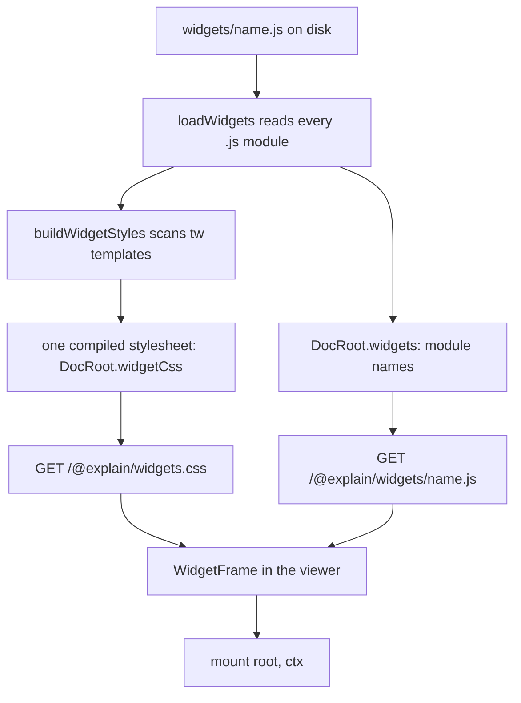

# Widgets

A widget is a small ES module in `widgets/<name>.js` that a page embeds with `<Widget name="…">`. The viewer draws a frame around it and hands the module an empty element to fill. This page follows a widget from the doc root on disk to a mounted element in the browser, and explains the one rule authors trip over: Tailwind classes only work inside `tw` templates.

## The path of a widget



Two halves meet here. The CLI side ([`loadWidgets`](explain:packages/cli/src/doc-root/widgets.ts:7-34) and [`buildWidgetStyles`](explain:packages/cli/src/doc-root/widget-styles.ts:52-106)) runs every time the doc root is loaded, so `explain validate`, `explain dev` and `explain build` all see the same widget list and the same diagnostics. The viewer side ([`WidgetFrame`](explain:packages/viewer/src/blocks/widget.tsx:37-131)) fetches the module and the stylesheet and calls `mount`.

## Loading modules

[`loadWidgets`](explain:packages/cli/src/doc-root/widgets.ts:11-33) lists `widgets/` in sorted order. Every `.js` file becomes a `WidgetModule` named after the file without its extension; every `.css` file is a diagnostic, *widget stylesheets are not supported; style the widget with Tailwind classes*. Other files are ignored. The full set of file names is kept as well, because the page checker uses it to report a `<Widget name="x">` whose `widgets/x.js` does not exist ([check-page.ts](explain:packages/cli/src/doc-root/check-page.ts:60-64)).

[`loadDocRoot`](explain:packages/cli/src/doc-root/load.ts:33) calls it once and stores three things on the `DocRoot` ([load.ts](explain:packages/cli/src/doc-root/load.ts:47-54)): the widget diagnostics join the root-level `errors`, the module names become `widgets`, and the compiled CSS becomes `widgetCss`. See [load-doc-root](./load-doc-root.md) for the rest of that loader.

## Classes live in `tw` templates

A module declares `const tw = String.raw;` and writes every class inside `` tw`…` ``. At runtime `String.raw` is the identity on a template without substitutions, so `` tw`flex gap-2` `` is just the string `"flex gap-2"`. The tag only matters to the CLI, which reads the module as text:

<AnnotatedSource file="explain:packages/cli/src/doc-root/widget-styles.ts:18-50">
<Note lines="18">A `tw` followed by a backtick, not preceded by an identifier character or `$`, so `rowtw` or `$tw` never match. The body is everything up to the next backtick.</Note>
<Note lines="20">Any bracket or parenthesis marks a Tailwind arbitrary value such as `p-[3px]`.</Note>
<Note lines="36-43">A `${` in the body makes the whole template unreadable: the scanner reports it and skips the template instead of guessing.</Note>
<Note lines="44-46">Each whitespace-separated token is a class candidate, with its line and column in the module for diagnostics.</Note>
</AnnotatedSource>

The candidates then go to Tailwind one at a time:

```ts file=explain:packages/cli/src/doc-root/widget-styles.ts:81-91
```

`compiler.build` returns the stylesheet for every candidate it has seen so far, so the output grows only when the new name is a real utility of the theme. That gives the CLI a precise answer per class, and [the diagnostics](explain:packages/cli/src/doc-root/widget-styles.ts:93-104) turn every candidate that did not grow the CSS into *"x" is not a class of the widget theme*, and every arbitrary value into *use a theme class*.

> [!IMPORTANT]
> Tailwind generates CSS only for the class names handed to `compiler.build`, and the only names handed over are tokens inside `tw` templates. A class written in a plain string, a `class=` attribute built by concatenation, or a template with `${…}` gets no CSS at all, with no runtime error.

Why a tag instead of scanning the whole file like Tailwind normally does? Because the scan doubles as validation. Every token inside a `tw` template is *claimed* to be a class, so a typo or a class missing from the theme becomes a diagnostic with a line and column. A whole-file scan would have to treat any word as a possible class and could never report one as wrong (inference: the design intent is not written down, but the diagnostics only make sense under this reading). The cost is that dynamic class names are impossible; the rule is to choose between whole `tw` strings in JS, or toggle a `data-*` attribute, as [widgets.md](explain:skills/explain-this/widgets.md:53-55) says.

The CLI test pins the three outcomes. In the rejected module, line 4 writes `bg-red-500` in an ordinary string and is never read; only the `tw` templates on lines 3 and 5 produce diagnostics. The widget below runs a port of the scanner on the test modules and compares its diagnostics with the ones the test expects.

<Widget name="widgets-tw-scan" title="What the class scanner reads" source="explain:packages/cli/src/doc-root/widget-styles.ts:18-50,93-104 explain:packages/cli/test/explain.test.ts:192-219 explain:packages/cli/test/dev.test.ts:103-119">

Pick one of the widget modules from the CLI tests. The shaded spans are the only text the scanner reads; the table lists each class it found, and the last line checks the port's diagnostics against the test's expected output. Whether a class belongs to the theme is the test's verdict, since Tailwind itself is not ported.

</Widget>

## The widget theme

The compiler's entry is the viewer's [`widgets.css`](explain:packages/viewer/src/styles/widgets.css), resolved through the `@explain/viewer/widgets.css` package export. `buildWidgetStyles` [preloads](explain:packages/cli/src/doc-root/widget-styles.ts:57-75) Tailwind's `theme.css` and `utilities.css` and refuses any other import, so the entry cannot pull in preflight or anything else.

```css file=explain:packages/viewer/src/styles/widgets.css:1-13
```

- **No preflight.** Only theme and utilities are imported, so a widget gets no CSS reset; properties it leaves unset inherit from the page's prose styles.
- **`important` utilities.** The comment says why: the viewer's own CSS is unlayered, and an unlayered rule beats every layered one, so without `!important` any viewer selector reaching into the widget body would override the widget's classes.
- **Tokens replace Tailwind's palette.** `--color-*`, `--font-*`, `--text-*` and `--radius-*` are reset to `initial`, and the [`@theme inline reference`](explain:packages/viewer/src/styles/widgets.css:12-51) block maps the remaining names onto the viewer's custom properties. `inline` makes each utility use the `var(--…)` directly and `reference` keeps Tailwind from emitting the variables itself, because the viewer already defines them on `:root`. The dev server test shows the result: `.bg-raised` becomes `background-color: var(--surface-raised) !important` and `.p-3` becomes `padding: calc(var(--space-1) * 3) !important` ([dev.test.ts](explain:packages/cli/test/dev.test.ts:115-119)).

Since there is one stylesheet for the whole doc root, a class used by any widget is available to all of them.

## Mounting in the viewer

`WidgetFrame` renders the frame itself in React: the title, the tag body as a description, and the `source` citations as links ([widget.tsx](explain:packages/viewer/src/blocks/widget.tsx:95-129)). The module only ever sees the empty `.widget-body` element.

The effect that mounts the module ([widget.tsx](explain:packages/viewer/src/blocks/widget.tsx:45-93)) does four things:

1. If the name is not in the site's `widgets` list, it shows `widgets/<name>.js` as the failure and stops.
2. It imports `/@explain/widgets/<name>.js` and, in parallel, the shared stylesheet. [`loadWidgetStyles`](explain:packages/viewer/src/blocks/widget.tsx:22-35) appends one `<link>` to `<head>` and caches the promise, so the stylesheet loads once per page view no matter how many widgets there are.
3. When both arrive, it checks that the module exports a function `mount` and calls `mount(root, ctx)`. A returned function is kept as cleanup.
4. On unmount, or when the name, props or locale change, it runs the cleanup and empties the element, so a locale switch remounts the widget from scratch.

Any thrown error, including a missing `mount`, is shown in an alert inside the frame instead of breaking the page.

### WidgetContext

```ts file=explain:packages/viewer/src/blocks/widget.tsx:11-16
```

| Member | What it does |
|---|---|
| `props` | The tag attributes other than `name`, `title`, `source`, as strings. They round-trip through `JSON.stringify`, which is also the effect's dependency key. |
| `locale` | The current viewer locale, for picking UI strings. |
| `cite(ref, label?)` | Builds the same `<a class="cite">` markup the frame uses for its sources ([widget.tsx](explain:packages/viewer/src/blocks/widget.tsx:54-65)). The source pane [turns every `data-ref` element](explain:packages/viewer/src/pane/anchors.ts:15-21) in the page into an anchor, so it behaves like any citation in the prose. It sets `data-follow="0"`, which [keeps it out of scroll-following](explain:packages/viewer/src/pane/anchors.ts:27); see [source-pane](./source-pane.md). |
| `readSource(ref)` | Parses the citation, loads the file through the source API, and returns the cited lines ([widget.tsx](explain:packages/viewer/src/blocks/widget.tsx:66-72)). Several ranges are [joined with newlines](explain:packages/viewer/src/ref.ts:45-48), with no marker between them. A missing file throws. |

`readSource` goes through the same `/@explain/api/source/…` route as the source pane, so it can only read files of repos in `explain.json`; see [site](./site.md) for that route.

## Authoring contract

The skill's [widgets.md](explain:skills/explain-this/widgets.md:22-58) is the contract a writer follows. Each rule maps to the code above:

| Rule | Enforced by |
|---|---|
| `name` is `widgets/<name>.js` | the page checker and `WidgetFrame`'s `known` check |
| `source` citations make the page stale when they change | `explain freshness sync` records them like any other citation |
| no widget `.css` files | `loadWidgets` |
| classes inside `tw`, no `${…}`, no arbitrary values, theme classes only | `buildWidgetStyles` |
| base classes `ui-button`, `ui-select`, … are plain strings outside `tw` | they come from the viewer's own CSS, not from Tailwind, so scanning them would report them as unknown |
| show only cases from the cited code or tests | not enforced; it is a writing rule |

> [!TIP]
> A module that needs a literal `` tw` `` in a string, such as a widget about the scanner itself, must build it without the backtick touching `tw` (for example `"tw" + "\x60"`), or the scanner will read the string as a class template.
