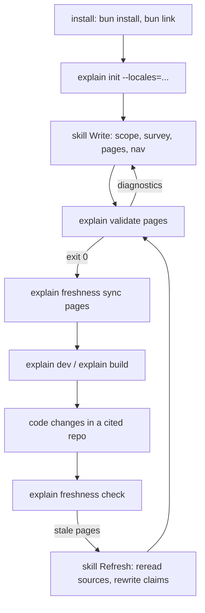

# Author workflow

This page follows one doc root through its life: install the CLI, create the doc root, let an agent write pages, check them, record what they cite, view them, and later refresh them when the code moves. Each step is one command or one skill branch; the [commands](./commands.md) page covers the commands in full.



## 1. Install the CLI

There is no published package. You clone the repo, install the workspace, and `bun link` the CLI package ([README.md](explain:README.md:5-17)). Linking works because `packages/cli` declares `explain` as a bin that points straight at the TypeScript entry ([package.json](explain:packages/cli/package.json:6-8)), and Bun runs that file directly ([main.ts](explain:packages/cli/src/main.ts:1)). That is also why `git pull && bun install` is enough to update: the link points at the source in the clone.

## 2. Create the doc root: `explain init`

```ts file=explain:packages/cli/src/commands/init.ts:11-32
```

`init` turns the current directory into a doc root by writing an `explain.json` with the given locales, no repos and an empty nav. It runs the text through the same decoder as every other command first, so `--locales=` with a malformed tag fails before anything is written, and it refuses to overwrite an existing `explain.json`. Repos, title and nav are left for the agent to fill in; their schema is on [config](./config.md).

Every other command finds the doc root by walking up from the current directory to the nearest `explain.json` ([config.ts](explain:packages/cli/src/doc-root/config.ts:25-35)), so you can run them from a locale folder too.

## 3. Write pages with the agent skill

The skill lives in `skills/explain-this/` and is copied into the agent's skill directory ([README.md](explain:README.md:19-34)). It is marked `disable-model-invocation: true` ([SKILL.md](explain:skills/explain-this/SKILL.md:4)), so it runs only when you name it, as `/skill:explain-this <what to explain>`. Before anything else it checks the two preconditions: `explain.json` exists and `explain` is on `PATH` ([SKILL.md](explain:skills/explain-this/SKILL.md:9-12)). The CLI is the agent's only way to check its work, so the skill stops rather than writing pages it cannot validate.

The skill has two branches, picked by what the user asked for:

<AnnotatedSource file="explain:skills/explain-this/SKILL.md:16-33">
<Note lines="18">Write covers both a new topic and a follow-up question about one already explained.</Note>
<Note lines="23">Scope is settled with the user; the agent does not guess how much of a repo to cover.</Note>
<Note lines="24">Survey adds each repo to `explain.json` `repos`; citations can only name repos listed there.</Note>
<Note lines="25">Each locale is written from the code, not translated, and every claim cites the lines behind it or is marked as inference.</Note>
<Note lines="27">The agent's done condition is the CLI's: `explain validate` exits 0, then `explain freshness sync` succeeds.</Note>
<Note lines="31">Refresh starts from the CLI's stale list, not from the agent's memory of what changed.</Note>
<Note lines="33">Refreshed pages are validated and synced even when their claims still hold, so their recorded hashes catch up.</Note>
</AnnotatedSource>

The skill points the agent at [format.md](explain:skills/explain-this/format.md) for every file it writes ([SKILL.md](explain:skills/explain-this/SKILL.md:14)).

## 4. Check the pages: `explain validate`

[`validate`](explain:packages/cli/src/commands/validate.ts:8-22) loads the whole doc root and prints the diagnostics of the pages you name, or of every page if you name none. It always adds the doc-root-wide errors as well, which come from `explain.json` repos ([load.ts](explain:packages/cli/src/doc-root/load.ts:44-50)). A page's diagnostics cover every kind: a missing page, parse errors, bad page links, a malformed sources file, and citation problems such as a cited file that does not exist, is not a file, or is shorter than the cited range ([resolve-source.ts](explain:packages/cli/src/doc-root/resolve-source.ts:74-92), [validate.ts](explain:packages/cli/src/commands/validate.ts:17)). Any diagnostic exits with code 2. The rules behind citations are on [citation](./citation.md) and [resolve-source](./resolve-source.md); the page grammar on [parse-page](./parse-page.md).

## 5. Record what the pages cite: `explain freshness sync`

### Why freshness exists

A page is a set of claims about code at one moment. The code keeps moving; the page does not. Nothing in a Markdown page tells you that the function it describes was rewritten last week. Freshness closes that gap: at sync time the CLI records a hash of every file the page cites, and on every later load it hashes those files again and compares.

[`sync`](explain:packages/cli/src/commands/freshness/sync.ts:10-30) requires at least one page argument and refuses any page that did not parse or still has a parse error or a citation problem, so a recorded snapshot always belongs to a page whose citations resolve. A bad page link or a malformed sources file does not stop it. For each accepted page it writes `<locale>/<id>.sources.json` with one entry per cited file ([freshness.ts](explain:packages/cli/src/doc-root/freshness.ts:72-76)):

```ts file=explain:packages/contract/src/sources.ts:7-11
```

The hash is a SHA-1 over `blob <length>\0` followed by the file bytes ([freshness.ts](explain:packages/cli/src/doc-root/freshness.ts:17-31)), which is how git computes a blob id (inference: same value as `git hash-object`, not checked against git here). Files are hashed whole, not per cited range, so any edit to a cited file marks the page stale even if the cited lines did not move.

### Checking later: `explain freshness check`

[`check`](explain:packages/cli/src/commands/freshness/check.ts:28-59) walks every page, prints each stale one with its reasons, and exits 1 when anything is stale or could not be checked. The reasons come from comparing what the page cites now with what was recorded ([compareSources](explain:packages/cli/src/doc-root/freshness.ts:34-70)):

| Reason | Printed as | Meaning |
|---|---|---|
| `sources-missing` | `no sources file; run explain freshness sync …` | the page was never synced |
| `sources-malformed` | `… is malformed; run explain freshness sync …` | the sources file does not decode; syncing rewrites it |
| `not-recorded` | `… is cited but not hashed` | the page cites a file that was added after the last sync |
| `not-cited` | `… is hashed but no longer cited` | the page dropped a citation since the last sync |
| `missing` | `… no longer exists` | a recorded file is gone from disk |
| `changed` | `… changed` | a recorded file's hash differs |

The printed texts are from [`describeReason`](explain:packages/cli/src/commands/freshness/check.ts:10-26). A page that is missing, fails to parse, or cites an unknown repo or a path outside the repo is listed as `not checked` and sends you back to `validate`. The comparison runs inside `loadDocRoot`, so the viewer gets the same verdict: the nav marks each page's status ([api-bodies.ts](explain:packages/cli/src/site/api-bodies.ts:18-27)). How the hashes are stored and compared is covered on [freshness](./freshness.md) and [sources](./sources.md).

> [!IMPORTANT]
> `sync` is the only thing that writes `.sources.json`, and it only runs on pages whose citations all resolve. A fresh page therefore means: its citations resolved when it was last synced, and no file it cites has changed since.

## 6. View or publish: `explain dev` and `explain build`

<Tabs>
<Tab label="explain dev">

[`dev`](explain:packages/cli/src/commands/dev.ts:9-28) serves the doc root, prints the URL, and runs until stopped. Without `--port` it starts at 4321 and Vite moves to the next free port if that one is taken; the printed URL is the one Vite actually bound ([site/dev.ts](explain:packages/cli/src/site/dev.ts:140-143)). With `--port` the port is strict: if it is taken, `dev` prints `explain dev: Port N is already in use` and exits 2. It watches the doc root and every repo listed in `explain.json` and reloads on any change ([site/dev.ts](explain:packages/cli/src/site/dev.ts:32,55-60,68-78)), so you can keep it open while the agent writes. It does not refuse pages with diagnostics; it serves them, diagnostics included, in the page response ([api-bodies.ts](explain:packages/cli/src/site/api-bodies.ts:87-104)).

</Tab>
<Tab label="explain build">

[`build`](explain:packages/cli/src/commands/build.ts:10-35) is stricter: it refuses if *any* page in the doc root has a diagnostic, not only the ones you touched. By default it writes to `dist/` inside the doc root; `--out` picks another directory. It will not overwrite a non-empty directory that is not a previous explain build ([build.ts](explain:packages/cli/src/site/build.ts:77-85)). Stale pages are not a build error; they ship with their stale badge.

</Tab>
</Tabs>

Both serve the same JSON through the same handler; [overview](./overview.md) shows how, and [site](./site.md) covers the details.

## 7. When the code changes

Run `explain freshness check` from the doc root, then invoke `/skill:explain-this` again ([README.md](explain:README.md:33-34)). The skill takes the Refresh branch, reads each listed source file in full, rewrites what no longer holds, and finishes with the same validate and sync as step 4 and 5. If the change added something the pages do not cover yet, Refresh falls back to the Write steps for it ([SKILL.md](explain:skills/explain-this/SKILL.md:32)).

<details>
<summary>Exit codes</summary>

Commands fail through [`ExitWith`](explain:packages/cli/src/commands/exit-with.ts:4-9), which carries code 1 or 2.

| Command | 0 | 1 | 2 |
|---|---|---|---|
| `init` | wrote `explain.json` | | `explain.json` exists or locales invalid |
| `validate` | no diagnostics | | diagnostics, or an argument is not a page |
| `freshness sync` | all named pages synced | | a page has a parse error or citation problem, or is not a page |
| `freshness check` | every page fresh | a page is stale or not checked | |
| `dev` | | | server failed to start, or an explicit `--port` is taken |
| `build` | site written | | diagnostics, or the build failed |

Every command that opens a doc root also exits 2 when no `explain.json` is found or it is invalid ([open-doc-root.ts](explain:packages/cli/src/commands/open-doc-root.ts:30-40)).

</details>
