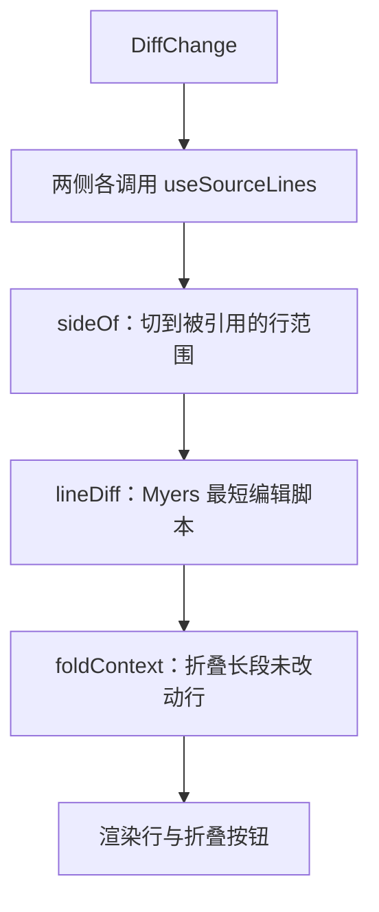

# 块渲染：把 Page AST 画成页面

CLI 把每个页面解析成一个 `Page`，正文是由 `Block` 和 `Inline` 节点组成的树（见[页面模型](./page-model.md)）。查看器在 `packages/viewer/src/blocks/` 里把这棵树变成 DOM：一个 `switch` 按节点类型分派给对应的 React 组件；凡是指向代码的元素都带上 `data-ref` 属性，[源码面板](./source-pane.md)靠这个属性找到它们，块组件本身完全不知道面板的存在。

## 每种节点一个分支

[`BlockView`](explain:packages/viewer/src/blocks/blocks.tsx:30-160) 是对 `block.type` 的一个 `switch`，`default` 分支写的是 [`block satisfies never`](explain:packages/viewer/src/blocks/blocks.tsx:157-158)：往 [`Block` 联合类型](explain:packages/contract/src/page.ts:60-107)里加一个新成员却忘了写渲染分支，类型检查就会失败。[`Inlines`](explain:packages/viewer/src/blocks/inlines.tsx:11-64) 对 [`Inline` 联合类型](explain:packages/contract/src/page.ts:12-26)用的是同一套写法。

[`Blocks`](explain:packages/viewer/src/blocks/blocks.tsx:17-28) 负责渲染一串块；传入 `lede` 时，第一个段落会加上 `lede` 类名。只有页面路由在渲染正文时传了它（[page-route.tsx](explain:packages/viewer/src/routes/page-route.tsx:135)），所以嵌套在提示框、标签页里的段落不会被当成导语。需要某个具体变体的组件用 [`BlockOf<"tree">`](explain:packages/viewer/src/blocks/blocks.tsx:15) 这样的类型取出它，不必重复声明字段。

| `Block` 类型 | 渲染者 | 画出来的样子 |
|---|---|---|
| `heading` | [`BlockView` 内联分支](explain:packages/viewer/src/blocks/blocks.tsx:39-49) | `h2`–`h4`，带解析出的 `id` 和 `#` 锚点 |
| `paragraph` | [内联分支](explain:packages/viewer/src/blocks/blocks.tsx:50-55) | `p`，正文首段带 `lede` |
| `list` | [内联分支](explain:packages/viewer/src/blocks/blocks.tsx:56-84) | `ol`/`ul`；只要有一项带 `checked`，整张列表都画成禁用的复选框 |
| `table` | [内联分支](explain:packages/viewer/src/blocks/blocks.tsx:85-111) | 外面包一层可聚焦的滚动区域，列对齐来自 `align` |
| `alert` | [内联分支](explain:packages/viewer/src/blocks/blocks.tsx:112-121) | `aside.alert-<kind>`，带图标和本地化标签 |
| `quote`、`thematicBreak`、`details` | [内联分支](explain:packages/viewer/src/blocks/blocks.tsx:122-144) | `blockquote`、`hr`、原生 `details`/`summary` |
| `code` | [`CodeBlock`](explain:packages/viewer/src/blocks/code.tsx:79-99) | 高亮后的字面代码，带复制按钮 |
| `excerpt` | [`Excerpt`](explain:packages/viewer/src/blocks/code.tsx:135-188) | 从仓库读出的带行号代码，标题是被引用的路径 |
| `mermaid` | [`Mermaid`](explain:packages/viewer/src/blocks/mermaid.tsx:24-69) | 按需加载 beautiful-mermaid 生成的 SVG |
| `tree` | [`TreeView`](explain:packages/viewer/src/blocks/tree.tsx:7-61) | 嵌套的 `details`，每个节点分名称和说明 |
| `tabs` | [`TabsView`](explain:packages/viewer/src/blocks/tabs.tsx:11-79) | 支持键盘操作的 ARIA 标签页 |
| `beforeAfter` | [`BeforeAfterView`](explain:packages/viewer/src/blocks/before-after.tsx:14-93) | 左右两栏，“之后”一侧没有的列表项被划掉 |
| `annotatedSource` | [`AnnotatedSourceView`](explain:packages/viewer/src/blocks/annotated-source.tsx:7-41) | 一列编号注释；代码本身显示在源码面板里 |
| `diff` | [`Diff`](explain:packages/viewer/src/blocks/diff.tsx:21-27) | 在浏览器里现算的统一格式行级 diff |
| `widget` | [`WidgetFrame`](explain:packages/viewer/src/blocks/widget.tsx:37-131) | 一个外框，动态导入并挂载 `widgets/<name>.js` |

## 引用只是几个属性 {#citations}

`citation` 内联节点渲染成一个普通链接（[inlines.tsx](explain:packages/viewer/src/blocks/inlines.tsx:44-54)）：`href` 指向该文件的源码路由并带上 `#L<首行>`（[`sourceHref`](explain:packages/viewer/src/ref.ts:40-43)），`data-ref` 是格式化后的引用字符串，没有行范围时 `data-kind` 为 `file`，否则为 `cite`。摘录、diff 行号、注释按钮、组件的来源列表输出的也是同一组属性。

面板这一侧在页面里查询所有 `[data-ref]` 元素，把属性值重新解析成 `Ref`（[`discoverAnchors`](explain:packages/viewer/src/pane/anchors.ts:11-31)）。悬停、聚焦、点击事件都委托在页面根节点上处理；普通左键点击会 `preventDefault`，改为在面板里切换或固定这个锚点（[`onClick`](explain:packages/viewer/src/pane/input.ts:56-67)）。按住 ⌘、Ctrl 或 Shift 的点击，以及非主键的点击，会直接返回，于是 `href` 仍然有效，比如可以在新标签页里打开该文件的源码页。Alt 不在检查之列，按住 Alt 点击和普通点击一样被拦下。

| 属性 | 取值 | 对面板的作用 |
|---|---|---|
| `data-ref` | `repo:path[:ranges]` | 显示哪些行 |
| `data-kind` | `cite`、`file`、`excerpt`、`note` | 锚点的种类 |
| `data-follow` | `"0"` 或不写 | 为 `"0"` 时，滚动阅读时面板不会自动跟随到这个锚点（[anchors.ts](explain:packages/viewer/src/pane/anchors.ts:27)、[controller.ts](explain:packages/viewer/src/pane/controller.ts:187-189)） |

`data-follow="0"` 用在次要链接上：摘录标题、diff 的每个行号、组件里的引用。摘录外层的 `figure` 自己带 `data-kind="excerpt"` 而不带 `data-follow`（[code.tsx](explain:packages/viewer/src/blocks/code.tsx:148)），所以滚动时面板把整段摘录当作一个锚点来跟随，不会被标题链接抢走。

> [!IMPORTANT]
> `blocks/` 下没有任何文件从 `pane/` 导入东西。两者之间只靠 DOM 约定：`data-ref`、`data-kind`、`data-follow` 三个属性，注释按钮上的 `data-index` 编号，以及面板用来收集同组注释时查询的 `note`、`annotated` 两个类名（[anchors.ts](explain:packages/viewer/src/pane/anchors.ts:33-39)、[controller.ts](explain:packages/viewer/src/pane/controller.ts:229)）。链接上的 `cite` 类名只给 CSS 用。新写的块如果要指向代码，就必须输出这些属性，面板才能接上它。

## 字面代码与摘录

两者都画成一个带标题栏和复制按钮的 `figure`，区别在于文本从哪里来。

<Tabs>
<Tab label="字面代码">

代码就在 AST 里，`CodeBlock` 按围栏的语言同步高亮，复制时原样复制 `value`。

```tsx file=explain:packages/viewer/src/blocks/code.tsx:79-99
```

</Tab>
<Tab label="摘录">

AST 里只有一个 `Ref`。[`useSourceLines`](explain:packages/viewer/src/blocks/code.tsx:14-32) 通过 [`loadSourceLines`](explain:packages/viewer/src/data.ts:49-60) 取文件：每个 `repo:path` 只请求一次源码接口，去掉末尾换行、按行切开，再按文件扩展名高亮。同一页里引用同一个文件的摘录、diff 和组件共享这一个 Promise。

```tsx file=explain:packages/viewer/src/blocks/code.tsx:138-146
```

没有行范围就显示整个文件。起点超出文件末尾的范围被丢掉，其余的截到文件末尾，所以文件变短后摘录只会变短，不会报错。两个范围之间插入一行 `⋮` 作为间隔（[code.tsx](explain:packages/viewer/src/blocks/code.tsx:173-183)）。加载中显示骨架，文件不存在时显示 [`MissingFile`](explain:packages/viewer/src/blocks/code.tsx:122-133)；复制按钮只复制被引用的那些行（[`citedLines`](explain:packages/viewer/src/ref.ts:45-48)）。

</Tab>
</Tabs>

## Diff

`<Diff before=… after=… />` 被解析成一个 `diff` 块，其 `change` 是 `modified`、`added` 或 `deleted` 三者之一（[`DiffChange`](explain:packages/contract/src/page.ts:55-58)）。解析器只保存两个引用，diff 本身每次渲染时都在浏览器里根据磁盘上的当前文件计算。



[`Diff`](explain:packages/viewer/src/blocks/diff.tsx:21-43) 加载两侧文件；新增或删除的文件缺的那一侧用一个空文件代替。[`sideOf`](explain:packages/viewer/src/blocks/diff.tsx:45-55) 把每一侧切到它的第一个行范围，并记下起始行 `from`，这样 `lineDiff` 返回的从 0 开始的下标就能用 `from + index` 换算回文件行号。每个行号本身就是一条单行引用（[`gutter`](explain:packages/viewer/src/blocks/diff.tsx:84-99)），所以 diff 里任何一行都能在源码面板里打开。标题栏统计删除和新增的行数（[diff.tsx](explain:packages/viewer/src/blocks/diff.tsx:144-145)）。

### `lineDiff` 怎么算

[`lineDiff`](explain:packages/viewer/src/blocks/line-diff.ts:10-60) 是 Myers 的贪心最短编辑脚本算法。把 `before` 放在 x 轴、`after` 放在 y 轴，组成一张网格：向右走一步表示删除 `before[x]`，向下走一步表示新增 `after[y]`，两行相等时可以免费沿对角线走。算法要找一条从 `(0, 0)` 到 `(n, m)`、非对角线步数最少的路径，再把这条路径倒着读成一行行结果。

<AnnotatedSource file="explain:packages/viewer/src/blocks/line-diff.ts:10-60">
<Note lines="14-19">`k = x - y` 标识一条对角线。`reach[offset + k]` 记录在对角线 `k` 上走到的最远 `x`；`offset = n + m + 1` 保证 `k ± 1` 不会越出 `Int32Array`。`stepsDown` 决定进入对角线 `k` 的方式：从 `k + 1` 向下走（新增），还是从 `k - 1` 向右走（删除）。在边界 `k = -d`、`k = d` 上没得选，其余情况选走得更远的邻居；两边一样远时向右，所以删除排在新增前面。</Note>
<Note lines="21-22">第 `d` 轮探索所有恰好含 `d` 次编辑的路径。每轮开始前把整个 `reach` 复制一份存进 `trace`，回溯时要用。</Note>
<Note lines="23-27">对 `d` 次编辑能到达的每条对角线（从 `-d` 到 `d`，隔一条取一条），从更好的邻居那里走出这一步编辑。</Note>
<Note lines="28-31">“蛇形”滑行：只要两行相等就沿对角线一直往下走。比较是对原始行做 `===`，不忽略空白。</Note>
<Note lines="32-33">记下新的最远 `x`。第一次到达 `(n, m)` 的那一轮结束搜索，此时的 `d` 就是最少编辑次数。</Note>
<Note lines="36-49">从 `(n, m)` 出发，按从后往前的顺序使用快照回溯。对第 `d` 轮，用 `stepsDown` 重新算出路径来自哪条相邻对角线、那条对角线当时的最远点在哪；从那里到当前点之间的对角线部分都是未改动的上下文行。</Note>
<Note lines="50-58">第 0 轮没有编辑步骤。其余各轮里，如果 `x` 没动，说明这一步是竖着走的，即新增了 `after[previousY]`；否则就是删除了 `before[previousX]`。</Note>
<Note lines="59">结果是从末尾往开头收集的，最后整体反转。</Note>
</AnnotatedSource>

从循环结构可以直接读出代价：轮数止于编辑距离 `D`，每轮最多处理 `2D + 1` 条对角线，`trace` 存了 `D + 1` 份长度为 `2(n + m + 1) + 1` 的数组。`<Diff>` 引用的通常只是几十行，这点开销可以忽略。代码里没有说明为什么自带一个 60 行的 diff 而不用依赖库；可能的原因是这样一个小函数能直接产出 `diff.tsx` 需要的行结构（推断）。

### 折叠未改动的行

[`foldContext`](explain:packages/viewer/src/blocks/line-diff.ts:62-92) 把行分成 `shown` 和 `folded` 两种片段。连续的上下文行超过 `foldOver = 6` 行时，两端各保留 `keep = 3` 行，中间折叠；六行及以下原样保留。开头和结尾的那段也按同样规则处理，所以即使改动在范围深处，diff 打开时仍先显示前三行。

```ts file=explain:packages/viewer/src/blocks/line-diff.ts:62-80
```

`DiffFigure` 把折叠片段画成一个按钮，按钮上写着折叠的行数；点击后把该片段的下标加入 `opened` 集合，这些行就在原地展开（[diff.tsx](explain:packages/viewer/src/blocks/diff.tsx:177-193)）。

<Widget name="blocks-line-diff" title="在测试用例上运行 lineDiff 与 foldContext" source="explain:packages/viewer/src/blocks/line-diff.ts explain:packages/viewer/src/blocks/line-diff.test.ts">

从 `line-diff.test.ts` 里选一个用例。组件用 JavaScript 移植版的 `lineDiff` 或 `foldContext` 处理该用例的输入，按 diff 块的列布局画出结果（修改前行号、修改后行号、符号、文本），并与测试里的期望值逐项比对。行号直接用 `lineDiff` 返回的从 0 开始的下标，与测试一致，而不是 diff 块里显示的文件行号。

</Widget>

## 其他组件

### Tree

[`TreeNode`](explain:packages/viewer/src/blocks/tree.tsx:19-61) 拆分每一项的标签：如果第一个内联节点不是纯文本（比如行内代码或引用），它就是节点名称，其余部分是说明；说明开头的空白或 `·` 由 [`trimStart`](explain:packages/viewer/src/blocks/blocks.tsx:175-180) 去掉。分支用原生 `details`，`depth < open` 时默认展开，`open` 缺省为 1（[tree.tsx](explain:packages/viewer/src/blocks/tree.tsx:12)）。树节点里的引用就是普通的引用内联节点，照样能连到源码面板。

### Tabs

[`TabsView`](explain:packages/viewer/src/blocks/tabs.tsx:11-79) 按 ARIA 标签页模式实现：可移动的 `tabIndex`，左右方向键循环切换，Home/End 跳到首尾。所有面板都留在 DOM 里，未选中的加 `hidden`（[tabs.tsx](explain:packages/viewer/src/blocks/tabs.tsx:64-76)）。面板依赖这一点：祖先带 `[hidden]` 的锚点被视为不可见（[geometry.ts](explain:packages/viewer/src/pane/geometry.ts:12-14)），所以未选中标签页里的引用不会参与滚动跟随。

### BeforeAfter

[`BeforeAfterView`](explain:packages/viewer/src/blocks/before-after.tsx:14-93) 是为列表设计的。它先统计“之后”一侧每个列表项规范化后的文本出现了几次，再遍历“之前”一侧，计数用完的项就被划掉，相当于求多重集合的差（[before-after.tsx](explain:packages/viewer/src/blocks/before-after.tsx:31-43)）。以行内代码开头的项会把那段代码显示成角色标签。`IntersectionObserver` 发现块进入视口后才播放划线动画，各项按 `--i` 自定义属性依次错开（[before-after.tsx](explain:packages/viewer/src/blocks/before-after.tsx:18-30)）。非列表的子块走普通的 `BlockView`。

### AnnotatedSource

这个块本身不画代码。[`AnnotatedSourceView`](explain:packages/viewer/src/blocks/annotated-source.tsx:7-41) 只渲染一个标题栏和每条注释对应的按钮，按钮带 `data-kind="note"`，`data-ref` 缩小到该注释的行。某条注释被显示时，面板会收集同一个 `.annotated` 容器里所有的 `.note`，把整段代码连同所有注释标记一起画出来（[controller.ts](explain:packages/viewer/src/pane/controller.ts:228-229)、[`noteMarkers`](explain:packages/viewer/src/pane/anchors.ts:33-39)）。

### Mermaid

[`Mermaid`](explain:packages/viewer/src/blocks/mermaid.tsx:24-47) 第一次用到时才导入 `beautiful-mermaid`，渲染用的[主题](explain:packages/viewer/src/blocks/mermaid.tsx:9-22)颜色全部是查看器的 CSS 变量，所以图表跟随页面配色，而不是写死的颜色。它还会删掉 SVG 里的 `@import url(…)` 规则，并在字体栈里加上中文字体。渲染失败时显示错误信息，并在 `details` 里附上图表源码（[mermaid.tsx](explain:packages/viewer/src/blocks/mermaid.tsx:58-66)）。

### Widget

[`WidgetFrame`](explain:packages/viewer/src/blocks/widget.tsx:37-131) 画出标题、说明和来源引用，然后同时导入 `/@explain/widgets/<name>.js` 与共享的组件样式表，调用模块的 `mount`；传入的上下文里，`cite` 生成的也是上文那种 `a.cite` 元素。名称不在站点的组件列表里，或者模块没有导出 `mount`，外框里会显示错误。模块约定以及 CLI 如何提供组件，见[组件](./widgets.md)一页。
