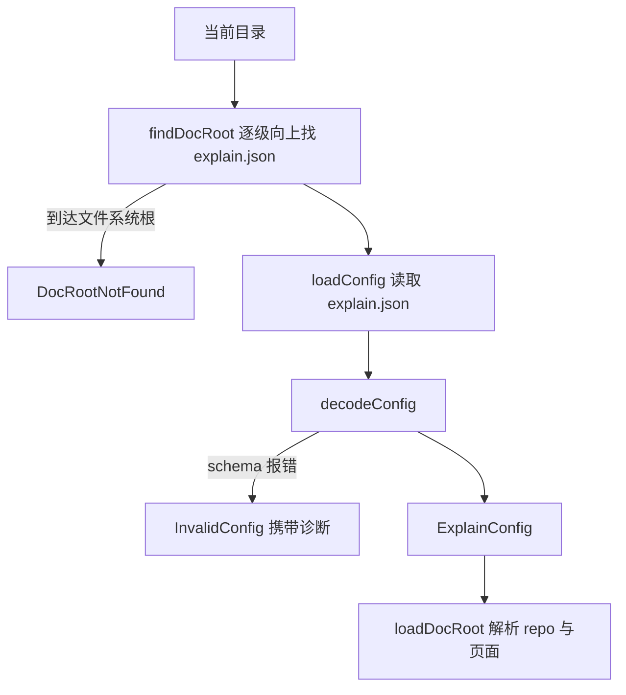

# explain.json 与 CLI 如何找到它

只要一个目录里有 `explain.json`，它就是文档根目录。这一个文件写明站点标题、语言、引用可以指向的 repo，
以及导航。它的 schema 在 contract 包里，用 Effect `Schema` 写成
（[config.ts](explain:packages/contract/src/config.ts)）；CLI 负责找到这个文件、用这个 schema 解码，
再把失败转换成 `file:line:column message` 格式的诊断
（[doc-root/config.ts](explain:packages/cli/src/doc-root/config.ts)）。

## 字段

```ts file=explain:packages/contract/src/config.ts:49-59
```

| 字段 | 必填 | 规则 |
|---|---|---|
| `title` | 否 | 所有语言共用一个字符串；缺省时由 CLI 在站点响应里填入 `Document`，viewer 只是照着显示（[api-bodies.ts](explain:packages/cli/src/site/api-bodies.ts:46)） |
| `locales` | 是 | 非空、不重复，每项是 `en`、`zh-CN` 这类 BCP 47 风格的标签（[config.ts](explain:packages/contract/src/config.ts:9-13,42-47)） |
| `defaultLocale` | 否 | 缺省为第一个语言；必须出现在 `locales` 里 |
| `repos` | 是 | key → 绝对路径；key 的规则与引用里的 repo key 相同（[config.ts](explain:packages/contract/src/config.ts:22-35)） |
| `nav` | 是 | 若干 `{ title, pages }` 分组；`title` 是单个字符串；页面 id 须匹配 `^[a-z0-9][a-z0-9-]*$`、不能是 `source`、全局只出现一次（[config.ts](explain:packages/contract/src/config.ts:5-7,15-20,37-40)） |

其中有两条规则是为了让别处的格式不产生歧义：

- repo key 用的是解析引用时的同一个 `repoKeyProblem`，所以像 `http` 这种页面里永远无法引用的 key，在配置里就被拒绝。
  详见 [citation](./citation.md)。
- 页面 id `source` 被保留，因为 viewer 的路由把 `/<locale>/source?…` 留给了源码视图
  （[router.ts](explain:packages/viewer/src/router.ts:23-28)）。

## `nav` 就是页面清单

没有单独的页面列表。`navPageIds` 按顺序把各分组的页面 id 拼起来：

```ts file=explain:packages/contract/src/config.ts:99-100
```

加载器在每种语言下只读这些 id（[load.ts](explain:packages/cli/src/doc-root/load.ts:25-31)）。不在 nav 里的
Markdown 文件根本不会被解析；nav 里有、磁盘上没有的页面，会变成带诊断的 "missing" 页面
（[check-page.ts](explain:packages/cli/src/doc-root/check-page.ts:34-37)）。页面链接也是对照同一个集合检查的
（[check-page.ts](explain:packages/cli/src/doc-root/check-page.ts:55-59)）。同一个页面若出现两次，就会在阅读顺序里占两个位置，
schema 禁止重复大概就是为此（推断）。

## `defaultLocale`：文件里可省，内存里一定有

这个 schema 有两种形态：文件形态里 `defaultLocale` 可选，解码后的类型里它必定存在。

<AnnotatedSource file="explain:packages/contract/src/config.ts:61-95">
<Note lines="62-63">`decodeTo` 的目标结构里 `defaultLocale` 是必填的 `Locale`，所以 `ExplainConfig.Type` 上它不会是 undefined。</Note>
<Note lines="65-68">解码时，缺失的 `defaultLocale` 用 `locales[0]` 补上。`Locales` 已被收窄成非空元组，这个下标一定有值。</Note>
<Note lines="69">编码时原样输出，所以重新编码的配置会保留补上的默认值。</Note>
<Note lines="75-80">跨字段的规则在解码后的值上执行：默认语言必须在 `locales` 里。</Note>
<Note lines="81-92">每个重复的页面 id 单独报一条，路径形如 `nav.1.pages.0`，指向重复出现的那一处。</Note>
</AnnotatedSource>

因此使用方读 `config.defaultLocale` 时不用再写兜底。站点响应把它原样交给 viewer
（[api-bodies.ts](explain:packages/cli/src/site/api-bodies.ts:44-52)），viewer 在首页重定向和遇到未知语言时使用它
（[app.tsx](explain:packages/viewer/src/app.tsx:35-55)）。

测试固定了这两种行为，并为每条规则各写了一个拒绝用例：

```ts file=explain:packages/contract/src/config.test.ts:22-55
```

## 查找并加载配置



`findDocRoot` 从工作目录开始，逐级检查父目录里有没有 `explain.json`，所以在文档根目录的任何子目录里都能运行命令：

```ts file=explain:packages/cli/src/doc-root/config.ts:25-35
```

`decodeConfig` 一步完成 JSON 解析和 schema 解码：

<AnnotatedSource file="explain:packages/cli/src/doc-root/config.ts:37-58">
<Note lines="39">`errors: "all"` 收集 schema 找到的全部问题，而不是遇到第一个就停。</Note>
<Note lines="40">`onExcessProperty: "error"` 让未知字段（比如拼错的字段名）报错，而不是被悄悄忽略。</Note>
<Note lines="45">Effect 的 Standard Schema 格式化器把嵌套的问题树压平成 `{ path, message }` 列表。</Note>
<Note lines="47-49">这里拿不到 JSON 里的位置，所以每条诊断都指向 `explain.json:1:1`。</Note>
<Note lines="50-53">问题路径用点连接后放在消息前面，得到 `repos.http: …`、`nav.1.pages.0: …` 这样的文本。</Note>
</AnnotatedSource>

两种错误都是 `Schema.TaggedError`，调用方按 tag 决定怎么处理：

| 调用方 | `DocRootNotFound` | `InvalidConfig` |
|---|---|---|
| 所有需要打开文档根目录的命令（[open-doc-root.ts](explain:packages/cli/src/commands/open-doc-root.ts:35-43)） | 打印 `no explain.json in … or any parent directory`，退出码 2 | 逐条打印诊断，退出码 2（[open-doc-root.ts](explain:packages/cli/src/commands/open-doc-root.ts:9-17)） |
| `explain init`（[init.ts](explain:packages/cli/src/commands/init.ts:22-24)） | 不适用 | 先校验将要写入的配置，失败则什么都不写 |
| `explain dev` 重新加载（[dev.ts](explain:packages/cli/src/site/dev.ts:29-42)） | 不适用 | 继续提供服务，进入列出诊断的 `invalid` 状态 |

### 问题是分层报出来的

对几份有错的配置运行 `explain validate`，可以看到 schema 分阶段报错。下面这份配置里有重复的语言、相对路径的 repo、
被保留的页面 id、未知字段 `titel`，结果只报出了字段级的问题：

```text
explain.json:1:1 titel: Expected no excess property
explain.json:1:1 locales: locales must be unique
explain.json:1:1 repos.http: repo path "rel" must be absolute
explain.json:1:1 nav.0.pages.0: page id "source" is reserved
```

同一份文件里被保留的 repo key `http`、不在 `locales` 里的 `defaultLocale`、在 nav 里出现两次的页面都没有报。
修好字段级问题后，`repos` 的 key 检查报出 `repos.http: repo key "http" is reserved`；再修好它，整体检查才同时报出
`defaultLocale "en" is not listed in locales` 和 `nav.1.pages.0: page "x" appears more than once in nav`。
用 `.check` 挂在 record 或 struct 上的过滤器，要等其成员全部解码成功后才执行（推断：依据上面几次运行的结果，以及这些检查在
[config.ts](explain:packages/contract/src/config.ts:28-35,72-95) 里挂载的位置）。

> [!NOTE]
> 修好 `explain.json` 之后，下一次运行可能冒出新的错误。这是 schema 分层检查的结果，并不说明之前的修改有误。

## schema 不检查什么

schema 只检查 repo 路径是不是绝对路径。它是否真是一个目录，要等之后的 `resolveRepos` 检查；
不是目录时报 `repos.<key>: … is not a directory`，作为文档根目录的错误，而不会让配置解码失败
（[resolve-source.ts](explain:packages/cli/src/doc-root/resolve-source.ts:18-37)）。之后页面如何加载，见
[load-doc-root](./load-doc-root.md)。
