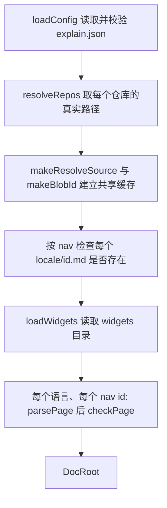

# 加载文档根

所有面向已有文档根的命令都只调用一次 `loadDocRoot`，之后只读它返回的值。加载过程不会因为某一页坏了就停下：它读 `explain.json`、解析仓库路径、逐个语言逐个页面地检查，最后交回一个 `DocRoot`，每一页自己记录自己的问题。正因如此，`validate` 能一次列出所有问题，`dev` 也能预览写了一半的文档根。

## 结果长什么样

```ts file=explain:packages/cli/src/doc-root/types.ts:24-57
```

`DocRoot.errors` 放不属于任何单页的问题：`explain.json` 里某个仓库路径不是目录，以及 `widgets/` 下有问题的模块。`resolveSource` 是之后所有步骤读取被引用文件的唯一入口，见[解析源文件](./resolve-source.md)。

`pages` 的每一项是 `DocPage`，按 `status` 分三种：

| `status` | 何时出现 | 携带什么 |
|---|---|---|
| `missing` | `nav` 列了这个 id，但 `<locale>/<id>.md` 不存在 | 一条说明缺失的错误 |
| `invalid` | Markdown 没能解析出 `Page` | 解析错误 |
| `parsed` | 解析成功 | `page`、`errors`、`refProblems`、当前的 `sources`、记录下的 `recorded`、以及 `freshness` |

三种都带同样的地址字段：`locale`、`id`、`file`（`<locale>/<id>.md`）和 `sourcesFile`（`<locale>/<id>.sources.json`）。命令行里的页面参数就是和 `file` 比对的。

## 加载流程



<AnnotatedSource file="explain:packages/cli/src/doc-root/load.ts:14-56">
<Note lines="19">只有文档根级别的失败才会中止加载：`explain.json` 解码失败表现为 `InvalidConfig`，读配置、页面或组件时的文件系统错误表现为 `PlatformError`。单个页面的问题从不中止加载。</Note>
<Note lines="21-23">解析器和哈希函数各自带缓存，整个加载过程共用一份：同一个文件被十个页面引用，也只读一次、算一次哈希。</Note>
<Note lines="25-31">页面集合来自 `nav`，不是目录列表。不在 `nav` 里的 Markdown 文件根本不会被读取。</Note>
<Note lines="33">先加载小部件，这样每页都能查询 `widgets/<name>.js` 是否存在。</Note>
<Note lines="35-38">文件不存在时返回 `undefined`，由 `checkPage` 变成 `missing` 页面。</Note>
<Note lines="51">仓库错误和小部件错误合并成文档根级别的 `errors`。</Note>
</AnnotatedSource>

解析本身是纯函数，放在 contract 包里（见[解析页面](./parse-page.md)）；`loadDocRoot` 只负责读文件，把文本和 id 交给 `parsePage`。

## checkPage 检查什么

`checkPage` 把一次解析结果变成一个 `DocPage`。它不会因为页面有问题而失败，只记录诊断。每条诊断都有文件、从 1 开始的行列号和消息（[Diagnostic](explain:packages/cli/src/doc-root/types.ts:10-15)）。

```ts file=explain:packages/cli/src/doc-root/check-page.ts:34-43
```

文件缺失时直接返回 `missing`；解析出错时先把解析错误逐条记下，如果连 `Page` 都没有，就返回 `invalid`。其余检查只对 `parsed` 页面进行。

### 引用

页面里的每一处引用，无论来自链接、`file=` 摘录、`AnnotatedSource`、`Diff` 还是 `Widget source`，解析器都放进了 `page.refs`。`checkPage` 逐个交给解析器，再按结果分到两份列表里：

```ts file=explain:packages/cli/src/doc-root/check-page.ts:45-54
```

| 解析结果 | 去向 | 为什么 |
|---|---|---|
| `unknown-repo` | `errors` | 仓库键写错了，改代码救不回来 |
| `escapes` | `errors` | 路径经符号链接跑出了仓库，这是页面不该引用的东西 |
| `missing` | `refProblems` | 文件被删了，是代码变了 |
| `not-a-file` | `refProblems` | 路径现在是目录等非文件 |
| `file` 但行号范围超出文件末尾 | `refProblems` | 文件变短了 |

> [!IMPORTANT]
> `errors` 是页面自身写错了；`refProblems` 是代码从页面脚下挪走了。`validate`、`sync`、`build` 两份都看，有任何一条就拒绝；`freshness check` 只跳过有 `errors` 的页面。因此被引用文件被删掉的页面会在 `check` 里显示为**过期**，而不是“未检查”，刷新流程就能据此找到受影响的页面。各命令怎么取舍见[命令](./commands.md)。

同一个循环还填好了 `cited`：以仓库加路径为键的映射。同一个文件引用五个行号范围，也只算一个文件。

### 页面链接和小部件

```ts file=explain:packages/cli/src/doc-root/check-page.ts:55-64
```

`./<id>.md` 形式的链接要求目标在 `nav` 里，**并且**在当前页面的语言下存在：`en/` 页面链接的目标若只有 `zh/` 版本，照样报错。链接里的 `#锚点` 在这里不检查。`<Widget name="x">` 只要求存在 `widgets/x.js` 这个文件；模块本身是否合法属于文档根错误，由 `loadWidgets` 报告（见[小部件](./widgets.md)）。

### 为新鲜度做准备

```ts file=explain:packages/cli/src/doc-root/check-page.ts:66-91
```

检查完之后，`checkPage` 还为新鲜度算出三样东西：

- `sources`：`cited` 中能解析成文件的那些，按仓库和路径排序，各带当前的 blob id。`explain freshness sync` 写进 `.sources.json` 的正是它。
- `recorded`：从 `<locale>/<id>.sources.json` 读出的记录；文件不存在时为 `undefined`。文件存在但解码失败，会给页面加一条错误。
- `freshness`：用 `compareSources` 比较以上两者的结果。

比较规则见[新鲜度](./freshness.md)，文件格式见[来源记录](./sources.md)。

最后 `errors` 按文件、行、列排序（[check-page.ts](explain:packages/cli/src/doc-root/check-page.ts:92-95)），输出顺序跟着页面走，而不是跟着检查的先后。
