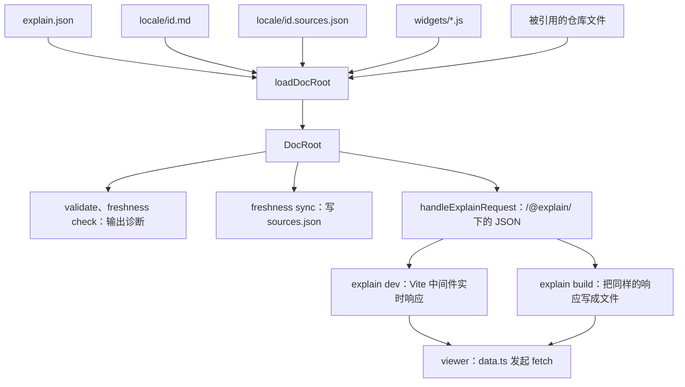

# 概览

explain-this 把一个装着 Markdown 页面的目录变成文档站点，页面里的每个论断都能落到真实的代码行上。作者（通常是由 [`explain-this` 技能](explain:skills/explain-this/SKILL.md) 驱动的编码 agent）用 `repo:path:ranges` 的形式引用代码；`explain` CLI 对照磁盘上的文件检查这些引用，记下每个被引用文件当时的样子，再启动开发服务器或构建静态站点；viewer 在浏览器里渲染页面，并在正文旁边打开被引用的代码。

这个目录叫 **doc root**：里面有一个 `explain.json`，每个语言一个子目录，存放 `<id>.md` 页面和由 `explain freshness sync` 写出的 `<id>.sources.json`，另外可以有一个 `widgets/` 目录（见 [format.md](explain:skills/explain-this/format.md:3-11)）。

## 仓库结构

仓库是一个 Bun workspace，`packages/` 下的每个目录都是一个包（[package.json](explain:package.json:6-9)）。下面的树只展开与数据流相关的文件，点击节点可以打开对应代码。

<Tree open="2">

- `explain-this/`
  - `packages/`
    - `contract/`：共享的格式定义，不做 I/O（[导出列表](explain:packages/contract/package.json:6-12)）
      - [`citation.ts`](explain:packages/contract/src/citation.ts)：解析与格式化 `repo:path:ranges`
      - [`config.ts`](explain:packages/contract/src/config.ts)：`explain.json` 的 schema
      - [`page.ts`](explain:packages/contract/src/page.ts)：页面 AST
      - `parse-page/`：把页面源码解析成 `Page`（入口 [`parse-page.ts`](explain:packages/contract/src/parse-page/parse-page.ts)）
      - [`sources.ts`](explain:packages/contract/src/sources.ts)：`.sources.json` 的 schema 与 `Freshness`
    - `cli/`：`explain` 可执行文件（[bin 与依赖](explain:packages/cli/package.json:6-16)）
      - [`main.ts`](explain:packages/cli/src/main.ts)：注册五个子命令
      - `commands/`：每个子命令一个模块
      - `doc-root/`：把 doc root 读成一个 `DocRoot`（[`load.ts`](explain:packages/cli/src/doc-root/load.ts)、[`types.ts`](explain:packages/cli/src/doc-root/types.ts)）
      - `site/`：JSON API、开发服务器与静态构建（[`api.ts`](explain:packages/cli/src/site/api.ts)、[`dev.ts`](explain:packages/cli/src/site/dev.ts)、[`build.ts`](explain:packages/cli/src/site/build.ts)）
    - `viewer/`：浏览器里的 React 应用（[依赖](explain:packages/viewer/package.json:11-21)）
      - [`api.ts`](explain:packages/viewer/src/api.ts)：API 的 URL 形状与响应类型
      - [`data.ts`](explain:packages/viewer/src/data.ts)：按这些 URL 取数并缓存
      - `blocks/`、`pane/`、`routes/`、`shell/`：块渲染、源码面板、路由、外壳
  - `skills/explain-this/`：agent 技能与格式规范（[`SKILL.md`](explain:skills/explain-this/SKILL.md)、[`format.md`](explain:skills/explain-this/format.md)、[`widgets.md`](explain:skills/explain-this/widgets.md)）

</Tree>

## 三个包如何分工

| 包 | 职责 | 依赖 |
|---|---|---|
| `@explain/contract` | 定义所有部分共用的词汇：引用、配置、页面 AST、页面解析、来源记录 | 只有 `effect`、`github-slugger` 和 mdast/micromark 系列（[package.json](explain:packages/contract/package.json:13-24)） |
| `@explain/cli` | 唯一读写磁盘的包：加载、校验、跟踪新鲜度、提供或构建站点 | 依赖 contract 和 viewer（[package.json](explain:packages/cli/package.json:9-16)） |
| `@explain/viewer` | 在浏览器里渲染 CLI 给出的 JSON | 运行时只有 React、highlight.js、beautiful-mermaid；contract 只是 devDependency（[package.json](explain:packages/viewer/package.json:11-21)） |

contract 里的 [`parsePage`](explain:packages/contract/src/parse-page/parse-page.ts:13-61) 是纯函数：输入页面文本和页面 id，输出 [`Page`](explain:packages/contract/src/page.ts:115-126) 和诊断信息，完全不碰文件系统。引用格式由 [`parseRef`](explain:packages/contract/src/citation.ts:62-72) 定义，CLI 在解析页面时用它，在 API 里校验 source 请求时也用它（[api.ts](explain:packages/cli/src/site/api.ts:64-65)）。

CLI 依赖 viewer 有两层原因：一是 CLI 从 [`@explain/viewer/api`](explain:packages/viewer/src/api.ts:4-23) 引入 URL 与响应类型来拼装响应体（[api.ts](explain:packages/cli/src/site/api.ts:1-8)）；二是 CLI 通过 `@explain/viewer/package.json` 定位 viewer 源码目录，交给 Vite 去服务或打包（[viewer.ts](explain:packages/cli/src/site/viewer.ts:9-17)）。

> [!IMPORTANT]
> viewer 只能以 `import type` 的方式引用 `effect`、`@effect/*`、`bun:*`、`node:*` 和 `@explain/contract/*`。CLI 往 Vite 里装了一个插件，一旦 viewer 的模块在运行时解析到这些包就报错，开发服务器和构建都会失败（[viewer.ts](explain:packages/cli/src/site/viewer.ts:6-7,19-34)）。于是 Effect 和解析器都不会进入浏览器包：解析只发生在 CLI，viewer 只消费结果。

## 数据流

每个命令的开头都一样：从当前目录向上找最近的 `explain.json`，然后加载整个 doc root（[open-doc-root.ts](explain:packages/cli/src/commands/open-doc-root.ts:19-24)、[findDocRoot](explain:packages/cli/src/doc-root/config.ts:25-35)）。之后的走向取决于命令。



### 加载：所有命令共用一个 `DocRoot`

[`loadDocRoot`](explain:packages/cli/src/doc-root/load.ts:14-56) 先解码 `explain.json`、解析各个仓库路径、加载 widget，然后对每个语言、每个出现在 `nav` 里的页面 id 读取页面。每个页面交给 [`checkPage`](explain:packages/cli/src/doc-root/check-page.ts:21-109)：用 contract 的 `parsePage` 解析，逐个解析引用、检查页面链接和 widget 名，给每个被引用文件算哈希，读出上次记录的 `.sources.json`，比较二者得到 `Freshness`。

```ts file=explain:packages/cli/src/doc-root/types.ts:24-57
```

页面有三种状态：`missing`（nav 里有但文件不存在）、`invalid`（无法解析）、`parsed`。已解析的页面同时带着“现在引用的文件哈希”（`sources`）和“上次同步时记录的哈希”（`recorded`），所以新鲜度在加载时就已算好，各命令直接读取即可。细节见 [load-doc-root](./load-doc-root.md)、[resolve-source](./resolve-source.md) 和 [freshness](./freshness.md)。

### 提供：一个请求处理函数，两种交付方式

站点是 `/@explain/` 下的一组只读 JSON 接口。接口形状由 viewer 定义，CLI 照着实现：

| URL | 内容 | 生成函数 |
|---|---|---|
| `/@explain/api/site.json` | 标题、语言、带页面状态的导航 | [`siteResponse`](explain:packages/cli/src/site/api-bodies.ts:28-53) |
| `/@explain/api/page/<locale>/<id>.json` | 解析后的 `Page`、诊断、新鲜度、每个来源文件的状态 | [`pageResponse`](explain:packages/cli/src/site/api-bodies.ts:85-103) |
| `/@explain/api/source/<repo>/<path>.json` | 文件文本、行数、引用它的页面 | [`sourceResponse`](explain:packages/cli/src/site/api.ts:56-93) |
| `/@explain/api/search/<locale>.json` | 该语言的搜索条目 | [api.ts](explain:packages/cli/src/site/api.ts:155-165) |
| `/@explain/widgets/<name>.js`、`/@explain/widgets.css` | widget 模块与样式 | [api.ts](explain:packages/cli/src/site/api.ts:121-132) |

这些全部由 [`handleExplainRequest`](explain:packages/cli/src/site/api.ts:110-167) 回答：输入当前状态、HTTP 方法和路径，输出状态码、响应头和响应体。它不知道自己跑在服务器里还是构建脚本里。

<Tabs>
<Tab label="explain dev">

[`serveDocRoot`](explain:packages/cli/src/site/dev.ts:18-142) 以 viewer 包为根启动 Vite，并挂一个中间件，把所有 `/@explain/` 请求转给 `handleExplainRequest`（[dev.ts](explain:packages/cli/src/site/dev.ts:80-96)）。它监听 doc root 和 `explain.json` 里的每个仓库，文件变动后重新加载 `DocRoot` 并通知浏览器整页刷新（[dev.ts](explain:packages/cli/src/site/dev.ts:29-64)）。`explain.json` 改坏了也不会让服务器退出，而是变成 `invalid` 状态交给 viewer 显示。

</Tab>
<Tab label="explain build">

[`staticSite`](explain:packages/cli/src/site/build.ts:24-59) 列出 viewer 可能请求的每一个 URL：站点信息、每个页面、每个语言的搜索索引、每个被引用或被记录的来源文件、每个 widget。[`buildSite`](explain:packages/cli/src/site/build.ts:61-127) 对每个 URL 调用同一个 `handleExplainRequest`，把响应体写到与 URL 同路径的文件里，再用 Vite 打包 viewer，并把 `index.html` 复制到每个页面路由下，让静态托管也能直接打开深层链接。

</Tab>
</Tabs>

静态文件恰好位于开发服务器会响应的那些 URL 上，所以 viewer 分不出两者：它只是通过路径辅助函数发起 `fetch`，并按路径缓存 Promise（[data.ts](explain:packages/viewer/src/data.ts:15-37)）。服务器与构建的细节见 [site](./site.md)，viewer 如何使用这些响应见 [viewer-shell](./viewer-shell.md)。

### 渲染

浏览器里，viewer 把 `/<locale>/<id>` 路由到页面，把 `/<locale>/source?<repo>/<path>` 路由到源码文件（[router.ts](explain:packages/viewer/src/router.ts:14-29)）。页面的 `Block` 树由 [blocks](./blocks.md) 渲染；点击引用会在 [source-pane](./source-pane.md) 中打开对应的代码行，代码通过上面的 `source` 接口加载。

## 接下来读什么

- [workflow](./workflow.md)：作者如何从一个空目录走到一个已发布、保持新鲜的站点。
- 格式，自底向上：[citation](./citation.md)、[config](./config.md)、[page-model](./page-model.md)、[parse-page](./parse-page.md)、[sources](./sources.md)。
- CLI：[commands](./commands.md)、[load-doc-root](./load-doc-root.md)、[resolve-source](./resolve-source.md)、[freshness](./freshness.md)、[widgets](./widgets.md)、[site](./site.md)。
