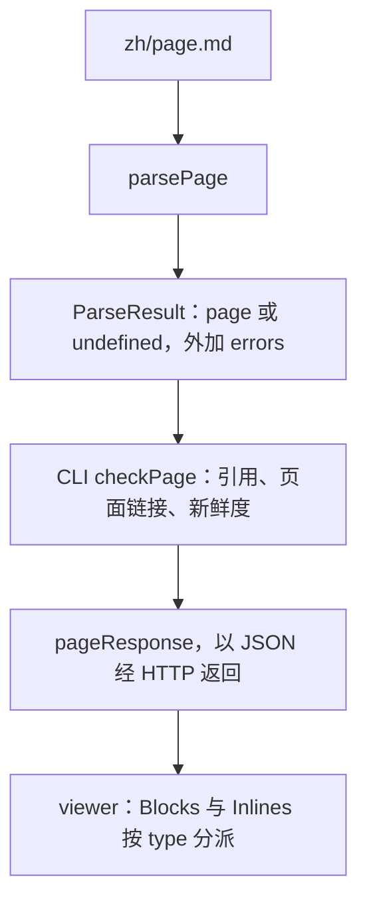

# 页面模型

contract 包里的 `page.ts` 规定了"解析后的页面"长什么样：一棵由 `Block` 和 `Inline` 组成的树，外加解析器顺路收集的几张列表。
除了一个取纯文本的辅助函数，这里没有任何逻辑。它是项目前后两半之间的契约：[parse-page](./parse-page.md) 把 Markdown 变成
`Page`，CLI 检查并通过 HTTP 提供它，viewer 的 [blocks](./blocks.md) 把它渲染出来。



## `Page`

```ts file=explain:packages/contract/src/page.ts:107-117
```

`title` 和 `blocks` 是正文内容。另外三个字段是解析器遍历 Markdown 时顺手建好的索引，下游不必再遍历一遍树：

| 字段 | 由谁填写 | 由谁读取 |
|---|---|---|
| `toc` | 每个 `##`–`####` 标题（[heading.ts](explain:packages/contract/src/parse-page/heading.ts:49)） | viewer 的目录（[page-route.tsx](explain:packages/viewer/src/routes/page-route.tsx:50)） |
| `refs` | 行内引用、摘录、`<AnnotatedSource>`、`<Diff>` 两侧，全部经过同一个 `citation` 辅助函数（[context.ts](explain:packages/contract/src/parse-page/context.ts:20-25)） | CLI：解析每个文件并为新鲜度计算哈希（[check-page.ts](explain:packages/cli/src/doc-root/check-page.ts:46-53,60-66)） |
| `pageLinks` | `./<id>.md` 和 `#anchor` 链接（[inline.ts](explain:packages/contract/src/parse-page/inline.ts:17-33)） | CLI：检查目标页面是否存在（[check-page.ts](explain:packages/cli/src/doc-root/check-page.ts:54-56)） |

`refs`、`pageLinks` 每一项都带 `Position`，出了问题可以报到对应 Markdown 的行和列上。

`parsePage` 不抛异常，而是返回 `{ page, errors }`。只有两种情况 `page` 是 `undefined`：Markdown 解析器抛出了无法恢复的异常，
或者页面带 frontmatter（[parse-page.ts](explain:packages/contract/src/parse-page/parse-page.ts:7-10,13-21,43-44)）。
其他问题都只记成一条 `Diagnostic`，页面其余部分照常构建。所以有错误的页面在 viewer 里仍能显示，错误列表放在正文上方
（[page-route.tsx](explain:packages/viewer/src/routes/page-route.tsx:130-137)）。

## 位置与诊断

```ts file=explain:packages/contract/src/page.ts:3-10
```

contract 里的 `Diagnostic` 只知道自己在页面源码里的行列，不知道来自哪个文件。CLI 收集诊断时补上文件名
（[check-page.ts](explain:packages/cli/src/doc-root/check-page.ts:28-32)）；viewer API 里的 `Diagnostic`
就是 contract 类型再加一个 `file` 字段（[api.ts](explain:packages/viewer/src/api.ts:23)）。

## 行内节点

```ts file=explain:packages/contract/src/page.ts:12-26
```

大部分对应格式允许的 GFM 行内节点。Markdown 链接语法按目标拆成三种：网址是 `link`，`repo:path:ranges` 是 `citation`，
`./<id>.md` 或 `#anchor` 是 `pageLink`（[inline.ts](explain:packages/contract/src/parse-page/inline.ts:17-44)）。

`citation` 节点保存的是解析好的 [`Ref`](explain:packages/contract/src/citation.ts:8-12)，而不是原始字符串，
viewer 直接读 `ref.repo`、`ref.path`、`ref.ranges`（[inlines.tsx](explain:packages/viewer/src/blocks/inlines.tsx:44-54)）。
引用语法本身见 [citation](./citation.md)。

## 块节点

```ts file=explain:packages/contract/src/page.ts:60-98
```

多数块就是常见的 GFM 块，其余的与格式自有语法一一对应：

| Markdown 写法 | 块类型 |
|---|---|
| `## 标题 {#id}` | `heading`，带解析好的 `id`；深度只有 `2 \| 3 \| 4`，因为 `#` 留给页面标题（[page.ts](explain:packages/contract/src/page.ts:30)） |
| `> [!NOTE]` 等五种提示 | `alert`，种类是 [`AlertKind`](explain:packages/contract/src/page.ts:28) |
| 带 `file=<citation>` 的代码围栏 | `excerpt`：只存 `Ref`，不存代码，由 viewer 从 repo 读取 |
| `mermaid` 围栏 | `mermaid` |
| `<details><summary>` | `details` |
| `<Tree>` | `tree`，由 [`TreeItem`](explain:packages/contract/src/page.ts:39-42) 组成 |
| `<Tabs>`、`<BeforeAfter>` | `tabs`、`beforeAfter`，都由 [`LabeledBlocks`](explain:packages/contract/src/page.ts:44-47) 组成 |
| `<AnnotatedSource>` | `annotatedSource`：一个 `Ref` 加若干 [`SourceNote`](explain:packages/contract/src/page.ts:49-53)，行号是文件里的绝对行号 |
| `<Diff>` | `diff`，内含一个 `DiffChange` |

> [!IMPORTANT]
> 页面里展示的 repo 代码从不复制进 `Page`。`excerpt`、`annotatedSource`、`diff` 都只带 `Ref`。
> 这样页面数据很小，viewer 显示的也永远是磁盘上的当前文件，而新鲜度检查比较的正是这份文件。

### `DiffChange`

```ts file=explain:packages/contract/src/page.ts:55-58
```

格式允许 `<Diff>` 在新增文件时省略 `before`、在删除文件时省略 `after`。用三个带标签的变体而不是两个可选字段来表达，
"两侧都没有"的 diff 就根本写不出来；使用方在访问任一侧之前都要先按 `kind` 收窄
（[diff.tsx](explain:packages/viewer/src/blocks/diff.tsx:21-42)）。

## 从行内节点取文本：`TocEntry` 与 `plainText`

```ts file=explain:packages/contract/src/page.ts:101-105,119-132
```

`TocEntry` 里的标题是已经用 `plainText` 压平的纯文本，目录不需要再渲染行内节点。CLI 生成导航标题和搜索索引时也用这个函数
（[api-bodies.ts](explain:packages/cli/src/site/api-bodies.ts:14-15)、[search.ts](explain:packages/cli/src/site/search.ts:6-13)）。

## 谁依赖这个结构

viewer 从 `page.ts` 只导入类型、不导入值，因此它自己留了一份同样逻辑的 `inlineText`
（[inlines.tsx](explain:packages/viewer/src/blocks/inlines.tsx:66-75)）。`BlockView` 和 `InlineView` 的
`switch` 都以 `satisfies never` 收尾（[blocks.tsx](explain:packages/viewer/src/blocks/blocks.tsx:154-155)、
[inlines.tsx](explain:packages/viewer/src/blocks/inlines.tsx:61-62)），所以新增一种 `Block` 或 `Inline`，
在 viewer 渲染它之前都会是类型错误。CLI 的搜索索引在一个没有 `default` 的 `switch` 里列出了所有 `Block` 类型
（[search.ts](explain:packages/cli/src/site/search.ts:9-41)），新增变体会让函数在那条路径上缺少返回值，TypeScript 同样会报错（推断）。

> [!TIP]
> 新增组件时先改 `page.ts`，再顺着类型错误往下改：解析器要产出这个变体，viewer 要渲染它，搜索索引要决定它贡献哪些文本。
> 如果组件引用代码，就让它的引用经过解析器的 `citation` 辅助函数，CLI 才会检查并计算哈希。
