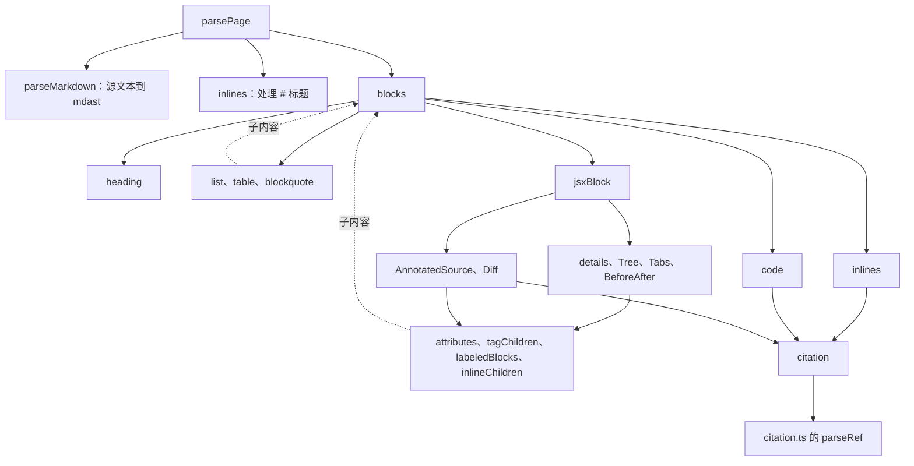

# 页面解析

`parsePage(source, pageId)` 把一个 `<locale>/<id>.md` 文件的文本变成 [page.ts](explain:packages/contract/src/page.ts:107-117) 里定义的 `Page` 树，同时返回一组带行号、列号的诊断。它是纯函数：不读文件，也不知道有哪些仓库。CLI 的加载器对每个页面调用一次（[load.ts](explain:packages/cli/src/doc-root/load.ts:32-35)），之后再拿解析时收集到的引用和页面链接去对照磁盘检查，那一步见[加载文档根](./load-doc-root.md)。树本身的形状见[页面模型](./page-model.md)。

## 文件分工 {#files}

一个文件负责一层。容器类组件为了处理子内容会递归调用 `blocks`。

<Tree open="1">

- `packages/contract/src/parse-page/`
  - [parse-page.ts](explain:packages/contract/src/parse-page/parse-page.ts)：入口；拒绝 frontmatter、取标题、组装 `Page`
  - [markdown.ts](explain:packages/contract/src/parse-page/markdown.ts)：Markdown 解析器配置、节点位置
  - [context.ts](explain:packages/contract/src/parse-page/context.ts)：共享收集器、`report`、`citation`
  - [block.ts](explain:packages/contract/src/parse-page/block.ts)：块级分发、列表、表格、引用与提示框
  - [inline.ts](explain:packages/contract/src/parse-page/inline.ts)：行内分发与链接分类
  - [heading.ts](explain:packages/contract/src/parse-page/heading.ts)：标题层级与 id
  - [code.ts](explain:packages/contract/src/parse-page/code.ts)：字面代码、摘录、mermaid
  - [jsx-block.ts](explain:packages/contract/src/parse-page/jsx-block.ts)：按标签名分发
  - [attributes.ts](explain:packages/contract/src/parse-page/attributes.ts)：按规格校验属性
  - [jsx-children.ts](explain:packages/contract/src/parse-page/jsx-children.ts)：各组件共用的子节点形状检查
  - [layout-components.ts](explain:packages/contract/src/parse-page/layout-components.ts)：`details`、`Tree`、`Tabs`、`BeforeAfter`
  - [source-components.ts](explain:packages/contract/src/parse-page/source-components.ts)：`AnnotatedSource`、`Diff`
  - [parse-page.test.ts](explain:packages/contract/src/parse-page/parse-page.test.ts)：本页描述的行为大多以它为证

</Tree>

## 调用关系 {#call-tree}



整个过程分两趟。第一趟交给现成的 Markdown 解析器，得到一棵 [mdast](https://github.com/syntax-tree/mdast) 语法树；第二趟是手写的遍历，把 mdast 节点逐个翻译成词汇少得多的 `Page` 节点，凡是不接受的节点都报告出来。

## 入口 {#entry}

<AnnotatedSource file="explain:packages/contract/src/parse-page/parse-page.ts:13-60">

<Note lines="14-19">在解析之前先拒绝 frontmatter。解析器没有装 frontmatter 扩展，开头的 `---` 块否则会被当成分隔线加一个 setext 标题，而不是报错（推断，依据 CommonMark 规则）。</Note>

<Note lines="21-36">唯一的致命路径。micromark 遇到无法切词的语法（比如残缺的 JSX 标签或 `<!--`）会抛异常，异常带着 `line`、`column`、`reason`，被转成唯一一条诊断，此时不返回 `Page`。</Note>

<Note lines="38-46">每次调用一个可变上下文。各个转换函数都往这几个数组里追加，而不是把附带数据通过返回值传出来。</Note>

<Note lines="47-54">第一个节点必须是一级标题。缺标题会报错，但解析继续，作者一次就能看到正文里的其他问题。</Note>

<Note lines="55-59">标题转成行内内容，其余节点转成块。`toc`、`refs`、`pageLinks` 是在 `blocks` 遍历完之后从上下文里取的，所以都按文档顺序排列。</Note>

</AnnotatedSource>

于是失败有两种，调用方的处理也不同：

| 出了什么问题 | `page` | `errors` | 对应测试 |
|---|---|---|---|
| 有 frontmatter，或 micromark 抛异常 | `undefined` | 恰好一条 | [frontmatter](explain:packages/contract/src/parse-page/parse-page.test.ts:137-139)、[HTML 注释](explain:packages/contract/src/parse-page/parse-page.test.ts:111-113) |
| 遍历阶段拒绝的任何节点 | 去掉被拒节点后的 `Page` | 全部 | [Diff 的各种错误](explain:packages/contract/src/parse-page/parse-page.test.ts:217-253) |

加载器给每条诊断补上文件名，只有 `page` 为 `undefined` 时才提前结束（[check-page.ts](explain:packages/cli/src/doc-root/check-page.ts:38-42)）；否则继续解析页面里的引用和页面链接（[check-page.ts](explain:packages/cli/src/doc-root/check-page.ts:46-58)）。

## Markdown 这一层 {#markdown}

```ts file=explain:packages/contract/src/parse-page/markdown.ts:15-23
```

解析器是 `mdast-util-from-markdown`，底下由 micromark 切词，挂了两个语法扩展：GFM（表格、任务列表、删除线、脚注等）和 MDX JSX。后者让 `<Tree>` 这类标签成为真正的语法节点，而不是一段原始 HTML。`disable` 一项又关掉了四个 CommonMark 结构：

- `htmlFlow` 和 `htmlText`：完全不识别原始 HTML。`<div>` 因此被当作 JSX 元素读进来，再按名字拒绝（[测试](explain:packages/contract/src/parse-page/parse-page.test.ts:115-117)）；`<!-- … -->` 则让 JSX 切词器直接抛异常（[测试](explain:packages/contract/src/parse-page/parse-page.test.ts:111-113)）。格式里"只允许 `<details>` 和 `<summary>` 这两种 HTML"就是这么实现的：它们和组件走同一条 JSX 分发路径。
- `autolink`：`<https://…>` 不是链接，同样落到 JSX 切词器上并抛异常。请写 `[文字](url)`。
- `codeIndented`：缩进四格的行只是普通段落文字，代码只有围栏这一种写法。原因大概是标签里的子内容常带缩进，否则会被误读成代码块（推断）。

每个 mdast 节点都带起始位置，[`positionOf`](explain:packages/contract/src/parse-page/markdown.ts:25-28) 是唯一读取它的地方，缺失时退回 1:1。[`describeNode`](explain:packages/contract/src/parse-page/markdown.ts:30-33) 给报错用的节点命名：标签写成 `<Name>`，其余用 mdast 类型名，所以不支持的节点会报成 `image is not supported` 这样。

## 上下文与诊断 {#diagnostics}

```ts file=explain:packages/contract/src/parse-page/context.ts:15-25
```

`report` 追加一条 `{ line, column, message }` 并返回 `undefined`。转换函数的写法是 `return report(...)`，两个列表遍历函数都会丢掉 `undefined` 结果（[blocks](explain:packages/contract/src/parse-page/block.ts:91-92)、[inlines](explain:packages/contract/src/parse-page/inline.ts:47-51)）。所以出错的节点从树里消失，兄弟节点照常保留，一个文件里的所有问题一次全报出来。

位置尽量精确：

- 大多数错误指向出错节点的起点：标题、围栏、标签。
- 属性错误指向属性本身（[attributes.ts](explain:packages/contract/src/parse-page/attributes.ts:19)）。`<Tree open={2}>` 的测试期望第 7 列，正是 `open` 开始的位置（[测试](explain:packages/contract/src/parse-page/parse-page.test.ts:105-109)）。
- mermaid 的 `click`、`@{}`、状态图 note 问题指向围栏内部的那一行：围栏所在行加上行下标再加一（[code.ts](explain:packages/contract/src/parse-page/code.ts:14-20)）。不支持的 `gantt`、`architecture-beta` 图则报在围栏本身所在的位置（[code.ts](explain:packages/contract/src/parse-page/code.ts:10-13)）。
- 链接错误指向链接的 `[`。同一行三个坏链接，测试期望列号 1、14、27（[测试](explain:packages/contract/src/parse-page/parse-page.test.ts:154-160)）。

`citation` 包了一层 [`parseRef`](explain:packages/contract/src/citation.ts:62-72)（见[引用](./citation.md)）：失败时把 `parseRef` 的错误信息报在给定位置，成功时把 `{ ref, at }` 记进 `ctx.refs`。

> [!IMPORTANT]
> 页面里的每一处引用，无论是链接、摘录围栏、`AnnotatedSource file` 还是 `Diff before`/`after`，都经过 `citation()`。因此 `page.refs` 就是该页引用文件的完整清单，`explain freshness sync` 记录的正是它。新增一个引用代码的组件也必须调用 `citation()`，否则它引用的文件会悄无声息地脱离新鲜度跟踪。

第一个测试把这一点钉住了：一个行内引用、一个摘录、一个 `AnnotatedSource` 分别在第 3、12、17 行产生 ref，顺序与文档一致（[测试](explain:packages/contract/src/parse-page/parse-page.test.ts:92-96)）。

## 块级节点 {#blocks}

[`block`](explain:packages/contract/src/parse-page/block.ts:68-89) 是一个按 mdast 类型分支的 switch。标题、段落、列表（保留任务列表的 `checked`）、表格（第一行成为 `head`）、引用块、代码、分隔线和块级 JSX 元素各有一支，其他一律落到 `default` 报错。行内内容由 [`inline`](explain:packages/contract/src/parse-page/inline.ts:53-73) 按同样的方式处理。这两个 `default` 是有意为之：链接引用定义和脚注定义落到 `block` 的 `default`，图片落到 `inline` 的 `default`，否则它们会被静默丢掉（[测试](explain:packages/contract/src/parse-page/parse-page.test.ts:255-260)）。

<details>
<summary>能解析但会被拒绝的 Markdown</summary>

下面这些都是合法的 GFM，会落到 `block` 或 `inline` 的 `default`，报成 `<type> is not supported`：

- `image`（``）
- `definition`（`[a]: https://x`）以及依赖它的引用式链接
- `footnoteReference` 和 `footnoteDefinition`
- `html` 不会出现，因为产生它的语法结构已被关闭

</details>

**提示框**其实是伪装的引用块。[`blockquote`](explain:packages/contract/src/parse-page/block.ts:38-66) 检查第一个段落开头的文字是不是 `[!KIND]`。没有标记就是普通的 `quote`；标记里的种类不认识，或者标记后面同一行还有文字，都报错。否则把标记从文字里剪掉，剪空的首段直接去掉，剩下的内容按普通块转换，装进 `alert`。

## 行内节点与链接 {#links}

[`inline`](explain:packages/contract/src/parse-page/inline.ts:53-73) 对文字、加粗、斜体、删除线、行内代码和硬换行一一对应。正文里夹着的 JSX 标签会被拒绝，提示"must stand on its own lines"（[inline.ts](explain:packages/contract/src/parse-page/inline.ts:68-69)），因为所有组件都是块级的。

格式里的三种链接就在这里区分。[`link`](explain:packages/contract/src/parse-page/inline.ts:11-45) 按下面的顺序判断目标：

| 目标 | 结果 | 记入 |
|---|---|---|
| `#anchor` | 指向当前页的 `pageLink` | `pageLinks` |
| `./<id>.md` 或 `./<id>.md#anchor` | `pageLink`，id 须匹配 `pageIdPattern` | `pageLinks` |
| 没有 `scheme:` 前缀（如 `../x.md`） | 报错 | |
| `http:`、`https:`、`mailto:` | 外部 `link` | |
| 其他任何 `scheme:` | `citation`，scheme 就是仓库键 | `refs` |

最后一行说明了为什么解析器不需要知道有哪些仓库键：凡是形如 `word:` 又不属于三种网页 scheme 的，一律当引用，仓库是否存在留给加载器判断。测试把 `[run](term:run)` 读成指向仓库 `term` 的引用（[测试](explain:packages/contract/src/parse-page/parse-page.test.ts:148-152)）；`ftp://x` 也同样变成引用，再由 `parseRef` 拒绝它的路径（[测试](explain:packages/contract/src/parse-page/parse-page.test.ts:154-160)）。

## 标题与 id {#headings}

[`heading`](explain:packages/contract/src/parse-page/heading.ts:11-51) 拒绝标题之后再出现的 `#` 一级标题，以及深于 `####` 的标题，因此树里的 `HeadingDepth` 只有 `2 | 3 | 4`。接着确定 id：

1. 如果最后一个文字子节点以 `{#id}` 结尾，就把这段后缀从可见文字里剪掉（[heading.ts](explain:packages/contract/src/parse-page/heading.ts:18-29)）。显式 id 必须匹配 `^[a-z0-9][a-z0-9-]*$`，且不能已被占用，任一不满足都会报错并丢掉该标题（[测试](explain:packages/contract/src/parse-page/parse-page.test.ts:141-146)）。
2. 否则 id 取标题纯文本经 `github-slugger` 的 `slug` 结果，若已被占用就依次追加 `-1`、`-2`……直到不冲突（[heading.ts](explain:packages/contract/src/parse-page/heading.ts:42-47)）。第一个测试里 `## Rules {#rules}` 先占了 `rules`，后面普通的 `## Rules` 就得到 `rules-1`（[测试](explain:packages/contract/src/parse-page/parse-page.test.ts:37-40)）。中文会保留原字，`## 压缩 闸门` 得到 `压缩-闸门`（[测试](explain:packages/contract/src/parse-page/parse-page.test.ts:99-103)）。如果文字 slug 之后为空（比如只有标点），会要求补一个显式 `{#id}`。

每个通过的标题同时推入 `ctx.toc`，成为页面目录。显式 id 和生成的 id 共用一个 `usedIds` 集合，所以显式 id 如果已被前面某个标题的 slug 占了，会报错而不是悄悄改名。

## 代码围栏 {#code}

[`code`](explain:packages/contract/src/parse-page/code.ts:24-45) 把围栏的 info 字符串按空白拆成词。至多一个词是 `file=<citation>`。语言只能是第一个词，所以 `file=` 要写在语言后面（`` ```ts file=… `` 可以，`` ```file=… ts `` 会被拒绝）；其他多出来的词都报错（`` ```ts title=x `` 会被拒绝）。结果由两个问题决定：

| 有 `file=` | 语言 | 结果 |
|---|---|---|
| 否 | `mermaid` | 经过检查后成为 `mermaid` 块 |
| 否 | 其他或没有 | 带正文的字面 `code` 块 |
| 是 | `mermaid` | 报错：图不能是摘录 |
| 是 | 其他或没有 | 带 `Ref` 的 `excerpt`，正文必须为空（[测试](explain:packages/contract/src/parse-page/parse-page.test.ts:123-127)） |

摘录里完全不存代码，只存引用，由查看器稍后去仓库读取对应行，所以摘录不可能和仓库内容脱节。

mermaid 检查（[code.ts](explain:packages/contract/src/parse-page/code.ts:6-22)）拒绝查看器渲染器不支持的特性：`gantt` 和 `architecture-beta` 图、`click`、`@{}` 形状、状态图里的 note。这些会报错，但 mermaid 块本身仍然保留。

## 标签 {#tags}

所有块级标签都进入 [`jsxBlock`](explain:packages/contract/src/parse-page/jsx-block.ts:16-40)，按名字分发。只在某个父标签里才有意义的标签（`Tab`、`Before`、`After`、`Note`、`summary`）会得到专门的"only allowed inside"提示，其他不认识的一律报 `unknown tag <Name>`（[测试](explain:packages/contract/src/parse-page/parse-page.test.ts:119-121)）。要得到"only allowed inside"提示，游离的标签得独占几行：写在顶层的单行 `<Note lines="1">x</Note>` 在 Markdown 看来是段落里的行内元素，走的是 `inline`，报的是"must stand on its own lines, not inside text"。

各组件共用三个辅助函数。

[`attributes`](explain:packages/contract/src/parse-page/attributes.ts:6-40) 按 `required` / `optional` 规格检查元素属性。值必须是字符串字面量，`{...}` 展开和 `name={expr}` 都是错误。未知属性名报错。它只在本次调用没有新增诊断时才返回属性值，判断方式是比较调用前后的错误数量，而不是另设标志位。

[`requireBlankLines`](explain:packages/contract/src/parse-page/jsx-children.ts:12-34) 检查原始文本：开标签到第一个子节点之间、最后一个子节点到闭标签之间，都必须有空行。只含空格或 `>` 的行也算空行，大概是为了让引用块里的标签也能通过（推断）。这是基于源文本偏移量的文本检查，而不是 mdast 结构检查。测试里 `<Tab label="a">` 下一行直接写 `text`，期望在 `<Tab>` 那一行报一条错（[测试](explain:packages/contract/src/parse-page/parse-page.test.ts:168-172)）。

[`tagChildren`](explain:packages/contract/src/parse-page/jsx-children.ts:61-84) 收集容器里指定名字的子标签。写成一行的子标签，比如 `<Note lines="2-4">first</Note>`，在 Markdown 解析器看来是段落里的行内元素，所以只含这种元素和空白的段落也被接受（[onlyTextElements](explain:packages/contract/src/parse-page/jsx-children.ts:36-46)）。容器里的其他内容按类型报错。

所有组件函数有一个共同习惯：放弃之前先把能报的错都报完。`annotatedSource` 在因缺少 `file` 而返回之前，已经检查了属性和 `Note` 子节点；`tree` 在因属性错误而返回之前，已经检查了空行和列表形状。

### 布局组件 {#layout}

它们装的是 Markdown，所以要回调 `blocks`（或 `inlines`）处理内容。

- [`tree`](explain:packages/contract/src/parse-page/layout-components.ts:41-58)：恰好一个列表。每一项是一段文字标签加一个可选的嵌套列表，不能带任务列表复选框（[treeItems](explain:packages/contract/src/parse-page/layout-components.ts:17-39)）。`open` 必须是纯数字，转成数字或 `null`。
- [`tabs`](explain:packages/contract/src/parse-page/layout-components.ts:60-67)：用 `tagChildren` 取出 `Tab`，每个交给 [`labeledBlocks`](explain:packages/contract/src/parse-page/jsx-children.ts:86-99)（`label` 必填、子内容为块、要求空行）。一个合格的 `Tab` 都没有就报错。
- [`beforeAfter`](explain:packages/contract/src/parse-page/layout-components.ts:69-85)：恰好两个块级子节点，先 `Before` 后 `After`，各自经过 `labeledBlocks`。
- [`details`](explain:packages/contract/src/parse-page/layout-components.ts:87-105)：第一个子节点必须是唯一的 `summary`，可以独占几行，也可以以内联形式写在段落里；`summary` 转成行内内容，其余子节点转成块。

### 源码组件 {#source-components}

它们都引用代码，所以每个引用属性都经过 `citation()`。

<Tabs>

<Tab label="AnnotatedSource">

```md
<AnnotatedSource file="fold:index.ts:1-20">

<Note lines="2-4">first</Note>

</AnnotatedSource>
```

[`annotatedSource`](explain:packages/contract/src/parse-page/source-components.ts:11-44) 要求 `file` 恰好引用一个行区间。每个 `Note` 需要 `lines="N"` 或 `lines="N-M"` 和一段行内文字，且必须落在该区间内；区间是 `5-10` 时，`lines="9-12"` 会在该 note 处报错（[测试](explain:packages/contract/src/parse-page/parse-page.test.ts:162-166)）。被拒的 note 丢掉，块本身保留。

</Tab>

<Tab label="Diff">

```md
<Diff before="base:src/a.ts:1-5" after="head:src/a.ts:2-7" />
<Diff after="head:src/b.ts" />
<Diff before="base:src/c.ts:3" />
```

[`diff`](explain:packages/contract/src/parse-page/source-components.ts:46-72) 不接受子内容，有两个可选属性，每个都是至多一个行区间的引用。哪一侧存在决定 `DiffChange` 的种类：两侧都有是 `modified`，只有 `after` 是 `added`，只有 `before` 是 `deleted`，都没有则报错。两侧都进入 `refs`，所以一个 diff 算作引用了两个文件（[测试](explain:packages/contract/src/parse-page/parse-page.test.ts:174-215)）。

</Tab>

</Tabs>

## 怎么读测试 {#tests}

[parse-page.test.ts](explain:packages/contract/src/parse-page/parse-page.test.ts) 是这门页面语言最好的地图。第一个用例用一页包含各种常见写法的文本构建整棵树，并断言完整的 `Page` 值（[测试](explain:packages/contract/src/parse-page/parse-page.test.ts:8-97)）；其余大多数用例把一小段错误页面交给 `errorsAt` 辅助函数，只断言 `{ line, column }` 列表（[辅助函数](explain:packages/contract/src/parse-page/parse-page.test.ts:4-5)）。新增一种写法时，也按这两种形式补测试：接受时的树，以及每种拒绝的位置。
