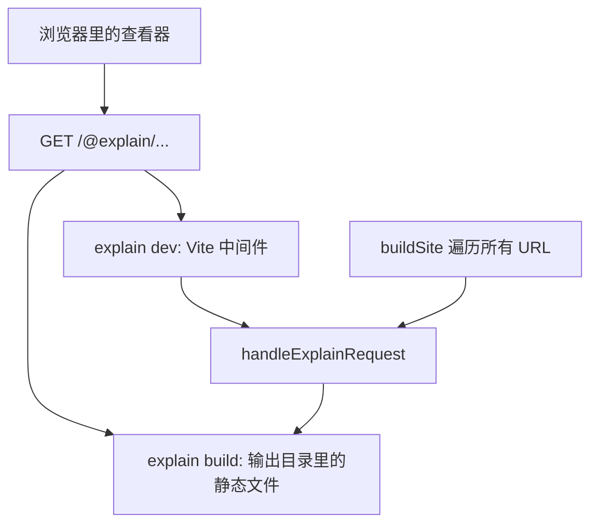

# 开发服务器与静态构建

`explain dev` 和 `explain build` 提供的是同一个查看器、同一份数据。查看器向文档根要的所有东西都在 `/@explain/` 这个前缀下，全部由一个函数 [`handleExplainRequest`](explain:packages/cli/src/site/api.ts:95-140) 回答。开发服务器对每个实时请求调用它；构建则对查看器可能请求的每个 URL 各调用一次，把响应写成文件。本页讲这个处理函数、它的两种用法，以及它提供的搜索索引。查看器如何请求和缓存这些响应，见 [viewer-shell](./viewer-shell.md)。

## 一个处理函数，两种宿主

处理函数的输入是 [`DevState`](explain:packages/cli/src/site/api.ts:17-23)：要么是加载好的 `DocRoot`，要么是 `explain.json` 加载失败时的诊断。输出是普通对象 `{ status, headers, body }`，不碰任何 HTTP 对象：

```ts file=explain:packages/cli/src/site/api.ts:25-29
```

正因为它只是"路径进、响应出"的纯粹映射，构建才能原样复用它。构建测试直接验证了这一点：对写出的每个文件，再拿同一个 URL 去问处理函数，逐字节比对（[build.test.ts](explain:packages/cli/test/build.test.ts:82-91)）。



所有路径都以 `.json` 结尾，响应不依赖查询参数或请求头；不带 `.json` 后缀去请求源码会得到 404（[dev.test.ts](explain:packages/cli/test/dev.test.ts:94)）。这让一个静态目录就能忠实复刻开发服务器（推断：代码里没写明这个理由，但构建依赖这一点）。

## 路由一览

路径的形状在查看器包里定义为 [`ApiPath`](explain:packages/viewer/src/api.ts:4-21) 类型，CLI 和查看器用同一组辅助函数拼 URL。

| 路由 | 返回 | 实现 |
|---|---|---|
| `/@explain/api/site.json` | `SiteResponse`：标题、语言列表、默认语言、根级诊断，以及每种语言的导航和每页状态。`explain.json` 无效时返回 `{ status: "invalid", errors }`，状态码仍是 200 | [siteResponse](explain:packages/cli/src/site/api-bodies.ts:28-52) |
| `/@explain/api/page/<locale>/<id>.json` | `PageResponse`：解析后的页面、诊断、新鲜度，以及每个源文件一条带状态的记录 | [pageResponse](explain:packages/cli/src/site/api-bodies.ts:84-102) |
| `/@explain/api/source/<repo>/<path…>.json` | `SourceResponse`：文件文本、行数、引用它的页面；或 `status: "missing"` | [sourceResponse](explain:packages/cli/src/site/api.ts:56-93) |
| `/@explain/api/search/<locale>.json` | `SearchIndex`：每个页面小节一条 | [searchEntries](explain:packages/cli/src/site/search.ts:43-66) |

所有响应都带 `Cache-Control: no-store`（[api.ts](explain:packages/cli/src/site/api.ts:38-42)），编辑之后浏览器不会拿旧缓存。

### 分发规则

```ts file=explain:packages/cli/src/site/api.ts:100-104
```

- 非 `GET` 一律 405。
- 先按 `/` 切分再逐段解码，所以段内的 `%2F` 解码后仍留在这一段里，不会多出一层目录；解码失败的段直接 404。
- `api` 路由去掉最后一段的 `.json`，剩下的段就是参数（[api.ts](explain:packages/cli/src/site/api.ts:106-110)）。
- 状态为 `invalid` 时，`site.json` 仍以 200 返回错误列表，好让查看器展示出来；其他路由一律返回 [503](explain:packages/cli/src/site/api.ts:54)，提示去看 `site.json`。

### 源码路由是安全边界

浏览器读磁盘文件只有源码路由这一条路，所以它只提供"引用能写出来"的文件：

```ts file=explain:packages/cli/src/site/api.ts:61-66
```

三道关：`repo` 必须是 `explain.json` `repos` 里的键，否则 404；`repo:path` 必须能解析成合法引用，否则 403，这会[拒绝 `.` 和 `..` 段](explain:packages/contract/src/citation.ts:34-38)；最后由 [resolve-source](./resolve-source.md) 对照磁盘检查，[解析到仓库外或不是普通文件](explain:packages/cli/src/site/api.ts:86-89)都是 403。dev 测试分别用编码过的 `..%2Fsecret.txt` 和一个指向仓库外的符号链接去试，并确认响应体里绝不出现秘密内容（[dev.test.ts](explain:packages/cli/test/dev.test.ts:96-100)）。

响应里的 `citedBy` 每次请求都现算：扫描所有解析成功的页面，找引用了同一仓库同一路径的（[api.ts](explain:packages/cli/src/site/api.ts:67-73)）。源码查看器用它列出"哪些页面引用了这个文件"。

## 开发服务器

[`serveDocRoot`](explain:packages/cli/src/site/dev.ts:18-142) 起一个 Vite 开发服务器，根目录是查看器包本身（[viewerRoot](explain:packages/cli/src/site/viewer.ts:9-16)），查看器源码由 Vite 直接即时编译。explain 相关的逻辑是一个 Vite 插件，负责两件事。

### 响应请求

```ts file=explain:packages/cli/src/site/dev.ts:80-106
```

`/@explain/` 开头的请求交给处理函数，读取当前状态时持有锁。其余请求中，接受 HTML 的 `GET`，只要路径第一段为空或是某个语言，就改写成 `/index.html`，这样 `/zh/site` 这类深链接也能打开单页应用。

### 文件变化后重新加载

Vite 的文件监视器同时盯着文档根和 `explain.json` 里的每个仓库。这些目录下的新增、修改、删除都进入一个队列，队列防抖 100 毫秒，每一批变化触发一次重新加载：

```ts file=explain:packages/cli/src/site/dev.ts:135-140
```

[重新加载](explain:packages/cli/src/site/dev.ts:29-64)是完整地再跑一遍 `loadDocRoot`，不做增量：重新解析页面、重新解析引用、重新计算新鲜度。新结果在中间件使用的同一把锁下替换 `state`，所以任何请求看到的要么是旧的文档根，要么是新的，不会是做到一半的。之后：

| 加载结果 | 服务器的处理 |
|---|---|
| 成功 | 按新的 `repos` 更新监视列表：移除的仓库取消监视，新增的开始监视。所以往 `explain.json` 加一个仓库，保存后它就被监视了 |
| 失败（`explain.json` 无效或文件系统错误） | 把错误打印到 stderr，状态变为 `invalid`；服务器不退出，下次保存正确后自动恢复 |
| 两种情况都会 | 通过 Vite 的 HMR WebSocket 发送 `{ type: "full-reload" }`，浏览器整页刷新 |

> [!NOTE]
> 之所以连仓库一起监视，而不只是文档根，是为了让新鲜度标记实时生效：改动一个被引用的源文件，浏览器刷新后对应页面就显示为过期。

## 搜索索引

索引在服务端按语言生成，查看器拿到后在浏览器里搜索（见 [viewer-shell](./viewer-shell.md)）。[`searchEntries`](explain:packages/cli/src/site/search.ts:43-66) 在每个标题处把页面切成小节；第一个标题之前的内容自成一节，标题用页面标题，没有锚点。

每节的文本由 [`blockText`](explain:packages/cli/src/site/search.ts:9-41) 决定：

<BeforeAfter>
<Before label="不进索引">

围栏代码、代码摘录、mermaid 图、diff、分隔线，统统返回空数组。

</Before>
<After label="进索引">

段落、列表项、表格单元格、提示块、引用、`<details>` 及其摘要、树节点标签、标签页的标题和内容、前后对比两侧的标签和内容，以及 `AnnotatedSource` 的注释。

</After>
</BeforeAfter>

也就是说，搜索命中的是页面"怎么讲这段代码"，而不是被引用的代码本身。只收录目标语言里解析成功的页面；未知语言返回 404（[api.ts](explain:packages/cli/src/site/api.ts:128-138)）。

## 静态构建

[`buildSite`](explain:packages/cli/src/site/build.ts:55-121) 把文档根变成静态托管能直接提供的目录，分五步：

1. [`staticSite`](explain:packages/cli/src/site/build.ts:23-53) 列出查看器可能请求的全部 URL：`site.json`、每个页面、每种语言一份搜索索引，以及源码响应。源码覆盖的是所有已解析页面引用过的文件，**加上**各页 `.sources.json` 里记录过的文件，因为来源面板也会列出已经从页面里消失的文件。构建测试在记录里放了一个已不存在的 `src/old.ts`，并期望写出它的源码响应（一个 `missing` 响应）（[build.test.ts](explain:packages/cli/test/build.test.ts:51-52,77)）。
2. 每个 URL 都交给 `handleExplainRequest`，并发 16 个；只要有一个不是 200，整个构建就失败，并报出 URL 和响应体。
3. 替换输出目录，但前提是它为空或已经含有 `@explain` 目录；不认识的目录原封不动地拒绝（[build.ts](explain:packages/cli/src/site/build.ts:77-85)）。
4. 用 Vite 把查看器构建进输出目录。
5. 按 URL 路径写出各个响应，再把构建出的 `index.html` 复制到单页应用的每个入口路由，外加一份 `404.html`（[build.ts](explain:packages/cli/src/site/build.ts:101-119)）。

构建测试的文档根只有一个 `zh-CN` 页面、引用两个文件，输出如下，对应测试里的[期望文件列表](explain:packages/cli/test/build.test.ts:71-105)：

<Tree open="3">

- `out/`
  - `index.html`、`404.html`
  - `assets/`：Vite 打包产物
  - `zh-CN/`
    - `index.html`：语言首页
    - `source/index.html`：源码查看器
    - `index/index.html`：页面 `index`
  - `@explain/`
    - `api/`
      - `site.json`
      - `page/zh-CN/index.json`
      - `search/zh-CN.json`
      - `source/fold/src/数据.ts.json`、`source/fold/src/index.html.json`、`source/fold/src/old.ts.json`

</Tree>

所有 HTML 路由文件与 `index.html` 逐字节相同，由查看器根据 URL 决定显示什么。`404.html` 给那些对未知路径返回它的托管服务用（推断：代码只负责写出这个文件，哪些托管会用它不在本仓库里）。

> [!IMPORTANT]
> 构建不计算任何开发服务器不会计算的东西：写出的每个文件都正好是开发服务器对那个 URL 的响应。`explain dev` 与构建产物之间如果有差异，只可能来自托管方式（比如怎样把 `/zh/site` 映射到 `zh/site/index.html`），不会来自数据。

## 两个命令

<Tabs>
<Tab label="explain dev">

```ts file=explain:packages/cli/src/commands/dev.ts:9-23
```

`--port` 默认 4321，并且是严格的：端口被占用时 Vite 启动失败，打印错误，退出码 2。启动时文档根必须能加载，因为 [`openDocRoot`](explain:packages/cli/src/commands/open-doc-root.ts:35-43) 遇到找不到或无效的 `explain.json` 会直接退出；只有启动之后的损坏才走 `invalid` 状态。有诊断的页面照样提供，错误放在页面响应里。命令随后永久等待，退出时作用域负责关闭 Vite 服务器。

</Tab>
<Tab label="explain build">

```ts file=explain:packages/cli/src/commands/build.ts:15-33
```

和 `dev` 不同，`build` 只要有任何诊断就拒绝构建，包括根级诊断（仓库）和页面诊断（含引用问题）。`--out` 相对当前目录解析，默认是文档根下的 `dist/`。成功后打印输出目录以及页面和源文件的数量。

</Tab>
</Tabs>

## 让查看器保持纯浏览器代码

两种 Vite 配置都装了 [`viewerImportGuard`](explain:packages/cli/src/site/viewer.ts:18-34)：查看器包内（不含其 `node_modules`）的任何模块，只要在运行时导入 `effect`、`@effect/*`、`bun`、`node:*` 或 `@explain/contract/*`，就直接报构建错误；`import type` 不受影响，因为类型在解析前就被擦除了。所以查看器可以引用 contract 包里的类型（`Page`、`Freshness`），而前后端共享的响应结构定义在 [`@explain/viewer/api`](explain:packages/viewer/src/api.ts:1-2)，CLI 从那里导入。
