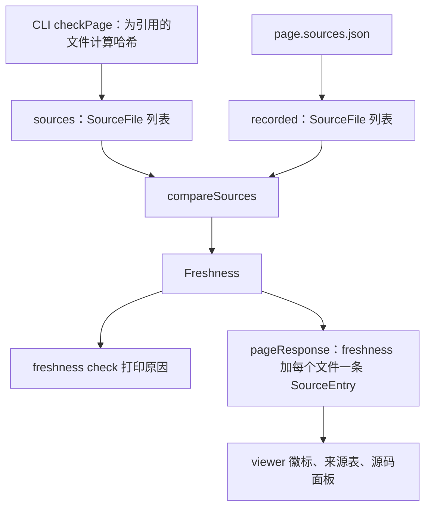

# 来源记录与新鲜度类型

页面引用的代码一变，页面就过期了。记下页面引用了哪些文件、再拿记录和磁盘比对，是 CLI 的事；把结果展示出来，是 viewer 的事。
contract 包里的 `sources.ts` 是两边共用的词汇表：一条文件记录长什么样、`<page>.sources.json` 是什么格式、新鲜度结论是什么结构。
结论具体怎么算出来，见 [freshness](./freshness.md)。

```ts file=explain:packages/contract/src/sources.ts
```

## `SourceFile`：一个带哈希的文件

`SourceFile` 由 repo key、路径和 `hash` 组成，`hash` 必须是 40 位小写十六进制字符串
（[sources.ts](explain:packages/contract/src/sources.ts:3-11)）。这里没有行区间：新鲜度按整个文件计算，
被引用文件里任何位置有改动，哪怕不在引用的行内，页面都会过期。

这个哈希就是 git 的 blob id。CLI 先拼出 `blob <长度>\0` 头，再接上文件字节，对整体做 SHA-1，这正是 git 给 blob 命名的方式：

```ts file=explain:packages/cli/src/doc-root/freshness.ts:15-32
```

写这一页时，[config](./config.md) 页面为 `packages/contract/src/config.ts` 记下的是
`8aaaa18005248bb7436d19b8e028bfd57517329e`，而 `git hash-object packages/contract/src/config.ts` 输出的是同一个值。
哈希按磁盘上的字节计算，未提交的修改同样算数。

## `SourcesFile`：`.sources.json` 的格式

`explain freshness sync` 为每个页面写一个 `<locale>/<page>.sources.json`。它的 schema 是
`{ files: SourceFile[] }`，`SourcesFileFromJson` 直接从 JSON 文本解码
（[sources.ts](explain:packages/contract/src/sources.ts:15-21)）。写出时统一走 `formatSourcesFile`，输出是确定的：

<AnnotatedSource file="explain:packages/contract/src/sources.ts:34-45">
<Note lines="34-38">先按 repo key、再按路径排序，用的是普通字符串比较。</Note>
<Note lines="41-43">每条记录重新组装，只保留 `repo`、`path`、`hash` 三个字段并固定顺序，多余字段不会写进文件。</Note>
<Note lines="44">两个空格缩进，末尾带换行。</Note>
</AnnotatedSource>

同样的输入总是得到同样的字节，版本控制里 `.sources.json` 的 diff 就只会落在真正变化的文件上（推断）。
下面摘自本仓库 `zh/config.sources.json` 的内容：

```json
{
  "files": [
    {
      "repo": "explain",
      "path": "packages/cli/src/commands/init.ts",
      "hash": "30346b589b2491ea79fff1c1ab6f43b0c9ebc60a"
    },
    {
      "repo": "explain",
      "path": "packages/contract/src/config.ts",
      "hash": "8aaaa18005248bb7436d19b8e028bfd57517329e"
    }
  ]
}
```

CLI 加载页面时用 `SourcesFileFromJson` 把这个文件读回来。文件不存在表示"从没同步过"；文件存在但解码失败，则报一条校验错误，
提示重新执行 sync（[check-page.ts](explain:packages/cli/src/doc-root/check-page.ts:74-89)）。

## `Freshness` 与 `StaleReason`

```ts file=explain:packages/contract/src/sources.ts:23-32
```

页面要么 `fresh`，要么 `stale` 并附带原因。`compareSources` 只在原因列表非空时才返回 `stale`
（[freshness.ts](explain:packages/cli/src/doc-root/freshness.ts:69-71)）。除 `sources-missing` 外，每种原因都指明了涉及的文件：

| `kind` | 含义 | `explain freshness check` 的输出 |
|---|---|---|
| `sources-missing` | 页面没有 `.sources.json` | `no sources file; run explain freshness sync …` |
| `not-recorded` | 页面引用了记录里没有的文件 | `… is cited but not hashed` |
| `not-cited` | 记录里有、页面已不再引用的文件 | `… is hashed but no longer cited` |
| `missing` | 记录过的文件已不存在 | `… no longer exists` |
| `changed` | 文件当前哈希与记录不同 | `… changed` |

这些输出文本来自 `describeReason`（[check.ts](explain:packages/cli/src/commands/freshness/check.ts:9-23)）。
比较的不只是哈希，还有"引用了哪些文件"这个集合，所以页面新增或删掉一处引用也会让它过期。

## 两边如何共用这些类型



CLI 这边，解析成功的页面同时带着三个值：当前的 `sources`、记录的 `recorded`（没有文件时为 `undefined`）、算出来的
`freshness`（[types.ts](explain:packages/cli/src/doc-root/types.ts:24-32)）。`compareSources` 生成 `Freshness`，
并用 `compareSourceKeys` 给原因排序，保证输出顺序稳定（[freshness.ts](explain:packages/cli/src/doc-root/freshness.ts:34-72)）。

viewer 从不自己计算新鲜度。它在页面响应里拿到 `Freshness` 和 `SourceFile`，类型都从 contract 导入
（[api.ts](explain:packages/viewer/src/api.ts:1-2,56-82)）。原因是按页面给的，而来源表和源码面板是按文件展示的，
所以服务端把它们折叠成每个文件一条 `SourceEntry`：`state` 要么是 `fresh`，要么是指向该文件的那条原因的 `kind`，
另附记录的和当前的 `SourceFile`（[api-bodies.ts](explain:packages/cli/src/site/api-bodies.ts:55-83)）。
`sources-missing` 不指向具体文件，于是所有条目都标成 `not-recorded`。

viewer 用 `freshness.status` 和 `sources-missing` 原因决定徽标
（[freshness.tsx](explain:packages/viewer/src/routes/freshness.tsx:11-16)），来源表显示记录的哈希，没有记录时退回当前哈希
（[sources.tsx](explain:packages/viewer/src/routes/sources.tsx:34,52-61)）。

> [!IMPORTANT]
> viewer API 里的 `SourceState` 是单独写出来的：`fresh` 加上四种按文件的 `StaleReason`
> （[api.ts](explain:packages/viewer/src/api.ts:56)）。新增 `StaleReason` 种类时，这里也要加上，并在每种语言的 `sourceStates`
> 里给出文案；`sourceStates` 的类型是以 `SourceState` 为键的 record（[strings.ts](explain:packages/viewer/src/i18n/strings.ts:36)）。
> 服务端把 `reason.kind` 存进 `Map<string, SourceState>`（[api-bodies.ts](explain:packages/cli/src/site/api-bodies.ts:69-74)），
> 漏掉第一步应当会导致类型检查失败（推断）。
