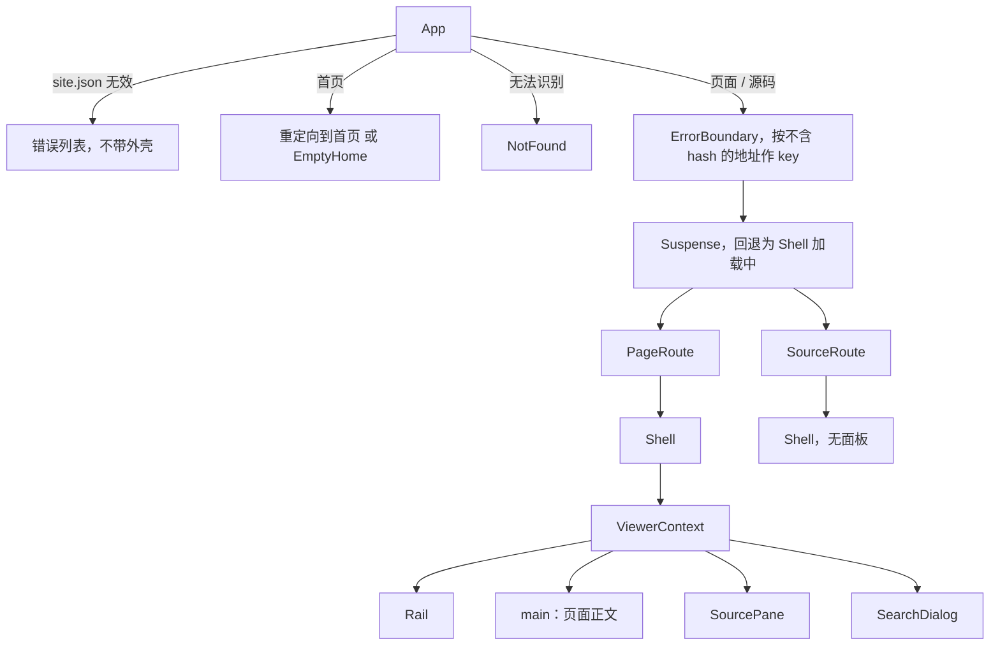

# 查看器外壳

查看器是渲染文档根目录的浏览器应用。本页讲它除正文块渲染（见 [blocks](./blocks.md)）和右侧源码面板（见 [source-pane](./source-pane.md)）之外的部分：启动、路由、数据加载、外壳（左侧导航、搜索、抽屉）、页面四周的附属信息（新鲜度徽标、来源表、上一页/下一页）、独立的源码页、界面文案的语言选择，以及样式的分层。

技术选型很克制：UI 框架是 React 19（[`react`、`react-dom` 均为 19.3.0](explain:package.json:28-29)，由[查看器的 `package.json`](explain:packages/viewer/package.json:11-16) 引入），另外只依赖 `highlight.js` 做代码高亮、`beautiful-mermaid` 画图。没有路由库，也没有状态管理库。查看器自己从不读文档根目录，只请求 `/@explain/...` 下的 HTTP 接口；这些接口在 `explain dev` 时由 CLI 实时提供，在 `explain build` 时被写成静态文件（见 [site](./site.md)）。

## 模块边界 {#modules}

<Tree open="1">

- `packages/viewer/`
  - [`index.html`](explain:packages/viewer/index.html) 唯一的 HTML：字体、三张样式表、入口脚本
  - `src/`
    - 入口与路由
      - [`main.tsx`](explain:packages/viewer/src/main.tsx) 挂载 `<App>`
      - [`app.tsx`](explain:packages/viewer/src/app.tsx) 按路由分派
      - [`router.ts`](explain:packages/viewer/src/router.ts) URL 与 `Route` 互转、`navigate`、拦截链接点击
    - 数据
      - [`api.ts`](explain:packages/viewer/src/api.ts) 接口路径与响应类型，CLI 也引用同一份
      - [`data.ts`](explain:packages/viewer/src/data.ts) 按路径缓存的 `fetch`
      - [`highlight.ts`](explain:packages/viewer/src/highlight.ts) 高亮并按行切分
      - [`ref.ts`](explain:packages/viewer/src/ref.ts) 引用的格式化、解析与链接
    - [`context.ts`](explain:packages/viewer/src/context.ts) `ViewerContext`
    - `routes/` 两种路由及页面附属组件
      - [`page-route.tsx`](explain:packages/viewer/src/routes/page-route.tsx)、[`source-route.tsx`](explain:packages/viewer/src/routes/source-route.tsx)
      - [`freshness.tsx`](explain:packages/viewer/src/routes/freshness.tsx)、[`sources.tsx`](explain:packages/viewer/src/routes/sources.tsx)、[`pager.tsx`](explain:packages/viewer/src/routes/pager.tsx)、[`dev-errors.tsx`](explain:packages/viewer/src/routes/dev-errors.tsx)
    - `shell/` 每个路由外面的框架
      - [`shell.tsx`](explain:packages/viewer/src/shell/shell.tsx)、[`rail.tsx`](explain:packages/viewer/src/shell/rail.tsx)、[`search-dialog.tsx`](explain:packages/viewer/src/shell/search-dialog.tsx)
    - `i18n/` 界面文案：[`strings.ts`](explain:packages/viewer/src/i18n/strings.ts)、[`en.ts`](explain:packages/viewer/src/i18n/en.ts)、[`zh-CN.ts`](explain:packages/viewer/src/i18n/zh-CN.ts)
    - `blocks/` 正文块，见 [blocks](./blocks.md)
    - `pane/` 源码面板，见 [source-pane](./source-pane.md)
    - `styles/` 样式，见[样式](#styles)

</Tree>

依赖方向是单向的：`app.tsx` → `routes/` → `shell/` 与 `blocks/`，它们共同依赖 `context.ts`、`data.ts`、`router.ts`、`i18n/`。`shell/shell.tsx` 是唯一引入 `pane/` 的地方（[shell.tsx](explain:packages/viewer/src/shell/shell.tsx:7-8)）。

## 从 index.html 到第一屏 {#boot}

[`index.html`](explain:packages/viewer/index.html:15-21) 只做三件事：按顺序引入 `tokens.css`、`base.css`、`viewer.css`，以模块方式加载 `/src/main.tsx`，留一个 `#root`。它能直接写 `.tsx` 路径，是因为 CLI 以查看器包为根目录启动 Vite（[dev.ts](explain:packages/cli/src/site/dev.ts:113-119)）。

```tsx file=explain:packages/viewer/src/main.tsx:5-14
```

根上的 `Suspense` 回退是 `null`：`site.json` 返回之前页面是空白的。`App` 第一行就是 [`use(loadSite())`](explain:packages/viewer/src/app.tsx:10-13)，同时用 `useLocation` 订阅地址变化、安装一次全局链接拦截。

## 组件树 {#tree}



注意 `Shell` 不是由 `App` 统一包一层，而是**每个路由组件自己渲染 `Shell`**。原因是只有路由知道要往外壳里塞什么：`PageRoute` 把标题、目录、来源列表交给外壳，并且只在页面解析成功时打开面板（[page-route.tsx](explain:packages/viewer/src/routes/page-route.tsx:41-56)）；源码页、404 和错误边界则渲染不带面板的外壳。代价是换页时外壳会整体重新挂载（推断：这也正好让外壳的"滚动到 hash"副作用每页执行一次）。

## 路由 {#routing}

[`parseRoute`](explain:packages/viewer/src/router.ts:14-29) 把 `pathname` 和 `search` 解析成四种路由之一：

| 地址 | 路由 |
|---|---|
| `/` | `home`，`locale` 为 `null` |
| `/zh`、`/zh/` | `home`，`locale` 为 `zh` |
| `/zh/viewer-shell` | `page` |
| `/zh/source?explain/packages/viewer/src/app.tsx#L11` | `source`：查询串第一个 `/` 前是仓库键，其余是路径 |
| 三段及以上，或 `source` 后缺仓库/路径 | `unknown` |

源码路由把文件放在**查询串**里而不是路径里。这样路径部分永远只有 `/<locale>/source` 两段，静态构建时每个语言只需要一份 `source/index.html`（[build.ts](explain:packages/cli/src/site/build.ts:46-49)），任意深度、含空格或 `#`、`?` 的文件路径也不会撞上"超过两段即未知"的规则。[router.test.ts](explain:packages/viewer/src/router.test.ts:10-43) 覆盖了这些情形，也确认旧的路径式写法 `/zh-CN/source/fold/README.md` 会被拒绝。

> [!IMPORTANT]
> 因为 `/<locale>/source` 固定是源码路由，`source` 不能作为页面 id；配置校验把它列为保留 id（[config.ts](explain:packages/contract/src/config.ts:7,18)）。

跳转只用 History API 加一个自定义事件：

<AnnotatedSource file="explain:packages/viewer/src/router.ts:37-72">
<Note lines="39-46">订阅 `popstate`（前进/后退）和自定义的 `explain:route` 事件。</Note>
<Note lines="48-49">`useSyncExternalStore` 以完整地址（含 hash）为快照，地址一变 `App` 就重新渲染。</Note>
<Note lines="51-55">`pushState`/`replaceState` 不会触发 `popstate`，所以手动派发 `explain:route`。</Note>
<Note lines="59-60">带修饰键或非左键的点击交给浏览器，保留"新标签页打开"。</Note>
<Note lines="62-64">有 `target` 的链接、外站链接、`/@` 开头的接口和小组件文件都不拦截。</Note>
<Note lines="65-66">同一页内只改 hash 的跳转也交给浏览器原生处理。</Note>
</AnnotatedSource>

有了这层全局拦截，导航、正文、来源表都可以直接渲染普通 `<a href>`，不需要专门的路由链接组件。

`App` 拿到路由后的分派规则（[app.tsx](explain:packages/viewer/src/app.tsx:34-81)）：

- `home`：URL 里的语言在站点里存在就用它，否则用 `defaultLocale`；然后跳到 [`homeHref`](explain:packages/viewer/src/shell/shell.tsx:13-18)，即导航中 id 为 `index` 的页，没有就取导航第一页；导航为空时渲染 `EmptyHome`。
- `unknown`，或语言不在 `locales` 中：用默认语言渲染 `NotFound`。
- `page`、`source`：包在以"不含 hash 的地址"为 key 的 `ErrorBoundary` 里。换页会重置上一页的加载错误，页内锚点跳转则不会让路由重新挂载。

## 数据加载 {#data}

接口在 [`api.ts`](explain:packages/viewer/src/api.ts:4-23) 里定义了四类路径：`site.json`、每页一个 `page/<locale>/<id>.json`、每个被引用文件一个 `source/<repo>/<path>.json`、每个语言一个 `search/<locale>.json`。查看器包把这个文件导出为 `@explain/viewer/api`（[package.json](explain:packages/viewer/package.json:6-10)），CLI 构建站点时直接复用这些路径函数（[build.ts](explain:packages/cli/src/site/build.ts:36-44)），两端不会各写一套。

```ts file=explain:packages/viewer/src/data.ts:15-29
```

缓存的是 **Promise** 而不是结果。React 的 `use` 要求挂起期间每次渲染拿到同一个 Promise，按路径缓存正好满足这一点；请求失败时删掉缓存项，下次可以重试。缓存从不主动失效：开发模式下文档根目录一有改动，CLI 就让 Vite 整页刷新（[dev.ts](explain:packages/cli/src/site/dev.ts:63)），模块状态随之清空。

源码文本还有第二层缓存 [`loadSourceLines`](explain:packages/viewer/src/data.ts:49-60)：拆行后交给 [`highlightLines`](explain:packages/viewer/src/highlight.ts:74-84)。highlight.js 输出的是一整段 HTML，`<span>` 可能跨行；[`splitHighlighted`](explain:packages/viewer/src/highlight.ts:54-72) 在每个换行处补齐未闭合的 `</span>`，下一行开头再把它们重新打开。这样每一行都是独立合法的 HTML，摘录和源码页可以只渲染任意一段行。只注册了 bash、css、diff、javascript、json、markdown、typescript、xml、yaml 九种语言，按扩展名或代码块语言名选择；其余按纯文本转义（[highlight.ts](explain:packages/viewer/src/highlight.ts:12-52)）。

## 外壳 {#shell}

[`Shell`](explain:packages/viewer/src/shell/shell.tsx:20-160) 是所有路由共用的框架，也是唯一提供 `ViewerContext` 的地方。上下文的内容见 [context.ts](explain:packages/viewer/src/context.ts:7-13)：站点、当前语言、界面文案、本页来源列表，以及一个向屏幕阅读器播报消息的 `status`。正文块和源码面板都从这里取值，不必层层传参。

外壳挂载时做几件事（[shell.tsx](explain:packages/viewer/src/shell/shell.tsx:56-81)）：

1. 把 `<html lang>` 设为当前语言，把标签页标题设为"页面标题 · 站点标题"。
2. 滚动到 hash 指向的元素，没有就回到顶部；然后给 `body` 加 `ready` 类，触发 `entrance.css` 里的入场动画。
3. 仅当 `pane` 为真时，以 `main` 元素为根创建 `PaneController`，再渲染 `SourcePane`。

渲染结果依次是：跳到正文链接、`.shell` 网格（窄屏才显示的顶栏、左侧导航、`main#main`、面板）、抽屉遮罩、搜索对话框、隐藏的播报区域（[shell.tsx](explain:packages/viewer/src/shell/shell.tsx:100-159)）。窄屏下左侧导航就是抽屉：打开时给 `body` 加 `drawer-open`，把 `main` 设为 `inert`，焦点移到当前页链接，按 `Escape` 关闭并把焦点还给菜单按钮（[shell.tsx](explain:packages/viewer/src/shell/shell.tsx:83-98)）。

左侧导航 [`Rail`](explain:packages/viewer/src/shell/rail.tsx:8-103) 按当前语言列出导航分组；`stale` 或 `invalid` 的页带一个小标记，文件不存在（`missing`）的页显示为淡色；当前页下面展开它的二级标题作为本页目录，标题顶部越过视口 30% 处即算当前节（[rail.tsx](explain:packages/viewer/src/shell/rail.tsx:105-124)）；底部的语言切换保留当前页 id，只换语言。

搜索对话框 [`SearchDialog`](explain:packages/viewer/src/shell/search-dialog.tsx:39-154) 是原生 `<dialog>`，`⌘K`/`Ctrl-K` 随时可开，`/` 在焦点不在输入框时可开。首次打开才拉取当前语言的索引。匹配就是对"标题 + 正文"做不区分大小写的子串查找，按索引顺序取前 12 条，并截出命中前后的片段（[search-dialog.tsx](explain:packages/viewer/src/shell/search-dialog.tsx:15-37)）；没有相关度排序。

## 两种路由 {#routes}

<Tabs>
<Tab label="页面路由">

[`PageRoute`](explain:packages/viewer/src/routes/page-route.tsx:32-57) 加载页面 JSON，并在拉平后的导航里求出本页的[位置](explain:packages/viewer/src/routes/page-route.tsx:21-30)：所属分组、序号，以及上一页/下一页所依据的完整顺序。`PageContent` 按响应状态渲染：

| 状态 | 内容 |
|---|---|
| `missing` | 导航里的标题，提示本语言还没写这页及预期的文件路径，返回首页，上一页/下一页 |
| `invalid` | 导航里的标题，页面解析错误和站点错误，不渲染正文 |
| `parsed` | 页面自己的标题、新鲜度徽标、错误（如有）、正文块、来源表、上一页/下一页 |

站点级错误（`site.errors`）只出现在解析成功和解析失败的页面上；当前语言下缺失的页面只显示缺失提示和翻页，源码页也不显示它（[page-route.tsx](explain:packages/viewer/src/routes/page-route.tsx:80-140)）。

[新鲜度徽标](explain:packages/viewer/src/routes/freshness.tsx:10-46)和[来源表](explain:packages/viewer/src/routes/sources.tsx:32-69)读的是同一份由 CLI 算好的 `sources` 列表（判定规则见 [freshness](./freshness.md)）。徽标只看 `freshness.status`；过期时列出不一致的文件，若全部只是 `changed` 就省掉逐个文件的状态词、统一补一句说明；若原因是 `sources-missing`（从未同步过），则提示运行 `explain freshness sync`。来源表每行显示文件、记录哈希的前 12 位（没有记录时用当前哈希）和状态，文件名链接到源码页。

</Tab>
<Tab label="源码路由">

[`SourceRoute`](explain:packages/viewer/src/routes/source-route.tsx:9-68) 显示仓库键、文件路径、行数、**当前语言**中引用了这个文件的页面列表，以及带行号的完整文件。地址里的 `#L<n>` 会在行加载完后给该行加 `target` 类并滚动到视口中间（[source-route.tsx](explain:packages/viewer/src/routes/source-route.tsx:70-80)）。行号行、复制按钮、文件已删除的提示都复用 `blocks/code.tsx`（见 [blocks](./blocks.md)）。这条路由没有源码面板，外壳带 `no-pane`，正文列更宽。

正文里的引用通过 [`sourceHref`](explain:packages/viewer/src/ref.ts:40-43) 链到这里，锚点取第一段行范围的起始行。

</Tab>
</Tabs>

## 界面文案如何随语言选择 {#i18n}

文档的语言是 `explain.json` 里的任意字符串，界面文案却只有两份。两者之间只靠这一个函数衔接：

```ts file=explain:packages/viewer/src/i18n/strings.ts:106-109
```

它取语言代码第一个 `-` 之前的部分、转小写，再到以**语种**为键的表里查找，查不到就回落到英文：

| 文档语言 | 查找键 | 使用的文案 |
|---|---|---|
| `zh` | `zh` | `zh-CN.ts` 导出的 `zhCN` |
| `zh-CN`、`zh-TW`、`ZH-hk` | `zh` | 同上，`zhCN` |
| `en`、`en-GB` | `en` | `en` |
| `ja`、`fr` 等 | 无 | 回落到 `en` |

文件名 `zh-CN.ts` 和导出名 `zhCN` 都不参与查找，唯一的键是 `byLanguage` 里的 `zh`。因此本站用的 `zh` 能拿到中文界面；反过来，`zh-TW` 站点得到的也是简体中文文案。

`App`、`Shell`、`SourceRoute` 直接调用 `stringsFor(locale)`，外壳以下的组件从 `ViewerContext` 取 `strings`。唯一的例外是 `site.json` 无效时：此时没有站点，也就没有语言，只能用浏览器的 `navigator.language`（[app.tsx](explain:packages/viewer/src/app.tsx:14-15)）。其余情况下界面语言和内容语言是同一个值：URL 里的语言段同时决定读哪个页面文件、用哪份文案，并被写进 `<html lang>`。

> [!IMPORTANT]
> 两份文案都声明为 [`Strings`](explain:packages/viewer/src/i18n/strings.ts:6-104) 类型。新增一条界面文案必须同时改接口、`en.ts` 和 `zh-CN.ts`，否则类型检查不通过。与数量或参数有关的句子写成函数（如 `freshNote(count)`、`pageOf(index, total)`），让每种语言自己组织语序，例如中文的[`pageOf`](explain:packages/viewer/src/i18n/zh-CN.ts:16) 是"第 N 页，共 M 页"。

## 样式 {#styles}

`index.html` 按顺序引入三层样式：

- [`tokens.css`](explain:packages/viewer/src/styles/tokens.css) 只定义自定义属性：一组 `oklch` 墨色灰阶和朱红强调色（`--ink-*`、`--zhu-*`），语义色（`--fresh`、`--stale`、`--added`、`--removed`、各类提示色），字体（标题用 Noto Serif SC，代码用 JetBrains Mono），字号、间距、圆角、动效，以及三个布局宽度 `--rail-w`、`--prose-w`、`--pane-min`（[tokens.css](explain:packages/viewer/src/styles/tokens.css:131-133)）。只有深色主题（`index.html` 声明 `color-scheme: dark`）。
- [`base.css`](explain:packages/viewer/src/styles/base.css) 定义少量 `ui-*` 基础组件：按钮、下拉、分段控件、表格、代码、标签。
- [`viewer.css`](explain:packages/viewer/src/styles/viewer.css) 本身只有 `@import`，按区域拆到 `viewer/` 下：外壳、导航、页面、各种正文块、面板、搜索、抽屉、底部抽屉、源码页等，一个区域一个文件。

[`widgets.css`](explain:packages/viewer/src/styles/widgets.css) 不在 `index.html` 里，它是小组件用的 Tailwind 入口，由 CLI 单独编译（见 [widgets](./widgets.md)）。

整体布局是一个 CSS Grid，在两个断点处收拢：

| 视口宽度 | 布局 |
|---|---|
| ≥ 1360px | 导航 · 正文 · 面板 三列（[shell.css](explain:packages/viewer/src/styles/viewer/shell.css:1-6)） |
| ≤ 1359px | 导航移出网格变成左侧抽屉，出现吸顶顶栏（[drawer.css](explain:packages/viewer/src/styles/viewer/drawer.css:1-43)） |
| ≤ 1079px | 单列，源码面板变成底部抽屉（[bottom-sheet.css](explain:packages/viewer/src/styles/viewer/bottom-sheet.css:1-9)） |

没有面板的路由给外壳加 `no-pane`，去掉面板列并放宽正文列（[source-page.css](explain:packages/viewer/src/styles/viewer/source-page.css:1-15)）。
