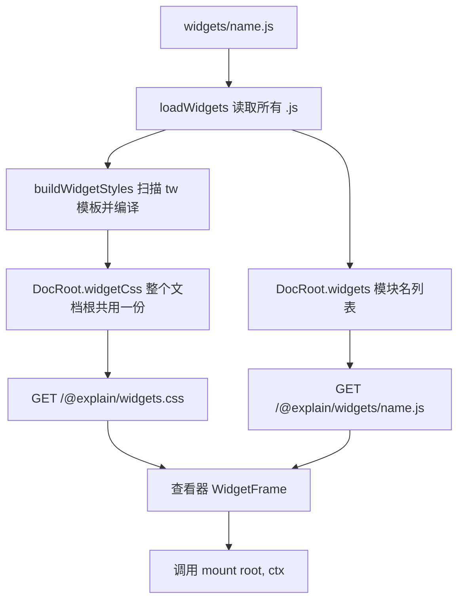

# Widget 组件

Widget 是放在 `widgets/<name>.js` 的一个 ES 模块，页面用 `<Widget name="…">` 嵌入它。查看器负责画外框，模块只负责填满框里那个空元素。本页沿着一个 widget 从磁盘上的文件走到浏览器里被挂载的过程，并重点解释作者最容易踩的规则：Tailwind 类只有写在 `tw` 模板里才会生效。

## 两半：CLI 与查看器



CLI 这一半在每次加载文档根时都会跑：[`loadDocRoot`](explain:packages/cli/src/doc-root/load.ts:33) 调用 `loadWidgets`，再把结果放进 `DocRoot`：诊断并入根级 `errors`，模块名变成 `widgets`，编译出的 CSS 变成 `widgetCss`（[load.ts](explain:packages/cli/src/doc-root/load.ts:47-54)）。所以 `explain validate`、`explain dev`、`explain build` 看到的 widget 列表和诊断完全一致。加载器的其余部分见 [load-doc-root](./load-doc-root.md)。

查看器这一半是 [`WidgetFrame`](explain:packages/viewer/src/blocks/widget.tsx:37-131)：它取回模块和样式表，然后调用 `mount`。

## 读取模块

```ts file=explain:packages/cli/src/doc-root/widgets.ts:11-33
```

`loadWidgets` 按文件名排序遍历 `widgets/`：

- `.js` 文件成为一个 `WidgetModule`，名字是去掉扩展名的文件名，内容按文本读入。
- `.css` 文件直接报错：*widget stylesheets are not supported; style the widget with Tailwind classes*。widget 不允许自带样式表。
- 其他文件被忽略。

返回值里还保留了完整的文件名集合 `files`，页面检查用它来报告"页面引用了 `<Widget name="x">`，但没有 `widgets/x.js`"（[check-page.ts](explain:packages/cli/src/doc-root/check-page.ts:60-64)）。

## 为什么类必须写在 `tw` 模板里

模块顶部写 `const tw = String.raw;`，所有类都写成 `` tw`…` ``。运行时 `String.raw` 对没有插值的模板就是原样返回，`` tw`flex gap-2` `` 就是字符串 `"flex gap-2"`，对浏览器没有任何特殊含义。这个标签只对 CLI 有意义：CLI 把模块当纯文本读，用正则找出这些模板。

<AnnotatedSource file="explain:packages/cli/src/doc-root/widget-styles.ts:18-50">
<Note lines="18">匹配后面紧跟反引号的 `tw`，且前一个字符不能是标识符字符或 `$`，所以 `rowtw`、`$tw` 都不算。模板体取到下一个反引号为止。</Note>
<Note lines="20">出现方括号或圆括号，就是 Tailwind 的任意值写法，比如 `p-[3px]`。</Note>
<Note lines="36-43">模板体里出现 `${` 就报错并跳过整个模板，不去猜插值会变成什么。</Note>
<Note lines="44-46">按空白切分，每个片段都是一个候选类，并记下它在模块里的行列号，供诊断使用。</Note>
</AnnotatedSource>

候选类随后逐个交给 Tailwind 编译器：

```ts file=explain:packages/cli/src/doc-root/widget-styles.ts:81-91
```

`compiler.build` 每次返回"到目前为止所有候选"的完整样式表，因此只有当新名字确实是主题里的 utility 时，输出才会变长。CLI 借此对每个类得到一个确定的结论，[诊断部分](explain:packages/cli/src/doc-root/widget-styles.ts:93-104)把没让 CSS 变长的类报成 *is not a class of the widget theme*，把任意值报成 *use a theme class*。

> [!IMPORTANT]
> Tailwind 只为传给 `compiler.build` 的类名生成 CSS，而传过去的只有 `tw` 模板里的片段。写在普通字符串里、靠拼接得到的、或者含 `${…}` 的模板里的类，一条 CSS 都不会有，运行时也不会报错，只是样式静悄悄地不生效。

为什么不像 Tailwind 平常那样扫描整个文件？因为这次扫描同时就是校验。`tw` 模板里的每个片段都被"声明"为类，写错或者主题里不存在的类就能带着行列号报出来；如果扫描全文件，任何单词都可能是类，也就永远没法判定哪个是错的（推断：设计意图没有写在代码里，但诊断逻辑只有在这种理解下才说得通）。代价是不能动态拼类名，替代做法是在 JS 里在几个完整的 `tw` 字符串之间选择，或者切换 `data-*` 属性，见 [widgets.md](explain:skills/explain-this/widgets.md:53-55)。

CLI 测试固定了三种结果。被拒的那个模块里，第 4 行把 `bg-red-500` 写在普通字符串里，根本不会被读到；只有第 3、5 行的 `tw` 模板产生诊断。下面的 widget 在测试用到的模块上运行扫描器的移植版，并把结果和测试期望的诊断逐行比对。

<Widget name="widgets-tw-scan" title="类扫描器读到了什么" source="explain:packages/cli/src/doc-root/widget-styles.ts:18-50,93-104 explain:packages/cli/test/explain.test.ts:192-219 explain:packages/cli/test/dev.test.ts:103-119">

选择 CLI 测试里的一个 widget 模块。带底色的部分是扫描器唯一会读的文本；表格列出读到的每个类，最后一行检查移植版的诊断是否与测试期望一致。某个类是否属于主题取自测试的断言，因为 Tailwind 本身没有被移植。

</Widget>

## Widget 主题

编译器的入口是查看器包导出的 `@explain/viewer/widgets.css`。`buildWidgetStyles` 预先读好 Tailwind 的 `theme.css` 和 `utilities.css`，`loadStylesheet` 遇到其他导入一律抛错（[widget-styles.ts](explain:packages/cli/src/doc-root/widget-styles.ts:57-75)），入口文件因此没法引入 preflight 或别的东西。

```css file=explain:packages/viewer/src/styles/widgets.css:1-13
```

这几行决定了 widget 样式的三个特点：

- **没有 preflight。** 只导入了 theme 和 utilities，widget 不会被 CSS reset；它没设置的属性继承自页面正文的样式。
- **utility 全部 `!important`。** 注释说明了原因：查看器自己的 CSS 不在任何 layer 里，而不分层的规则总是胜过分层的规则；不加 `!important`，查看器里任何伸进 widget 的选择器都会盖过 widget 的类。
- **用查看器的 token 取代 Tailwind 的调色板。** 颜色、字体、字号、圆角先被重置为 `initial`，再由 [`@theme inline reference`](explain:packages/viewer/src/styles/widgets.css:12-51) 映射到查看器的 CSS 变量。`inline` 让 utility 直接写 `var(--…)`，`reference` 让 Tailwind 不再输出这些变量本身，因为查看器已经在 `:root` 上定义了它们。dev 服务器测试里能看到效果：`.bg-raised` 编译成 `background-color: var(--surface-raised) !important`，`.p-3` 编译成 `padding: calc(var(--space-1) * 3) !important`（[dev.test.ts](explain:packages/cli/test/dev.test.ts:115-119)）。

整个文档根只有一份样式表，所以任何一个 widget 用到的类，其他 widget 也都能用。

## 在查看器里挂载

外框完全由 React 画：标题、标签正文作为说明、`source` 引用作为链接（[widget.tsx](explain:packages/viewer/src/blocks/widget.tsx:95-129)）。模块拿到的只有空的 `.widget-body` 元素。

负责挂载的 effect（[widget.tsx](explain:packages/viewer/src/blocks/widget.tsx:45-93)）按顺序做这些事：

1. 名字不在站点响应的 `widgets` 列表里，就把 `widgets/<name>.js` 作为失败原因显示出来，到此为止。
2. 同时动态导入 `/@explain/widgets/<name>.js` 和共享样式表。[`loadWidgetStyles`](explain:packages/viewer/src/blocks/widget.tsx:22-35) 只往 `<head>` 里插一次 `<link>` 并缓存这个 promise，页面上有多少个 widget 都只加载一次。
3. 两者都到位后，确认模块导出了函数 `mount`，调用 `mount(root, ctx)`；如果返回一个函数，就留作清理函数。
4. 卸载时，或者名字、props、语言变化时，先调用清理函数，再清空元素。切换语言会让 widget 从头重新挂载。

任何抛出的错误（包括没有导出 `mount`）都显示在框内的提示里，不会让整页崩掉。

### WidgetContext

```ts file=explain:packages/viewer/src/blocks/widget.tsx:11-16
```

<Tabs>
<Tab label="props 与 locale">

`props` 是标签上除 `name`、`title`、`source` 以外的属性，值都是字符串。它经过 `JSON.stringify` 再解析，这个 JSON 字符串同时也是 effect 的依赖键，所以属性不变时不会重新挂载。`locale` 是查看器当前语言，用来选界面文案。

</Tab>
<Tab label="cite">

`cite(ref, label?)` 生成和外框里 source 链接一模一样的 `<a class="cite">`（[widget.tsx](explain:packages/viewer/src/blocks/widget.tsx:54-65)）。源码面板把正文里所有带 `data-ref` 的元素都[当作锚点](explain:packages/viewer/src/pane/anchors.ts:15-21)，所以它和正文里的引用一视同仁。它设置了 `data-follow="0"`，因此[不参与滚动跟随](explain:packages/viewer/src/pane/anchors.ts:27)。面板行为见 [source-pane](./source-pane.md)。

</Tab>
<Tab label="readSource">

`readSource(ref)` 解析引用，通过源码 API 取回文件，返回被引用的那些行（[widget.tsx](explain:packages/viewer/src/blocks/widget.tsx:66-72)）。多个区间之间[直接用换行拼接](explain:packages/viewer/src/ref.ts:45-48)，中间没有分隔标记；文件不存在时抛错。它走的是和源码面板相同的 `/@explain/api/source/…` 路由，因此只能读 `explain.json` 里登记过的仓库，路由细节见 [site](./site.md)。

</Tab>
</Tabs>

## 写作约定与对应的代码

技能里的 [widgets.md](explain:skills/explain-this/widgets.md:22-58) 是写 widget 时遵守的约定。每条规则都能在上面的代码里找到落点：

| 规则 | 由谁保证 |
|---|---|
| `name` 对应 `widgets/<name>.js` | 页面检查，以及 `WidgetFrame` 的 `known` 判断 |
| `source` 里的文件变了，页面就过期 | `explain freshness sync` 像记录其他引用一样记录它们 |
| 不允许 widget 自带 `.css` | `loadWidgets` |
| 类写在 `tw` 里、不插值、不用任意值、只用主题类 | `buildWidgetStyles` |
| `ui-button`、`ui-select` 等基础类写在 `tw` 之外 | 它们来自查看器自己的 CSS 而不是 Tailwind，放进 `tw` 会被报成主题外的类 |
| 只展示被引用代码或测试里出现的情况 | 没有代码检查，是写作规则 |

> [!TIP]
> 如果模块需要在字符串里写出字面的 `` tw` ``（比如本页这个讲扫描器的 widget），必须让反引号不紧贴 `tw`，例如 `"tw" + "\x60"`，否则扫描器会把这个字符串当成类模板来读。
