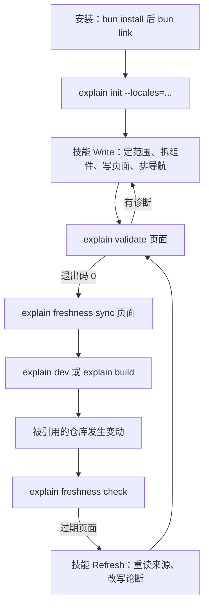

# 作者工作流

本页沿着一个 doc root 的生命周期走一遍：安装 CLI、创建 doc root、让 agent 写页面、校验、记录引用、预览或发布，以及代码变动后的刷新。每一步对应一条命令或技能的一个分支；命令本身的完整说明见 [commands](./commands.md)。



## 为什么需要新鲜度 {#why-freshness}

页面是在某个时刻对代码作出的一组论断。代码会继续变，页面不会自己跟着变；一篇 Markdown 不会告诉你它描述的函数上周已经被重写了。explain-this 用新鲜度来补上这个缺口：同步时，CLI 给页面引用的每个文件记一个哈希；之后每次加载，都重新计算这些文件的哈希并与记录比较。下面的流程里，第 5 步写记录，第 7 步读记录，二者合起来让“页面是否还可信”变成一条命令就能回答的问题。

## 1. 安装 CLI

CLI 没有发布到包仓库，安装方式是克隆仓库、`bun install`、再在 `packages/cli` 里 `bun link`（[README.md](explain:README.md:5-17)）。`packages/cli` 把 `explain` 声明为指向 TypeScript 入口的 bin（[package.json](explain:packages/cli/package.json:6-8)），入口第一行是 `#!/usr/bin/env bun`（[main.ts](explain:packages/cli/src/main.ts:1)），由 Bun 直接运行源码。因此更新只需要在克隆目录里 `git pull && bun install`，不必重新 link。

## 2. 创建 doc root：`explain init`

```ts file=explain:packages/cli/src/commands/init.ts:11-32
```

`init` 在当前目录写一个 `explain.json`，内容只有给定的语言、空的 `repos` 和空的 `nav`。写之前先用与其他命令相同的解码器检查一遍，所以 `--locales=` 里写了不合法的语言标签会直接失败；已有 `explain.json` 时拒绝覆盖。标题、仓库和导航留给 agent 后续填写，字段规则见 [config](./config.md)。

其他命令会从当前目录逐级向上寻找最近的 `explain.json`（[config.ts](explain:packages/cli/src/doc-root/config.ts:25-35)），所以在语言子目录里运行也可以。

## 3. 用技能写页面

技能放在 `skills/explain-this/`，需要装进 agent 的技能目录（[README.md](explain:README.md:19-32)）。它的 frontmatter 设了 `disable-model-invocation: true`（[SKILL.md](explain:skills/explain-this/SKILL.md:4)），只有用户点名 `/skill:explain-this <要解释的东西>` 时才会运行。开始前它先确认两个前提：`explain.json` 存在、`explain` 在 `PATH` 上，任一不满足就告诉用户并停下（[SKILL.md](explain:skills/explain-this/SKILL.md:9-12)）。agent 检查自己成果的唯一手段就是 CLI，没有 CLI 就不该动笔。

技能按用户的请求分成两个分支：

<AnnotatedSource file="explain:skills/explain-this/SKILL.md:16-33">
<Note lines="18">新话题和对已有内容的追问都走 Write。</Note>
<Note lines="23">范围由用户确认，agent 不自行猜测要覆盖仓库的多少。</Note>
<Note lines="24">Survey 把仓库登记进 `explain.json` 的 `repos`；引用只能指向登记过的仓库键。</Note>
<Note lines="25">每个语言都从代码独立写成，不是互相翻译；每条论断要么有引用，要么标为推断。</Note>
<Note lines="27">完成标准交给 CLI 判定：`explain validate` 退出码为 0，随后 `explain freshness sync` 成功。</Note>
<Note lines="31">Refresh 从 CLI 给出的过期列表出发，而不是凭 agent 的记忆判断哪里变了。</Note>
<Note lines="33">即使论断仍然成立，刷新过的页面也要重新校验和同步，让记录的哈希跟上文件。</Note>
</AnnotatedSource>

技能让 agent 写任何文件前先读 [format.md](explain:skills/explain-this/format.md)（[SKILL.md](explain:skills/explain-this/SKILL.md:14)）。

## 4. 校验：`explain validate`

[`validate`](explain:packages/cli/src/commands/validate.ts:8-22) 加载整个 doc root，输出所点名页面的诊断；不带参数时检查所有页面。无论点名与否，它都会带上 doc root 级别的错误，也就是来自 `explain.json` 仓库路径的错误（[load.ts](explain:packages/cli/src/doc-root/load.ts:44-50)）。页面诊断不分种类全部输出：页面缺失、解析错误、坏的页面链接、损坏的来源文件，以及引用问题，比如被引用的文件不存在、不是普通文件，或者引用的行号超出文件行数（[refProblem](explain:packages/cli/src/doc-root/resolve-source.ts:74-92)、[validate.ts](explain:packages/cli/src/commands/validate.ts:17)）。只要有一条诊断，退出码就是 2。引用规则见 [citation](./citation.md) 和 [resolve-source](./resolve-source.md)，页面语法见 [parse-page](./parse-page.md)。

## 5. 记录引用：`explain freshness sync`

[`sync`](explain:packages/cli/src/commands/freshness/sync.ts:10-30) 至少要一个页面参数，并拒绝没解析成功、或仍有解析错误或引用问题的页面，所以被记录下来的快照一定属于一个引用全部能解析的页面。坏的页面链接和损坏的来源文件不挡同步。对每个通过的页面，它写出 `<locale>/<id>.sources.json`（[writeSources](explain:packages/cli/src/doc-root/freshness.ts:72-76)），每个被引用文件一条记录：

```ts file=explain:packages/contract/src/sources.ts:7-11
```

哈希是对 `blob <长度>\0` 加文件字节做 SHA-1（[makeBlobId](explain:packages/cli/src/doc-root/freshness.ts:17-31)），这与 git 计算 blob id 的方式一致（推断：应等于 `git hash-object` 的结果，本页未实际对照 git 验证）。哈希针对整个文件而非引用的行范围，所以被引用文件的任何改动都会让页面过期，即使被引用的那几行没动。

> [!IMPORTANT]
> 只有 `sync` 会写 `.sources.json`，且只对引用全部能解析的页面执行。因此“新鲜”的含义是：页面在上次同步时引用都能解析，并且此后它引用的文件都没有变化。

## 6. 预览与发布：`explain dev` 和 `explain build`

<Tabs>
<Tab label="explain dev">

[`dev`](explain:packages/cli/src/commands/dev.ts:9-28) 提供站点，打印 URL 后一直运行。不给 `--port` 时从 4321 开始，被占用就由 Vite 换下一个空闲端口，打印的是 Vite 实际绑定的 URL（[site/dev.ts](explain:packages/cli/src/site/dev.ts:140-143)）。给了 `--port` 就是严格的：端口被占用时打印 `explain dev: Port N is already in use` 并以 2 退出。它监听 doc root 和 `explain.json` 中登记的每个仓库，任何变动都会重新加载并刷新浏览器（[site/dev.ts](explain:packages/cli/src/site/dev.ts:32,55-60,68-78)），适合在 agent 写作时一直开着。它不会因为页面有诊断而拒绝服务，而是把诊断放进页面响应一起返回（[pageResponse](explain:packages/cli/src/site/api-bodies.ts:87-104)）。

</Tab>
<Tab label="explain build">

[`build`](explain:packages/cli/src/commands/build.ts:10-35) 更严格：doc root 里**任何**页面有诊断就拒绝构建，不只看你改过的页面。默认输出到 doc root 下的 `dist/`，可用 `--out` 指定；如果目标目录非空且不是之前的 explain 构建产物，它拒绝覆盖（[build.ts](explain:packages/cli/src/site/build.ts:77-85)）。过期本身不算构建错误，过期页面照常发布，由 viewer 标出状态（[navPage](explain:packages/cli/src/site/api-bodies.ts:18-27)）。

</Tab>
</Tabs>

两者通过同一个请求处理函数输出同样的 JSON，原理见 [overview](./overview.md)，细节见 [site](./site.md)。

## 7. 代码变了之后

在 doc root 里运行 `explain freshness check`，再调用一次 `/skill:explain-this`（[README.md](explain:README.md:33-34)）。

[`check`](explain:packages/cli/src/commands/freshness/check.ts:28-59) 遍历所有页面，打印每个过期页面及原因；有过期页面或无法检查的页面时退出码为 1。缺失、无法解析、或引用了未知仓库或仓库外路径的页面会显示为 `not checked` 并提示先跑 `validate`。过期原因来自“现在引用的文件”与“上次记录的文件”的比较（[compareSources](explain:packages/cli/src/doc-root/freshness.ts:34-70)），输出文字由 [`describeReason`](explain:packages/cli/src/commands/freshness/check.ts:10-26) 生成：

| 原因 | 输出 | 含义 |
|---|---|---|
| `sources-missing` | `no sources file; run explain freshness sync …` | 页面从未同步过 |
| `sources-malformed` | `… is malformed; run explain freshness sync …` | 来源文件解码失败，同步会重写它 |
| `not-recorded` | `… is cited but not hashed` | 上次同步后新增了引用 |
| `not-cited` | `… is hashed but no longer cited` | 上次同步后删掉了引用 |
| `missing` | `… no longer exists` | 记录过的文件已从磁盘消失 |
| `changed` | `… changed` | 记录过的文件哈希变了 |

技能随后走 Refresh 分支：完整重读每个列出的来源文件，改写不再成立的部分，最后同样执行第 4、5 步的校验与同步。如果变动引入了页面尚未覆盖的内容，Refresh 会转而按 Write 的步骤为它写新页面（[SKILL.md](explain:skills/explain-this/SKILL.md:32)）。哈希如何存储和比较见 [freshness](./freshness.md) 与 [sources](./sources.md)。

<details>
<summary>各命令的退出码</summary>

命令通过 [`ExitWith`](explain:packages/cli/src/commands/exit-with.ts:4-9) 以 1 或 2 退出。

| 命令 | 0 | 1 | 2 |
|---|---|---|---|
| `init` | 已写出 `explain.json` | | `explain.json` 已存在或语言不合法 |
| `validate` | 无诊断 | | 有诊断，或参数不是页面 |
| `freshness sync` | 所有点名页面已同步 | | 有点名页面缺失、解析失败或带引用问题，或参数不是页面 |
| `freshness check` | 所有页面都新鲜 | 有页面过期或无法检查 | |
| `dev` | | | 服务器启动失败，或显式给出的 `--port` 被占用 |
| `build` | 站点已写出 | | 有诊断或构建失败 |

另外，凡是需要打开 doc root 的命令，找不到 `explain.json` 或其内容不合法时都以 2 退出（[open-doc-root.ts](explain:packages/cli/src/commands/open-doc-root.ts:30-40)）。

</details>
